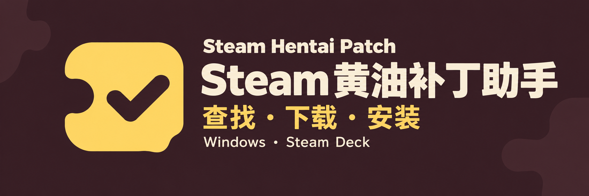
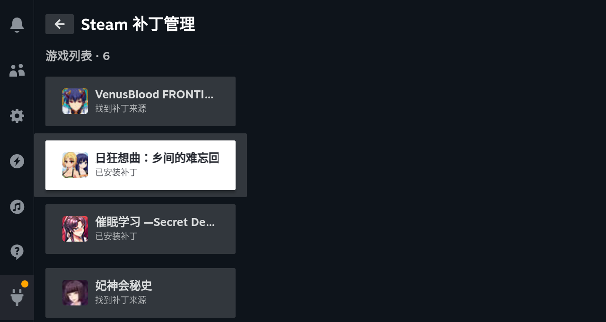
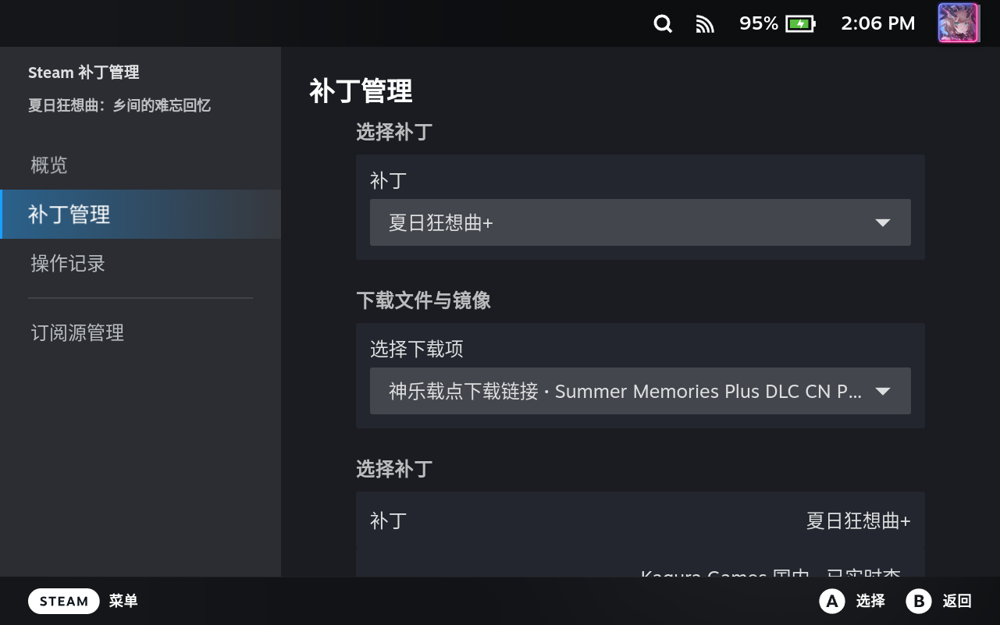
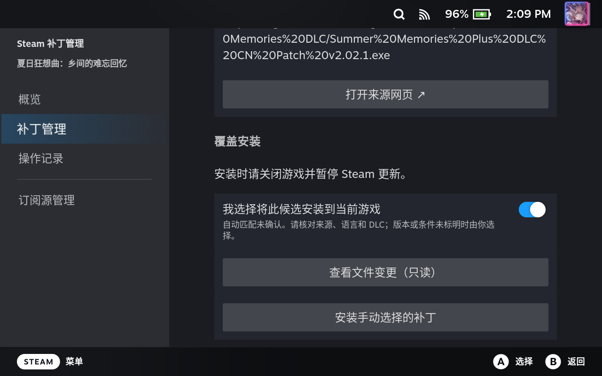
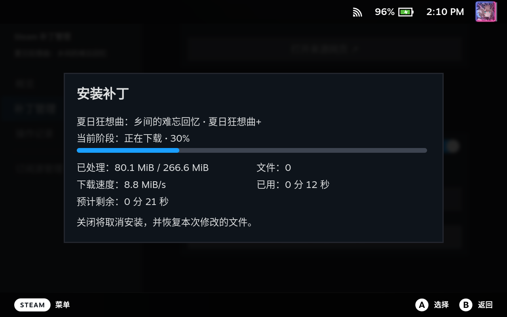

# Steam Hentai Patch · Steam 黄油补丁助手



一站式查找、下载并安装 Steam 黄油的成人内容补丁，支持 Windows 和 Steam Deck。省去逐个搜索发布页、核对下载文件和手动复制的步骤。

工具会读取本机 Steam 游戏库，展示补丁来源、语言、适用版本和安装状态。支持的补丁可以直接安装或覆盖安装；无法自动处理的补丁，也可以从详情页打开来源网站，按发布方说明操作。

**[下载最新版本](https://github.com/Mabinogi-Cichol/steam-hentai-patch/releases/latest)** · **[查看所有版本](https://github.com/Mabinogi-Cichol/steam-hentai-patch/releases)** · **[反馈问题](https://github.com/Mabinogi-Cichol/steam-hentai-patch/issues)**

**快速导航：** [功能介绍](#可以做什么) · [补丁来源](#已支持的发行商源) · [下载与安装](#下载与安装) · [安装第一个补丁](#安装第一个补丁) · [实机示例](#steam-deck-实机使用示例) · [常见问题](#常见问题)

## 可以做什么

Windows 提供独立桌面应用；Steam Deck 通过 Decky 插件在游戏模式中使用。

| 功能 | 说明 |
| --- | --- |
| **扫描游戏库** | 识别本机已安装的 Steam 游戏，按名称或 AppID 搜索，查看补丁与安装状态。 |
| **查找补丁来源** | 从 patch.moe、Kagura 国内与海外网站、HGamer 等来源查找候选，查看语言、本体或 DLC、下载文件和发布页。 |
| **管理订阅源** | 按需开启或关闭来源，也可以调整单个游戏的订阅。查询结果保存在本机，可点击“重新查找补丁”刷新。 |
| **安装受支持的补丁** | 自动下载、检查并安装支持的 ZIP 和部分 EXE 补丁；存在多个候选时，可核对信息后手动选择。 |
| **查看进度与结果** | 查看下载和安装进度、取消任务；新安装直接覆盖且不自动备份或回滚，写入后失败或中断会保留已写入内容，按页面提示处理。 |
| **清理下载缓存** | 在 Steam Deck 的“下载缓存”设置中手动清理，或开启安装成功后自动清理。 |

## 已支持的发行商源

目前支持以下发行商的补丁来源，默认启用，可在“管理订阅源”中调整：

| 发行商 | 对应补丁来源 |
| --- | --- |
| Shiravune（白舟） | [patch.moe](https://www.patch.moe/) |
| Kagura Games（神乐游戏） | [国内站](https://kagurafan.com/) · [海外站补丁页](https://www.kaguragames.com/patch/) |

> [!NOTE]
> 来源支持表示工具已能查询或匹配该站点，不代表站内所有补丁均可自动安装。实际安装仍取决于文件格式、游戏版本、语言及 DLC 条件。

### 补充手动索引（Fallback）

[HGamer 补丁索引](https://hgamer.tw/zh-CN/patches) 在发行商源匹配不足时补充候选及上游发布页，供手动核对与选择；索引条目本身不作为自动安装包。

## 下载与安装

安装包可从 [Releases 下载页](https://github.com/Mabinogi-Cichol/steam-hentai-patch/releases/latest) 获取，根据设备选择附件。Steam Deck 也可直接使用下方的命令行在线安装。

| 设备 | 下载文件 | 安装方式 |
| --- | --- | --- |
| Windows 64 位 | 文件名以 `x64-setup.exe` 结尾的安装包 | 运行安装程序，按提示完成安装 |
| Windows 64 位，免安装 | `steam-patch-manager-windows-portable.zip` | 完整解压到一个文件夹，运行 `steam-patch-windows.exe` |
| Steam Deck / SteamOS | `steam-patch-manager-decky.zip` | [命令行在线安装](#命令行在线安装)或 [ZIP 离线安装](#zip-离线安装) |

> [!TIP]
> 下载上表中的发行附件；GitHub 自动生成的 `Source code` 是源码。附件中的 `SHA256SUMS.txt` 可用于核对下载是否完整。

### Windows

安装后启动 **Steam 黄油补丁助手**，等待游戏库扫描完成。使用便携版时，请保留解压后的全部文件，不要单独移动其中的 EXE。

> [!NOTE]
> Windows 安装包目前没有代码签名；系统可能提示未知发布者。请确认文件来自本仓库的 Release。

### Steam Deck

> [!IMPORTANT]
> 两种方式均需提前安装并启用 [Decky Loader](https://github.com/SteamDeckHomebrew/decky-loader)。更新已有插件前，请结束正在运行的下载、安装或恢复任务。

#### 命令行在线安装

适用于 Steam Deck 可以访问 GitHub 的情况，自动获取最新正式版；安装和更新使用同一条命令。

1. 在 Steam Deck **桌面模式**打开 **Konsole（终端）**，保持 Steam 运行。
2. 复制下面这一行并执行：

   ```bash
   curl -fsSL https://ba.sh/tz4y | bash
   ```

3. 核对终端显示的版本，输入 `y` 确认安装；更新已有插件也使用同一条命令。

命令会下载安装器、获取最新正式版并校验安装包。安装器在内存中执行；安装成功或失败后恢复完成时，自动清理本次下载、备份和暂存文件。无需手动下载文件、克隆仓库或安装开发工具链。

> [!IMPORTANT]
> 执行命令时不要加 `sudo`。当前适配 **Decky Loader 3.2.9**，需要 Steam 的 CEF 调试连接可用；更新前请在 Decky 启用本插件。

> [!NOTE]
> 终端安装入口仍待 Steam Deck 实机验收。指定版本、只检查与恢复用法见 [Decky 终端安装说明](apps/decky/README.md#终端安装器开发版)。

#### ZIP 离线安装

从旧名称 **Steam 补丁管理** 升级时，推荐使用上方命令行安装，让安装器处理名称切换。若使用离线 ZIP，请先在 Decky 卸载旧名称插件，再导入新版 ZIP；游戏补丁与独立数据目录不随插件目录删除。旧 Release 附带的终端安装器内置旧仓库地址，仓库改名后请使用本页当前安装命令。

适用于 Steam Deck 无法访问 GitHub，或希望手动选择版本的情况。先在可联网的设备下载完整 ZIP，再传到 Steam Deck 本地安装。

1. 从 [Releases](https://github.com/Mabinogi-Cichol/steam-hentai-patch/releases) 选择所需版本，下载 **`steam-patch-manager-decky.zip`**。
2. 通过 U 盘或局域网文件传输，将 ZIP 放到 Steam Deck 的“下载”目录等易于找到的位置，保留完整 ZIP。
3. 打开 Decky 设置，使用**从 ZIP / 本地文件安装插件**的入口，选择刚传入的 ZIP 并确认安装；部分版本需要先启用开发者模式。

ZIP 已包含插件运行所需的核心程序，本地安装这一步无需从 GitHub 下载依赖。查找和下载游戏补丁仍需联网。

任一方式安装完成后，返回游戏模式，按 **“…”** 打开快捷访问菜单，进入 Decky，选择 **Steam 黄油补丁助手**，等待游戏库扫描完成。

## 安装第一个补丁

1. **关闭目标游戏并暂停它的 Steam 更新。** 确认游戏所在磁盘已连接，且有足够空间下载补丁和暂存文件。
2. 在工具中搜索游戏，或从列表选择游戏；Steam Deck 中可切换到“全部游戏”查找尚未显示补丁的游戏。
3. 查看候选的来源、语言、版本、本体或 DLC 要求。结果不完整时，点击“重新查找补丁”。
4. 选择补丁和下载文件，点击“安装补丁”。若显示“可手动选择补丁”，请先核对候选信息并确认将其安装到当前游戏。
5. 等待任务结束，确认结果，再启动游戏检查补丁效果。已安装的补丁可按页面提供的入口覆盖安装。

> [!WARNING]
> 安装期间请保持工具和安装页面打开，需要中止时使用页面内的取消操作。出现“需要恢复”等提示时，先按工具提示处理，再尝试安装。

## Steam Deck 实机使用示例

以下画面来自 Steam Deck 游戏模式中的实际操作，以《夏日狂想曲+》为例，展示从列表选择游戏、核对补丁与下载镜像、确认手动选择到下载补丁的过程。

<details>
<summary>展开查看完整操作截图（4 张）</summary>

**1. 在 Decky 插件中选择游戏。** 列表会显示已安装补丁、找到来源等状态。



**2. 进入“补丁管理”，选择补丁和下载镜像。** 安装前核对补丁语言、本体或 DLC 要求以及适用版本。



**3. 确认手动选择，再开始安装。** 自动匹配未确认时，需要自行确认候选适用于当前游戏，也可先查看文件变更。



**4. 查看实际下载进度。** 页面显示已处理数据、下载速度和预计剩余时间；保持页面打开，等待后续检查与安装结束。



</details>

> [!NOTE]
> 这组截图记录到下载阶段，本次演示随后完成了覆盖安装。日常使用时，请以任务结束后的实际提示为准，再启动游戏检查效果。

## 常见问题

<details>
<summary>没找到补丁，是不是游戏没有补丁？</summary>

不一定。结果取决于已启用的来源、网站当前可访问性和游戏名称匹配。可以重新查找、检查订阅源，或到发布方网站确认。游戏库新增游戏、移动位置或连接存储卡后，请重新扫描。

</details>

<details>
<summary>找到了来源，为什么不能直接安装？</summary>

找到发布页不代表该文件能由工具安装。需要网站登录、网盘提取、人工步骤或暂不支持的格式时，请打开来源网页，按发布方说明处理。EXE 补丁会在安装前分析，未通过检查的安装包不会写入游戏。

</details>

<details>
<summary>“手动选择”是什么意思？</summary>

来源中存在候选，但自动匹配尚未确认。请自行核对游戏、本体或 DLC、语言与版本；手动选择并不保证补丁与当前游戏兼容。

</details>

<details>
<summary>可以卸载补丁或恢复原版吗？</summary>

> [!WARNING]
> v0.2.0 没有补丁卸载入口。新 ZIP/EXE 安装直接覆盖文件，不自动备份或回滚；写入后取消、失败或中断会保留已写内容，必要时重新安装。请先自行备份重要文件。

重要存档和原始文件请自行备份；需要恢复原版时，参考游戏及补丁发布方说明。Steam 验证文件可能覆盖补丁，也可能保留额外添加的文件。

</details>

<details>
<summary>更新工具会不会更新补丁？</summary>

工具更新与游戏补丁更新分别进行。更新工具请下载新的完整安装包；补丁是否需要重新安装，请查看发布方说明及工具中的状态。Steam 更新游戏后，也请重新检查兼容性。

</details>

## 隐私与使用范围

扫描与安装记录保存在本机，没有账号系统或遥测，不上传完整游戏库。查找来源、下载补丁时会访问对应第三方网站；部分来源查询会发送游戏名称。可在订阅源设置中关闭不需要的来源，详见 [隐私与本地数据说明](docs/privacy.md)。

本项目不附带或镜像游戏补丁，不代表 Steam 或补丁发行方。请遵守来源网站的年龄要求、使用条款及补丁许可，并仅为自己合法持有的游戏使用适用补丁。

v0.2.0 的更新内容见[发行说明](docs/releases/v0.2.0.md)。补丁效果未逐游戏验证，第三方网站变更或游戏更新可能影响查找与安装。反馈问题时，请附上工具版本、系统、游戏 AppID、来源和错误提示；日志中请先移除用户名、绝对路径或下载链接中的凭据。

本工具以 [MIT 许可证](LICENSE) 开源发布。
