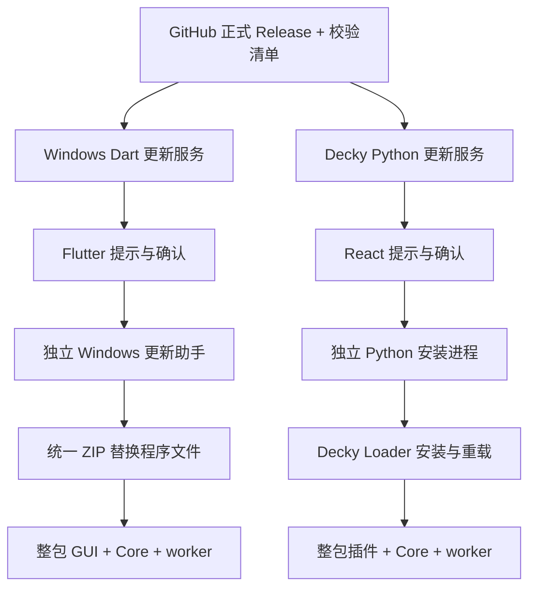

# Windows 与 Decky 客户端自更新设计

- 日期：2026-10-24。
- 状态：**已实现，双端本地 Release 夹具完整更新链通过，正式跨版本发布及完整安装版验收待完成**；实际范围以施工记录为准。
- 施工记录：[progress.md](progress.md)。
- 基线：`main@81a2965`；设计分支 `feature/client-self-update`。

## 1. 目标与产品范围

Windows 和 Decky 自动查询本项目 GitHub 正式 Release；发现高于当前运行版本的新版本时提示。用户确认后，由客户端完成下载、校验、安装及重启或重载，保留订阅源、配置、安装记录、信任数据库和游戏文件。这里的“自更新”包括应用本体与包内配套 Core/worker，不是更新游戏补丁或订阅源。

默认自动检测、人工确认安装；不在后台静默替换程序。支持手动检查、“稍后”和“跳过此版本”；跳过只压制该 Tag 的自动通知，手动检查仍显示。不另设自动检查开关，用户通过“跳过此版本”控制该版本的更新提醒。首期只跟随正式版，不增加预发布通道、降级、差分更新、镜像轮询或常驻更新服务。

Windows 安装版和便携版均在范围内；Decky 只更新当前已启用插件，不承担首次安装、启用禁用插件或升级 Decky Loader。已有终端安装器继续承担其原有入口。

2026-10-24 Windows 界面修订：保留固定的版本号与检查入口；手动检查的进行中、最新版本、失败、发行包未就绪及新版本详情均放在可滚动弹窗内，不能撑高主界面底栏。底部新版本提醒仅由自动检测触发，并遵守稍后/跳过规则；提醒打开同一详情弹窗，不重复检查。下载完成后重新打开弹窗保留“重启并更新”，不通过再次检查覆盖 ready 状态。该修订不改变 Decky 页面。

2026-10-27 Windows 修复：下载弹窗展示进度条、百分比、可读大小与阶段；未知总长度显示不定进度。上次安装结果与本次操作错误分开展示。更新助手在允许发起者退出前检查同目录其他 GUI 实例并提示关闭，准备阶段允许发起者自身及其 Core 工作；退出后继续检查全部进程，再开始替换。不自动关闭其他实例、不强杀任务、不增加固定等待或网络重试。详见[修复计划](fix-plan.md)。

2026-10-28 追加 Windows 单实例：在原生入口、Flutter 和后台任务初始化前获取 `Local\PatchHub.SingleInstance` 命名互斥量，持有至原生窗口及 Flutter 引擎退出。Windows 当前会话中安装版/便携版共用一个实例（两者使用同一用户数据）；重复启动只还原并激活已有窗口，新进程直接退出。主实例尚在初始化时也拒绝重复启动，由首个进程正常展示窗口。互斥量错误明确报错，异常退出后由 Windows 释放；不使用持久锁文件、轮询、任意等待或强杀。更新探针同样遵守单实例，助手必须等旧进程退出后启动新版。

## 2. 调研依据与当前事实

| 对象 | 已核对事实 | 对设计的影响 |
| --- | --- | --- |
| [Core](../../../crates/core/src/lib.rs) / [协议](../../../crates/protocol/src/lib.rs) | Rust 承担补丁领域服务；v5 JSONL 已有严格契约，没有应用更新方法 | 自更新不必为了复用 HTTP 而扩展补丁协议 |
| [Windows 入口](../../../apps/windows-flutter/lib/main.dart) / [退出](../../../apps/windows-flutter/lib/host/app_lifecycle.dart) | Flutter 管理窗口；[AppTasks](../../../apps/windows-flutter/lib/host/source_tasks.dart) 负责取消、等待任务及 Core 子进程退出 | 更新必须经过宿主退出流程，不能运行中覆盖 EXE/DLL 或强杀补丁任务 |
| [NSIS](../../../scripts/windows-installer.nsi) | 当前为用户级安装；有 `install.ini`、HKCU 安装路径和卸载项；卸载文件列表在构建时生成并编入卸载器 | 自更新统一走 ZIP；安装版需同步维护版本及卸载清单，不能沿用固定旧文件列表 |
| [Decky 主机](../../../apps/decky/main.py) / [来源任务](../../../apps/decky/backend/source_service.py) | Python 宿主管理业务任务、来源任务及调度，卸载会关闭这些对象 | 更新执行者不能是即将卸载的插件协程；忙碌判断须覆盖两类任务与在途请求 |
| [终端安装器](../../../scripts/install-decky.py) | 已有冻结 Release、校验包、Loader 安装、恢复与清理；适配 Loader 3.2.9；仍有实机待验项 | 复用其安装引擎，不另写直接覆盖插件目录的流程；不是已验证可直接嵌入的 SDK |
| [CI](../../../.github/workflows/ci.yml) / [打包](../../../scripts/package-artifacts.py) | 同一 Release 发布 Windows ZIP/NSIS、Decky ZIP 和 `SHA256SUMS.txt`；当前先创建 Release 再逐步上传附件 | 检测到 Tag 不等于附件已齐，应改成草稿上传完整后再公开 |
| 实时公开 Release 查询 | 2026-10-24 查询旧远程地址的 latest API，实际返回 `Mabinogi-Cichol/steam-hentai-patch` 的 `v0.3.0`，北京时间 02:23:52 发布；双端包及校验清单均存在 | 使用已核实的规范仓库名；不依赖旧仓库重定向拼接附件 URL |

当前附件名：`steam-patch-manager-windows-portable.zip`、`Steam.Hentai.Patch_0.3.0_x64-setup.exe`、`steam-patch-manager-decky.zip`、`SHA256SUMS.txt`。正式 v0.3.0 Windows ZIP 为 19,199,825 字节，Decky ZIP 为 7,003,317 字节。版本和大小仅为本次快照，不能成为后续硬限制。`checksums-windows.json` 目前只描述 ZIP，不涵盖 NSIS，因此统一采用 Release 的 `SHA256SUMS.txt` 校验选定附件。

### 外部接口依据

- [GitHub Releases API](https://docs.github.com/en/rest/releases/releases#get-the-latest-release)：公开仓库可匿名查询；`latest` 排除草稿和预发布，不等于按 SemVer 搜索最大版本，仍须比较版本。
- [GitHub 限流](https://docs.github.com/en/rest/using-the-rest-api/rate-limits-for-the-rest-api)：匿名额度按出口 IP 共享，为每小时 60 次；据响应的 `Retry-After` / reset 信息暂停请求，不内置 Token。
- [Loader 3.2.9 utilities.py](https://github.com/SteamDeckHomebrew/decky-loader/blob/v3.2.9/backend/decky_loader/utilities.py)：安装申请与确认是两步调用，有对应 request ID。
- [Loader 3.2.9 browser.py](https://github.com/SteamDeckHomebrew/decky-loader/blob/v3.2.9/backend/decky_loader/browser.py)：`_install` 先移除旧插件，再调用校验/解压；所以必须事前校验并保留恢复材料，Loader 返回不等于新版可用。
- [Loader 前端](https://github.com/SteamDeckHomebrew/decky-loader/blob/v3.2.9/frontend/src/plugin-loader.tsx) 与本地 `node_modules/@decky/api/src/index.ts`：插件公开的 `callable` 不是任意 Loader 管理路由，不能假设 `callable('utilities/install_plugin')` 可安装。沿用已有管理桥接，明确版本兼容边界。

以上为源码与接口调研，未连接 Steam Deck，也未实际更新本机程序。

## 3. 分层决策：放在客户端层

**推荐：更新检测、下载和安装协调均归客户端宿主；Core 保持补丁领域边界。** Windows 在 Dart 宿主及独立 Windows 更新助手实现；Decky 在 Python 宿主及独立安装进程实现。React/Flutter 页面只展示状态和提交操作。

| 方案 | 收益 | 代价与结论 |
| --- | --- | --- |
| 全部放 Core | 单一 Rust 检测实现 | Core 要知道自己的发行包、宿主生命周期、安装路径、Loader；执行时还需要替换自身；不采用 |
| Core 只检测，客户端安装 | 可统一 GitHub 解析与版本比较 | 要增加协议、生成物和双端桥接；检测依赖 Core 可启动，但待更新目标恰好包含 Core；当前一个固定仓库、两个平台不足以支持这些成本；不采用 |
| 客户端检测和安装协调 | 可以独立于补丁引擎启动、退出和重载；复用各端安装通道 | 两份很小的 Release 解析实现；通过共同测试样例保持语义；采用 |

“核心业务共享”指游戏补丁领域，不代表所有网络请求都必须进入 Rust。现有来源服务中“网络工作归 Core”的约定继续适用于来源发现；自更新网络访问作为宿主基础设施写明边界。首期不新增 Rust updater crate、统一跨语言更新 SDK 或通用更新服务器。

## 4. 双端统一行为

### 4.1 检查时机与提示

- 宿主启动完成后异步检查一次，不阻塞首屏、扫描或任务。成功后每 24 小时检查；宿主常驻期间维持同一节奏，恢复前台时补做已到期检查，不追赶错过的次数。24 小时是产品通知频率，不是任务超时。
- 持久化最后一次自动尝试时间，失败后也不在每次打开页面时重试；用户可手动重试。系统时钟回拨时重新计算一次下次检查，不无限等待。相同宿主中的并发检查合并为同一请求。
- 自动失败仅在更新区域记录原因，不弹打断式错误；手动失败立即显示。无网络、限流、仓库不可用和解析失败都不能显示“已是最新版”。限流解除前手动按钮显示可重试时间。
- Windows 在全局工具/设置区域提供“检查更新”，发现新版显示非模态横幅；Decky 只在全局设置的“缓存、备份与更新”页展示更新状态和操作，QAM 侧边栏不展示更新区域。发现新 Tag 可通知一次，点击通知进入全局设置；持久化 `last_notified_tag` 防止插件重挂载重复通知。
- 提示包含当前版本、目标版本、发布日期、更新说明、包类型和“更新 / 稍后 / 跳过”。说明按文本显示，或交给浏览器打开官方 Release 页面，不执行 Release 正文 HTML。
- 后台只拉取 Release 元数据；确认更新后才下载大包。活动业务任务可继续；最终替换前需再次进入维护门禁。

### 4.2 GitHub 与版本语义

固定来源为 `https://api.github.com/repos/Mabinogi-Cichol/steam-hentai-patch/releases/latest`，发送 User-Agent、GitHub JSON Accept 和显式 API 版本头；实现时以官方支持版本为准。无需账号、PAT 或用户配置仓库地址。

用 SemVer 规则比较 `vX.Y.Z`，忽略本地构建元数据，不按字符串大小或发布时间比较。例：`v0.10.0 > v0.9.0`。本地为同基础版本预发布时正式版更高；本地开发版本无法解析时显示“开发构建”，保留查看 Release，禁用自动覆盖；本地高于远端时不提示降级。远端草稿、预发布或无法解析的 Tag 不进入安装流程，明确显示没有可用的正式更新或元数据不支持。

首次检测冻结 Release ID、Tag、附件 ID/名称/URL、文件大小与校验依据。下载始终使用该版本附件，不使用 `/latest/download/`。重新确认安装前若已选附件被删除或身份变化，终止本次准备并要求重新检查，不悄悄换成另一个版本。兼容 GitHub 的 HTTPS 附件 CDN 重定向，不因最终域名不同于 `github.com` 拒绝合法下载。

附件按平台选择：Windows 安装版和便携版统一使用 `steam-patch-manager-windows-portable.zip`，由同一个更新助手完成替换；Decky 使用固定插件 ZIP。NSIS 不参与自动更新，保留用于首次安装、手动安装和卸载。只要求本平台所需 ZIP 与校验清单齐全，缺失/重名显示“新版已发布，当前平台更新包尚不可用”，不误报最新版，不猜下载链接或使用 GitHub 自动生成的源码 ZIP。

读取同一冻结 Release 的 `SHA256SUMS.txt`，取附件名完全一致的唯一 SHA-256，下载后流式计算并比对；若元数据带 `digest`，一并核对一致性。该校验用于检测损坏与错包，信任根仍是官方 GitHub HTTPS 发布账号，不将它描述成独立代码签名。当前没有签名更新清单，不引入新的密钥管理体系，也不复用补丁目录签名密钥。

请求连接失败、HTTP 失败或用户取消会结束当前操作并给出原因；不设置整个下载/安装的任意总时限，不以速度慢判断任务失败，不增加自动重试循环、包大小上限或 Release 说明截断上限。下载按实际读取显示字节进度，有长度则显示总量，无长度则显示已下载量；在可取消阶段支持取消。

### 4.3 状态与数据

宿主更新状态最少包含 `idle / checking / up_to_date / available / downloading / ready / applying / failed`；`failed` 附阶段、原因和是否可重试。安装执行阶段由独立执行者的记录决定，新客户端需验证运行版本后才能显示成功。下载完成、启动安装器、RPC 成功返回都不是成功判据。

持久化的偏好/检查缓存为 `last_attempt_at`、`last_success_at`、`skipped_tag`、`last_notified_tag` 与最近候选摘要；不把瞬时 checking 状态当成可恢复事务。Windows 放在现有 APPDATA 宿主状态下独立 `updates` 区域，Decky 放在现有状态目录的宿主区域；不写入 Core 的来源调度或游戏补丁事务表。安装事务材料与普通检查缓存分开。

## 5. Windows 安装设计

### 5.1 版本与安装类型

构建时从仓库统一版本生成客户端可读版本信息；CI 校验 Cargo、Flutter、Decky、NSIS 与 Tag 一致，不能依靠当前脚本中手写的 `0.3.0` 默认值。版本取当前正在运行的客户端，而非仅询问 CLI。

安装版识别同时核对当前 EXE 目录、`install.ini` 和对应 HKCU `InstallLocation`；其余正常解压包识别为便携版。标记冲突时要求用户选择正确安装位置或通过官方安装包处理，不因机器上装过另一份应用就更新错误目录。便携版不转成安装版、不创建快捷方式。首期目标是现有 Windows x64 发行包。

### 5.2 共同准备与退出

1. 在用户可写临时目录下载并校验目标包，显示进度；这一步不改现有应用目录。
2. 预检写权限、目标位置及当前任务；权限不足时显示可操作错误，提供官方 Release 页面供用户手动处理，不自动提权，也不宣称已经自更新。
3. 用户点击“重启并更新”后，由宿主在同一操作门禁内停止接收新任务和自动任务。存在下载、安装、恢复、扫描/来源等活动工作时提示先完成或由用户取消；不因自更新自动取消正在写游戏的任务。任务确认结束后才继续。
4. 复用 AppTasks/生命周期的取消读取、等待 Core/worker 实际退出及正常 WM_CLOSE 路径。已有失败/待恢复信息继续展示，不能跳过退出收尾。独立助手准备成功后才关闭 GUI；退出失败则助手不修改安装目录。
5. 助手复制到应用目录外，持有原 GUI 进程句柄并等待实际退出；检查同一目录的其他应用实例。使用真实文件占用/进程结果处理冲突，不 force kill、不固定 sleep 后覆盖。

### 5.3 统一 ZIP 更新与安装信息维护

两种版本共用一条更新路径：助手解压已校验的完整 ZIP 到同卷暂存区，验证相对路径、无越界/链接、必要运行文件及包内版本；原程序退出后，按上一版本和新版本的受管理文件清单替换程序文件、移除已废弃的程序文件，再启动新版。用户额外放入的无关文件保留，不能递归清空程序目录。APPDATA 数据不属于程序包，不参与覆盖。不增加 NSIS 自更新模式，也不要求用户执行安装器。

安装类型只影响安装信息维护：便携版不写注册表、不生成卸载器或快捷方式；安装版保留当前安装目录、原产品名、`install.ini`、卸载器和已有快捷方式，更新本产品卸载项的 `DisplayVersion` 及受管理文件清单。共用 ZIP 不携带会将便携版注册为安装版的副作用，也不能用包内文件覆盖安装版专属元数据。

受管理文件清单随 ZIP 发行，NSIS 首次安装使用同一程序文件清单，并让卸载器在卸载时读取当前已提交清单，而非永久使用首次安装时编入的列表。这是安装版经 ZIP 多次更新后仍能正确卸载新增文件、保留无关文件的必要条件。现有 v0.3.0 卸载器不具备该契约，因此首次接入更新功能的安装版须通过新 NSIS 手动安装，部署支持该清单的卸载器；之后自更新不再下载 NSIS。

文件替换使用同一事务：更新前保存本次会覆盖/删除的旧程序文件，记录安装前版本、目标、文件清单和阶段；安装版额外记录本次修改的本产品注册表版本值。写失败或提交前失败时，由助手恢复旧文件、清单及修改过的安装信息，再验证旧程序可启动。新版初始化确认前不提交新卸载清单；维护模式下拒绝同目录的卸载/手动安装，避免与更新交叉写入。新卸载器和 NSIS 安装入口需遵守同一个更新互斥约定。普通取消在替换前直接清理；开始替换后须完成提交或恢复再退出。

成功判据为新版启动后报告自身版本、从当前目录加载的 Core 能完成 `get_capabilities`、探针页面完成首帧。助手通过本次用户范围文件握手确认（绑定本次事务目录和子进程 PID），不是以进程出现为准。初始化失败、进程异常退出属于恢复触发条件；进程仍在正常初始化时展示等待，不以固定时长回滚。

目录内保留一个固定的 `.steam-patch-maintenance.lock` 作为更新/手动安装/卸载的互斥载体，释放句柄后不删除，避免另一进程刚取得该文件时被前一进程删除产生锁分裂；卸载收尾时删除。它是应用控制文件，不属于下载/备份暂存，不进入 ZIP。恢复标记只允许由所属事务清理，JSON 记录统一用 UTF-8 读写以支持中文路径。

为避免失败的新版本迁移业务数据库后旧版无法读取，待确认的更新启动先只运行版本/运行时探针，不执行扫描、业务写入或不可逆数据迁移。握手通过并由助手确认提交后，再进入正常业务初始化；今后有数据迁移的发行必须单独声明其兼容与恢复方案，本期不复制整个用户数据目录。

普通异常自动恢复旧程序；断电或被强杀则可能留下未完成事务。助手可由下次客户端启动或同一官方安装包的恢复入口续做，恢复前核对本次实际写入阶段；恢复失败保留唯一必要材料及明确提示，不能删除材料伪装清理成功。成功或旧版恢复通过后清理本次暂存/备份。旧便携版无法重启时仍须有应用目录外的助手恢复入口，不能把恢复完全依赖于已经损坏的 GUI。

## 6. Decky 安装设计

### 6.1 检测与执行者分离

Python 宿主负责后台检测、偏好和供前端读取的候选；React 通过宿主 RPC 获取状态。更新 RPC 属于 Decky 宿主接口，不进入 Rust v5 协议。拟新增 `check_app_update`、`get_app_update_status`、`set_app_update_preferences`、`start_app_update`；启动只接受宿主已检查的候选标识，不接受前端传入任意 URL、脚本或目标目录。

**采用仓库现有终端安装器引擎，增加 GUI 启动模式和结构化状态出口。** 将受信任的脚本随当前插件发行，不从 `main` 或新版 Release 临时下载并执行安装代码；启动前复制到插件目录外的用户缓存事务区。沿用现有 Loader 3.2.9 管理桥接、回滚记录与锁；UI 更新和终端更新必须互斥。不要把整套恢复算法再复制进 `main.py`。

GUI 模式中用户点击更新即授权对应冻结版本，传递显式非交互确认，但不自动同意不匹配的 Loader 事件。安装确认按本次 request ID、插件身份、版本和包哈希关联。现有工具的 CDP/CEF 要求与版本适配照实呈现；不兼容时仍可检查和提示，说明升级入口不可用，提供 Release 页面和已有终端/离线入口，不自动打开调试端口或重启 Steam。

2026-10-24 实施时确认设备已升级到 Loader 3.3.0；核对该版本官方 [browser.py](https://github.com/SteamDeckHomebrew/decky-loader/blob/v3.3.0/backend/decky_loader/browser.py)、[utilities.py](https://github.com/SteamDeckHomebrew/decky-loader/blob/v3.3.0/backend/decky_loader/utilities.py)、[plugin.py](https://github.com/SteamDeckHomebrew/decky-loader/blob/v3.3.0/backend/decky_loader/plugin/plugin.py) 及实际管理桥接后，适配范围扩展为 3.2.9 / 3.3.0。独立执行者使用系统 `python3` 而非 Loader 的冻结 `sys.executable`，启动系统进程前恢复 `LD_LIBRARY_PATH`；宿主 HTTPS 显式使用设备已核实的 `/etc/ssl/cert.pem` 系统 CA，解决冻结解释器证书路径错误，继续保留证书验证。

### 6.2 更新流程与卸载边界

1. 独立进程先下载冻结包和清单，完成 SHA-256、ZIP 路径、插件名/目录、版本、Linux 运行文件及权限验证。尤其不能把未验证 ZIP 直接交 Loader。
2. 进入维护门禁，暂停来源调度，禁止新的补丁/恢复/清理/设置等写请求与新任务；检查补丁任务、SourceService 来源/匹配任务、扫描以及已进入宿主的请求。忙碌时返回 UI 等待用户处理；不能只检查 `list_tasks`。
3. 门禁检查和拒绝新请求必须使用同一协调边界。下载期间发生的新任务会在此被发现；用户取消 Loader 确认或准备失败后恢复门禁与调度。
4. 已知空闲且独立进程接管后，备份当前插件包与本插件 Loader 设置，通过 Loader 正常安装。本插件重载不应重启整个 Loader 或影响其他插件。
5. 独立进程应在 `_unload`、插件后端停止和前端卸载后继续存活，监视 Loader 写入与结果。这里不能假定简单 `create_task` 或普通子进程足够；先在目标 Loader 验证停止插件时的进程组行为，使用经验证的脱离插件生命周期启动方式。没有证据前不开放“立即更新”。
6. 新后端启动先识别外部更新记录并处于维护状态，只提供验证 RPC；前端同样不发起自动扫描。执行者核对文件、包版本、实际后端/前端版本、唯一有效实例、Core capabilities，完成确认后释放门禁，才恢复业务任务和来源调度。无握手不得推断成功。
7. Loader 失败或新版验证失败时复用现有恢复流程；响应丢失时先确认 Loader 是否仍在执行，再决定恢复。普通失败恢复旧插件后清理；断电/上下文丢失等无法确认时保留必要记录，下次更新/恢复入口优先收尾，不和未结束的安装并发。

进度写到插件目录外的事务状态文件，旧 UI 卸载后由新插件读取。原 `start_app_update` RPC 仅返回“已受理”和任务标识，不等待自身卸载后的最终结果。前端断开显示“插件正在重载”，不能把预期断连当作更新失败。若新版无法启动，外部执行者负责恢复，并通过现有 Loader 通知/恢复后的旧插件呈现结果。

旧版插件备份只含程序与必要 Loader 设置，不复制游戏、来源库或业务数据库。待确认期间同样禁止不兼容迁移。现有终端安装器的大小硬限制、任意等待阈值及只检查部分任务等行为必须在复用路径逐项复核：没有外部约束依据的分支直接清理，不能因“已有实现”成为新功能规范。

## 7. 发布与落点

| 范围 | 计划修改 |
| --- | --- |
| Windows | `apps/windows-flutter/lib/host/` 下新增更新服务、偏好/版本信息；页面提示与安装确认；独立 Windows 更新助手及统一 ZIP 事务；安装版版本信息维护；打包受管理文件清单，NSIS 卸载器读取当前清单并遵守更新互斥 |
| Decky | `backend/` 更新服务、`main.py` 生命周期与门禁、`src/` 更新入口；扩展并打包已有 `scripts/install-decky.py` 的 GUI 模式与结构化状态 |
| 共同行为 | 版本/Release 测试 JSON 样例共享，Dart/Python 分别执行；不共享语言无关运行时或新增协议版本 |
| CI / 发行 | 从版本源生成并核对双端版本、助手和清单；全部附件准备后上传到草稿 Release，完整核验再公开；维护正式包完整性，公开后不自动 clobber 已发布附件 |
| 文档 | 更新客户端指南、隐私说明（启动时访问 GitHub，无需登录）、Release 检查表与本施工记录 |

已有公开 Release 若缺附件，更新提示按“包尚不可用”处理；修复发行由维护者显式执行，不由客户端猜测。一次更新必须替换完整客户端发行物，不能单独更新 Rust CLI 导致 GUI/协议/worker 不匹配。v0.3.0 没有此功能，用户首次需手动安装包含更新器的新版本，此后才可自更新。

## 8. 实施拆分与退出条件

| 阶段 | 内容与依赖 | 退出条件 |
| --- | --- | --- |
| P0：安装可行性原型 | 先验证 Windows 统一 ZIP 替换、安装信息/卸载清单维护、失败恢复及外部助手；验证 Decky 3.2.9 外部进程跨卸载、管理桥接和双类任务门禁 | 两端隔离目录/设备测试证明可完成安装、确认、恢复；若某路径不可行，修订本设计再实施，不能先宣称一键升级可用 |
| P1：检测与提示 | P0 可并行调研；实现版本生成、GitHub 检测、偏好、手动检查和提示 | 两端共用样例通过；离线不影响主功能；版本/附件/限流语义一致 |
| P2：Windows 自更新 | 依赖 P0 Windows 与 P1 | 安装版和便携版经同一 ZIP 路径真实旧→新版本成功；权限、占用、取消/失败恢复；安装版版本与卸载清单正确、多次更新后可卸载；APPDATA 与无关文件保留 |
| P3：Decky 自更新 | 依赖 P0 Decky 与 P1 | 游戏模式 UI 触发、旧端卸载、助手存活、新版验证和失败恢复通过；补丁及来源任务门禁均有效 |
| P4：发布链与验收 | P2/P3 完成；草稿发布链可提前改造 | 完整附件公开后可检测；双端从正式旧发行物更新到候选并验明运行版本；施工记录与范围相符 |

P1 完成只能标记“自动检测与提示已实现”，不能当成自更新功能全部完成。用户已授权实施后的原型、构建与部署证据见施工记录；未执行的验收继续保留。

## 9. 验收矩阵

- 检测：相同/较低/较高版本、跨两位数版本、预发布本地构建、构建元数据、开发版、缺附件、重名、错误 Tag、HTTP 失败、离线、限流、重复检查、稍后/跳过及新 Tag 再提示。
- 下载：进度、用户取消、中断、SHA-256 不符、同一 Tag 附件被替换、合法 HTTPS CDN、缺少 Content-Length；未校验前不修改正式程序目录，不设任意规模上限。
- Windows：安装版默认/自定义路径与便携路径均使用同一 ZIP；路径含中文/空格、存在另一份安装、同目录多实例、只读目录、任务忙碌及临界新增任务；真实退出码/子进程退出、文件/清单/注册表版本值恢复、新版握手、断电后恢复入口、数据和无关文件保留；安装版快捷方式与安装位置保留、多次更新增删文件后卸载正确、更新与卸载/手动安装互斥，便携版不产生安装版注册信息。
- Decky：已验证 Loader 版本、接口不兼容、CEF 不可用、补丁/来源/匹配任务和在途调用、调度临界触发、拒绝/取消确认、卸载后执行者存活、Loader 响应丢失、错误包/重载失败、失败恢复、重复启动互斥、其他插件不受影响。
- 两端：新端待确认启动不写业务数据、不启动任务；验证通过再恢复功能；正常成功/恢复后清理本次临时包与备份，无法完成恢复时保留必要材料并准确显示未完成。
- 自动化提供必要的解析、版本、任务门禁与故障注入证据；双端真实旧→新更新、重启/重载及失败恢复必须实测，不能用模拟状态代替。

## 10. 过度设计审阅与待验证项

按 [overengineering-review](../../../.agents/skills/overengineering-review/SKILL.md) 做设计级审阅：客户端分层、一个正式通道、现有完整包和校验清单足以满足需求，不扩展 Core 协议、不新增更新服务器/通用 SDK/常驻服务，不增加自动重试或总耗时硬限制。

Windows 两种版本统一使用 ZIP 和同一助手，不再开发 NSIS 更新事务模式；只为安装版维护必要的版本和卸载信息。保留独立执行者、任务门禁和最小恢复记录，依据分别是 Windows 运行文件占用、多文件替换可能部分失败、Decky 安装会卸载调用者且 Loader 不能保证失败保留旧版；这些机制与实际执行路径直接相关。复用 Decky 安装器不等于无条件保留它的每条旧限制。

已验证部分包括 Windows 隔离 ZIP 替换/恢复/动态卸载、真实 Flutter/Core 提交握手，以及 Steam Deck 上 Loader 3.3.0 正常安装/重载、一次真实失败恢复、GitHub 检测和实际更新页面。系统安装版完整回归、前端确认后由独立进程跨正式版本完成自更新、实体手柄与正式发行链仍待验收。未发现需要为当前范围新增通用框架的依据。

实施差异：自动审批拒绝批量删除既有 CEF 响应大小与操作超时边界，理由为无界等待及可用性风险，因此本轮保留这些旧边界，未绕过拒绝。下载 ZIP 的任意大小/数量限制已删除；不能将旧 CEF 限制已精简当作本轮完成结果。
