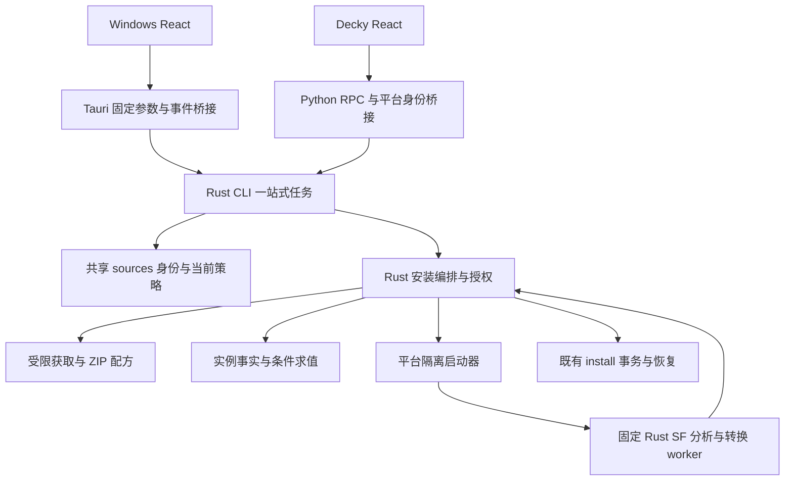

# 跨平台安装器迁移

日期：2026-10-08（Asia/Shanghai，2026-10-10 更新状态）。状态：**P1/P3 已实现并通过各自验证；P2 主体与可得真实样本通过，三旧 profile 待验；P4 Windows 按调整后验收范围完成，2303800 EXE 与 2743810 ZIP 真安装及两款游戏内确认、最终自动化、恢复/历史 RPC、便携包校验通过；用户已取消断网实测要求，该项未执行；P5 已实现/正式部署并验收完成，ZIP/EXE 真安装、写入回滚及用户实体手柄/两款游戏内确认通过；P6 待执行；更早 Windows 版本未覆盖**。

2026-10-10 运行问题修订：**代码主体已实现、整合与实机待验**，见 [fix-plan.md](fix-plan.md)、[fix-gate-review.md](fix-gate-review.md)。覆盖安装、ZIP 资源与 YPF 映射的最新目标以第 10 节为准；P5 历史验收范围保留。

施工记录：[progress.md](progress.md)。前置功能：[共享来源发现与订阅](../shared-source-discovery/design.md)及其[施工记录](../shared-source-discovery/progress.md)。沿用产品规则：[通用 EXE](../generic-exe-installation/design.md)、[一站式安装](../simplified-install-flow/design.md)、[Decky UX](../decky-ux/design.md)。

## 1. 目标与完成定义

将 Decky Python 中的 **动态 ZIP 配方生成、EXE 行为分析和安装授权全部迁入 Rust 核心层**，同时迁移获取、缓存、转换、条件检查与任务编排。Windows 与 SteamOS 使用同一来源契约、安装判定和事务规则；宿主保留平台环境、进程生命周期与 UI 事件桥接。

EXE 行为分析属于共享 Rust 后端，但在隔离的固定 Rust worker 进程中执行。核心校验报告、结合当前实例事实决定授权，调用既有 Rust 事务安装器。不能在拥有游戏写入权限的常驻服务进程内直接解析不可信安装包，也不能只把 Python 调用包一层 Rust 外壳算作迁移完成。

首个产品目标是 Windows 的 AppID 2303800“妃神会秘史”：已有官方来源候选可进入“安装补丁”，完成 EXE 下载、静态分析、提取、真实安装及同内容重装。它是验收案例，不是游戏白名单。Decky 保留 ZIP/EXE 产品能力、取消与失败恢复；旧持久化格式不作为兼容目标。

完成必须同时满足：

- 动态 publisher ZIP 与现有 SF9.5–9.7 EXE 的业务策略由一份 Rust 实现负责，Windows 无 Python/WSL 运行时依赖。
- 两端安装链路和隔离均实际可用；同一冻结输入的身份、载荷、阻断与内容标识一致，平台可用性和现场条件允许有据可查的差异。
- 安装器采用新状态 schema；旧缓存可失效并重新获取/分析，不维护旧 ID、profile、签名或收据读取兼容。切换前处理完未完成事务，保留游戏文件、来源设置与恢复材料。
- 共享来源迁移遗留随本期收口：旧 Python 状态导入、双引擎检查点、Python 哈希复刻、旧规则 schema、旧核心降级和已无消费者的适配接口退出生产代码与产物。按第 7.3 节逐项验收，不能仅以安装器迁入 Rust 结项。
- 自动化、生产打包、Windows 实机与 Decky 实机证据齐全。来源查询成功、只读 worker 成功和合成进度不能代替真实安装验收。

## 2. 范围与产品决策

### 2.1 本期迁移

| 能力 | 本期要求 |
| --- | --- |
| publisher ZIP | 来源重核、受限下载与缓存、清单/目标映射、现场摘要、配方、本机授权、检测与同内容重装 |
| 通用 EXE | 候选选择、内容身份、SF9.5/9.6/9.7 完整结构、受限 Lua AST/行为 IR、条件求值、隔离转换与产物核验 |
| 历史样本 | 三条旧 profile 对应的包只作通用行为/载荷回归 fixture；不迁移 profile 注册表或旧持久化路由 |
| 任务与状态 | 新 schema 下的一站式编排、幂等、进度、取消/EOF、撤销、失败恢复、成功清理、历史与缓存清理 |
| 两端接入 | Windows 开放动态安装；Decky 使用共享服务，删除已迁出的安装策略和 Python SF 生产运行时 |
| 来源兼容遗留收口 | 冻结 Rust 来源 ID/序列化与当前规则契约；消费者切换后删除旧来源适配、状态导入、切换检查点和旧核心降级 |

已有签名目录 `managed_zip` 保留原信任链、自动获取与本地 ZIP 导入。动态安装只接受后端从核实来源解析的 URL，不新增任意 EXE 导入或前端自定义配方。state_dir、Steam roots、平台、核心/worker 路径由宿主固定。

### 2.2 沿用的体验与边界

- 点击一次“安装补丁”完成获取、检查和写入；不增加准备后二次确认、逐游戏申请审核、解压器选择或条款向导。条款仍只用于内部语义分析，不进入前端提示。
- 扫描只做缓存/轻量能力评估，不自动下载全库大型 EXE。安装链路可用且无已知阻断的通用 EXE 显示“有可用补丁”，详情提示“安装时自动检查条件”；下载后的完整分析决定写入许可。隔离未确定可用时不显示可安装。
- 区分 `check_required` 与实测 `verified`。自行计算 SHA、现场 build 或 CRC 条件通过不等于发行商认证或游戏实测。
- 保留前台任务、独立结果面板和会话内终态去重；旧终态历史不自动弹出，详情重挂载不反复扫描。
- 成功清理本次临时 stage/backup；失败/取消恢复到本次开始前。恢复冲突时保留材料，不新增长期备份/卸载开关。
- 同实例、同内容身份才可重装。新版本、语言/DLC 变化及同 URL 不同字节属于内容更新，本期不支持直接叠加升级。

本期不扩大格式范围：Inno、NSIS、7z SFX 的完整行为适配另立功能。未知 SF 布局、动态脚本、外部进程、网络动作、注册表写入、删除/移动和差分更新继续阻断。不执行官方 EXE、Lua、Wine/Proton 或任意解压命令；游戏载荷中的正常 EXE/DLL 仍可作为数据复制。

### 2.3 开发阶段的 breaking change 决策

用户明确接受旧缓存文件的 breaking change，本期不承担旧版本兼容成本。安装器可重新设计 cache/report/recipe/policy/receipt、选择/内容 ID 与内部 RPC；两端宿主随新核心一起更新，不提供旧字段解析、ID 映射、双写、自动导入或旧版本回退。

旧下载包、缓存 manifest、分析报告、规范化 ZIP、临时配方与短期授权直接视为无效；新版本重新获取、分析并授权。旧成功收据/任务历史不要求进入新版本展示，可留档而不运行时读取。真实安装内容继续存在，不能因记录格式改变显示成“未安装”并直接覆盖。

未完成事务的 journal、原文件恢复副本、游戏文件和来源订阅不属于可丢弃缓存。切换前用旧引擎完成撤销/恢复，再启用新 schema；存在无法恢复的事务时阻断相关实例的切换，不要求为新引擎实现旧 journal 兼容解析。完整过程见第 7 节。本轮只改设计，不实际清理用户文件。

该决定也适用于 [shared-source-discovery](../shared-source-discovery/design.md) 中尚存的迁移兼容机制。本期以第 5.1、7.3 节的新契约取代其旧 ID 保持、Python 状态导入、双向切换与旧核心降级要求；前序施工记录保留历史事实。主要清理在安装器迁移过程中完成，列入 P6 结项门槛，不另留一轮迁移后的清理。无依赖的残留可提前删除，但当前 Publisher/EXE 消费接口须随对应消费者切换，避免先重构临时 Python 接口。

## 3. 已核对的迁移基线

本节为 2026-10-08 源码和已有施工记录的只读核对，不是新功能验证。

| 当前入口 | 现有职责 | 迁移处理 |
| --- | --- | --- |
| [sources](../../../crates/core/src/sources/) | 唯一 Rust 来源规则、订阅、缓存、发现与身份引擎 | 消费当前来源策略、记录与 revision，不重建查源策略 |
| [publisher.py](../../../apps/decky/backend/publisher.py) | 下载/条件缓存、ZIP 检查与 XP3 包装映射、分实例状态、本机签名、旧事务桥接 | 全部业务迁 Rust；映射/错误用 fixture 固化，不能改成无差别解压 |
| [exe_generic.py](../../../apps/decky/backend/exe_generic.py)、[exe_profiles.py](../../../apps/decky/backend/exe_profiles.py) | 选择 ID、来源/镜像/语言/变体、通用条件与旧 profile | 共享身份/能力与通用行为准入，旧 profile 仅作测试输入 |
| [exe_facts.py](../../../apps/decky/backend/exe_facts.py)、[exe_installation.py](../../../apps/decky/backend/exe_installation.py) | manifest/文件事实、空间、转换、policy 与 apply 重核/撤销 | 共享 facts/authorization/orchestrator，继续使用原事务核心 |
| [exe_worker.py](../../../apps/decky/backend/exe_worker.py)、[SF worker](../../../scripts/sf95_worker.py)及 sf9_* | Linux 非特权 bwrap，完整对象/AST/行为分析与规范化 ZIP | 固定 Rust worker，双平台各有可验证隔离启动器 |
| [install.rs](../../../crates/core/src/install.rs)、[download.rs](../../../crates/core/src/download.rs) | 文件事务/日志/恢复、签名目录获取 | 复用并扩展动态授权，不另写游戏文件安装器 |
| [CLI runtime](../../../crates/cli/src/runtime.rs) | 协议 v2 签名 ZIP 一站式安装与 sources 方法 | 新动态路由/能力/任务/历史，候选不冒充签名 release |
| [Decky tasks](../../../apps/decky/backend/tasks.py)、[main](../../../apps/decky/main.py) | 前台租约、任务历史、安装路由和事件投影 | 宿主随新协议更新，业务编排归核心，不保留旧 RPC 兼容层 |
| [Windows 宿主](../../../apps/windows/src-tauri/src/main.rs)、[页面](../../../apps/windows/src/main.tsx) | 签名 ZIP 安装与来源展示，动态候选尚不启用安装 | 动态能力/任务/结果接入，删除过期逐版本审核提示 |

前序来源迁移 P0–P6 已完成，沿用其证据，不重跑验收。2026-10-08 Decky 并发读日志/旧结果复播修复已完成自动化、隔离设备验证及正式部署，RPC/真实页面通过，实体手柄待验收；本期保留该修复，不能重现 `installer_busy` 误报或历史弹窗。通用 EXE 既有四款本地验收仅作为语义/恢复基线，不视为 Rust 移植或 Windows 隔离验收。

## 4. 目标架构与职责

拟新增 `crates/core/src/installer/` 的 model、resolve、acquire、zip_recipe、facts、authorization、store、orchestrator。SF 布局/对象图/AST/IR 放入独立 `crates/installer-format/`，无宿主、网络和游戏目录依赖；固定 worker 放入 `crates/installer-worker/`，支持 analyze/analyze_behavior/convert_behavior。平台生产隔离启动器由核心编排调用（P3待实现）。解析依赖、许可、SBOM、链接方式与便携体积在 P0 冻结；P1的核心安装器模块已实施；P2格式库与固定worker的实施边界见 [p2-rust-sf.md](p2-rust-sf.md)。

正常服务只处理可信实例事实、来源策略和严格校验的报告。worker 仅获得只读包、固定运行时与独占输出，不获得游戏根、Steam manifest、用户状态、私钥或网络。Rust 核心而非 UI/worker 决定安装授权。

### 4.1 获取与 ZIP 配方

- 扩展既有 download 的流式/取消/进度能力，签名目录仍强制校验预期摘要/长度。动态首次 SHA 建立内容身份，来源提供可靠摘要时另行核验。
- 使用当前 `download_hosts`，每跳重定向/镜像/连接重核；不从 page_hosts、HGamer 或客户端扩大许可。HTTPS、公共地址校验与解析到连接的地址绑定为验收项。网页 4 MiB 抓取器不能直接用于 GB 级包。
- 缓存复用前重哈希，核对来源及 ETag/Last-Modified；304 必须有完整同身份包。镜像不同字节独立分析，不拼接或以版本字符串替代内容身份。中断不写成功缓存，本期不新增跨镜像断点续传。
- 固化 ZIP 编码、重复/大小写/Unicode/文件目录冲突、链接/特殊成员、额外字段、压缩比、实际展开长度和保留路径。XP3 包装映射只沿用已证明规则，歧义阻断，普通包不凭文件名猜引擎。
- 配方来自实际载荷摘要和可信目的映射；原文件摘要表示本次开始前现场，不是原版认证。最终交 install.rs 重核/写入。

### 4.2 SF 语义移植

以现有 sf9_metadata/graph/lua/behavior 与 worker 冻结最小脱敏 fixture/黄金报告，再逐模块移植。覆盖五类项目事件、界面/控件、include/全局函数、条件/包选择、覆盖属性和全部结构区间。文件清单正确不能替代完整行为覆盖。

IR 保留文件存在、CRC/摘要、确定载荷选择及可信实例定位；AST 只静态转写，绝不执行。返回 supported/unsupported/invalid 和具体对象/偏移/原因。不得按样本 SHA、AppID、逐脚本摘要或人工 build 表放行。Rust/Python 差异逐项决策，未知字段不默认无害。

### 4.3 双平台隔离门槛

Linux 沿用非 root 身份、bwrap namespace/离线/只读输入/独占输出、父退出终止和资源限额，改为执行固定 Rust worker。Decky Loader 即使为 root，worker 和核心文件操作保持用户降权（P0-D 已完成最小降权实现与 WSL root 场景补测，见 [p0-sandbox-probe-linux.md](p0-sandbox-probe-linux.md) §6；生产 Decky 集成按 P3 复核）。

Windows 拟采用原生 AppContainer、明确资源权限与 Job Object 组合，不要求 WSL、管理员或 Python。微软文档分别说明 [AppContainer 资源隔离](https://learn.microsoft.com/en-us/windows/win32/secauthz/appcontainer-isolation)与 [Job Object 进程组/资源控制](https://learn.microsoft.com/en-us/windows/win32/procthread/job-objects)。Job Object 本身不能证明文件/网络隔离。以下项目要求尚未实测：

1. 受限身份、无网络能力，只授权隔离区与固定运行时；探针证明游戏/文档/state/私钥、注册表及宿主进程访问被拒绝。普通子进程、低完整性标记和 Rust 内存安全不能替代隔离证明。
2. P0 核实 AppContainer 默认可读资源及 ACL 的实际影响，冻结支持版本和更严格配置；不足时修订方案、阻断 Windows EXE 发布，不能降为无沙箱运行。
3. 限制继承句柄、环境、进程数及内存/CPU；建立 Job/限制后才恢复挂起 worker，不允许 breakaway。取消/超时/IPC 断开/父退出终止并回收全部 worker，无可见控制台。
4. 核对不同卷、中文/长路径、reparse point、占用/杀软、权限失败与隔离 profile 生命周期；不扩大游戏目录权限或改其 ACL。

能力协商返回安装协议/格式/策略版本、publisher ZIP 可用性与 EXE sandbox 实际探测状态/原因。运行时仍重核；隔离缺失只阻断对应 EXE，来源页和签名 ZIP 保留。

## 5. 身份、授权与条件契约

### 5.1 选择与内容分离

P0 设计并冻结新选择 ID、内容 ID 与 canonical 编码；不沿用或映射旧 patchmoe/source/exe/profile 路由，不要求 Rust 复刻 Python ID 哈希。共享 sources 的 candidate/source_record ID 作为当前来源输入，但不赋予安装权限；本期同时冻结其 Rust 序列化、候选 ID、fingerprint、query_key 与规则指纹契约，移除 `canonical.rs::python_json` 的 Python 字节格式复刻。采用 Rust 的确定性编码，明确字段集合、键排序、Unicode 与 URL 规范化，不再以旧 Python golden 的字节/ID 相等作为验收条件。黄金测试验证新 Rust ID 的确定性与两端一致性。ZIP 同 ID 的 URL/字节变化仍必须受新 schema 的内容身份约束。

选择 ID 只代表候选，不可直接 apply。内容身份绑定来源、AppID、语言/变体、EXE SHA、元数据及完整载荷/选择摘要；终态显式返回最终 release_id。adapter/policy/report 版本独立绑定分析，不混入内容更新判断。各设备实例/现场事实独立，不做 state 云同步。

来源哈希/查询契约变化时版本化并失效受影响的来源 cache/discovery/index，重新查询，不维护旧 ID 映射或旧缓存导入。切换前停止旧来源任务、撤销未执行的安装许可，两端宿主同步采用新字段，防止旧事件/选择混入新任务。当前 Rust 用户来源规则、启停与按 AppID 订阅继续保留，不能将缓存失效扩大为设置重置；重新查询仍完整核验身份、出处、语言/DLC 与域名。

### 5.2 信任与授权

签名 catalog 保留原 trust/catalog 验证，动态来源或本机 key 不扩大公共目录信任。动态授权由 Rust 根据当前来源身份/订阅/规则、实际包和语义生成，直接设计新的内部授权类型并同步 prepare/apply 验证。无需为旧 publisher 本机签名 envelope 设计适配或导入；UI/worker 无私钥、签名路径或批准布尔值，不增加任意 recipe 导入接口。

授权绑定实例/路径、候选/来源与 settings revision、规则/条件、内容/转换产物、plan/task/request 归属、策略、manifest/build/语言/DLC/文件快照、期限与撤销状态。旧签名或可写 cache 不能独自证明新包获准；schema/路径/归属与全部绑定均须验证。plan TTL 不放宽既有 900 秒上限。

来源声明、包内条件与现场事实分离。DLC 未知/冲突不默认满足，无实际条件的包不新增人工 DLC/build 审核。游戏事实在 worker 外只读核验；转换后/apply 前重读，Steam 更新、退订、策略/目标变化使未执行许可失效。

同内容重装只有成功收据能证明哪些基线是自身覆盖的；外部修改、其他实例或旧报告不能豁免条件。存档/用户数据/非拥有文件继续保护。

## 6. CLI、事件与任务生命周期

以当前 protocol_version=2 为基线，P0 可按新契约需要升级版本/字段；核心与两端宿主一起更新，旧版本明确拒绝，不设计兼容路由。下表为拟定接口，P0 同步 [契约](../../../packages/contracts/README.md)、Rust 类型、宿主白名单与[共享 UI](../../../packages/ui/src/index.ts)，不表示已实现：

Windows 来源能力检查不再把旧核心或任意 RPC 异常降级为“仅静态扫描”；契约不匹配明确报错，调用失败保留实际诊断。能力协商继续用于协议校验和平台安装/隔离可用性，不能因删除旧版本降级而删掉这些检查。同步精简 Decky 来源白名单、Rust capabilities、宿主命令和共享 DTO 中已无消费者的方法/字段。

| 接口 | 拟定契约 |
| --- | --- |
| get_capabilities | installer schema、格式/策略、按平台探测的 ZIP/EXE 链路与阻断 |
| scan / preview | 只读投影能力/检测/历史；preview 不授权、不下载大型 EXE |
| install_patch | 后端判别签名 release 与动态选择/内容路由；instance_id、operation、幂等 request_id；单任务获取至 apply |
| list_transactions / recover | 查询/恢复新 schema 的受管事务，返回稳定归属；旧未完成事务在切换前由旧引擎处理 |
| discard_plan / cancel、EOF | 持久撤销、停止 worker/获取；底层动态计划仅受控编排使用，UI 不传配方 |
| 缓存清理 | 两端调用新共享清单/清理接口，不提供旧 RPC 别名；不删除 active lease、receipt、journal 或恢复材料 |

请求仍 ≤64 KiB，宿主响应行 ≤8 MiB。内部 worker 报告 ≤16 MiB，不能直接塞进 UI 单行响应；返回受限摘要/计数/诊断，完整报告留在受控目录。worker 无任意 command/脚本/路径参数，只接受固定 action 与核心绑定输入。

阶段沿用 connecting/downloading/validating/analyzing_installer/extracting/planning/applying/rolling_back/cleanup。字节随阶段可重置，未知 total 不伪造百分比。事件带 request/task ID、递增 sequence、实例与选择 ID；终态返回内容 ID/事务归属/恢复及清理诊断，与 sources 事件分离。最终响应一次，乱序/旧任务不得更新当前页面。

保留前台租约（Decky 当前 15 秒），宿主转发续租，核心掌握真实授权/取消。取消/退出/EOF/租约过期先持久撤销，再停止获取/worker；进入写入按 journal 恢复，完成恢复才确认取消。提交成功优先于迟到取消；恢复冲突为 needs_recovery，不伪装 cancelled/completed。

幂等请求绑定实例、选择、操作与已解析内容；重复返回原任务/终态，同 ID 不同绑定拒绝，崩溃不触发第二次写入。重启不恢复旧未完成写入许可，先恢复事务；终态历史可读而不自动弹窗。

### 6.1 互斥与读取

网络/解析/来源任务不持 journal 写锁。不同签名/动态任务对同游戏操作仍只有一个写入者，不能只依赖各自 journal.lock。切换期间旧引擎必须停止新任务，禁止两代引擎同时写入。P0 冻结跨进程实例锁、所有路由的获取顺序与完整操作持有范围，UI busy 标志不足以证明互斥。

scan/list_transactions 使用一致只读快照或短时协调，保留 2026-10-08 同 state 排队及不同 state 独立修复；真实安装/恢复 busy 仍报告。清理与 active lease 同步，等待锁可取消，不删锁绕过恢复。

## 7. 新状态初始化、旧缓存失效与收口

新安装器使用 `installer/rust-v1/` 的统一 schema/内容存储/任务与收据。不复用 `publisher/<release_id>/<instance_hash>/` 的旧布局，不聚合旧 journal，不导入旧 profile/签名 key/recipe/policy/receipt，不维护 migration/legacy 模块、旧 ID 别名或双版本写入。继续复用 install.rs 的事务算法，其存储接口可为新 schema 一起调整。

### 7.1 切换流程

1. 停止旧引擎发起新安装；等待任务结束，planned 撤销，applying/rolling_back/needs_recovery 由旧版本完成恢复。无法收尾的实例保留 journal/原文件恢复材料并阻断切换，不能把它们当缓存删除。
2. 明确缓存与事务材料的边界。旧下载包/manifest、报告、normalized ZIP、临时配方和授权不进入新安装器，可在确定无任务占用后清理或留在不读取的旧目录；完整旧 publisher 目录不是可直接递归清空的缓存目录。
3. 已终态的旧成功收据/历史可留档，供人工查看，但新版本不要求解析或显示。已有补丁文件保持原样，扫描按当前可信检测/完整载荷核验识别为外部或非新引擎托管；没有新收据不等于未安装，也不能豁免条件或冲突检查。未能核实的已修改内容应明确显示未知/冲突，不能直接覆盖。
4. 建立新 schema，以临时文件、sync 与原子发布完成初始化；中断后幂等重试。旧缓存/未知 schema 不自动转换为新授权，后续安装重新获取、完整分析并绑定内容/现场事实。
5. 核心与两端宿主按同一新契约部署，一次运行只启用新 Rust 安装引擎。开发对照使用冻结 fixture/独立目录，不混发事件或双写 state/游戏。
6. 不设计旧版本回退、往返迁移或新旧收据映射。新版本产生的事务由新核心恢复；不得通过切回旧引擎或恢复旧 state 快照覆盖实际新写入。

共享 sources/rust-v1 的当前 Rust 订阅/配置与签名目录信任状态不是本期安装器缓存，继续使用，不整体清空；其中受新哈希/查询契约影响的来源缓存按第 5.1 节失效。首次初始化直接建立 Rust 默认状态，不再读取迁移前 Python 来源目录。Windows 使用自己的 app_data_dir，不复制 Deck state。停用源仍禁止新准备/重装，新 schema 的历史/失败恢复离线可读。

### 7.2 最终收口

双端门槛通过后删除 publisher/exe_*/SF Python 中已迁出的业务、profile 注册表及旧 RPC 兼容入口，宿主随新契约更新并只转发身份/任务/事件。Python 黄金工具与历史包的 fixture 可保留开发对照，但不进入生产包或成为第二引擎。

两端包包含固定 Rust worker、版本/哈希、许可和 SBOM，不从 PATH 找工具或联网下载运行时；源码和生产包均应证明没有旧缓存解析/导入、ID 映射、旧 profile 准入或双版本写入策略。

### 7.3 共享来源兼容遗留清单（全部待清理）

下表来自 2026-10-08 对实际代码与调用者的只读检查，不表示已修改或通过回归。P0 冻结替代契约，实施中按消费者依赖删除，P6 逐项核对源码、调用链与两端生产包。

| 遗留与当前入口 | 清理要求 | 时机与门槛 |
| --- | --- | --- |
| [SourceStore](../../../crates/core/src/sources/store.rs) 的 `import_python_state`、Python 路径、导入 staging/报告；[CLI](../../../crates/cli/src/runtime.rs) / [SourceService](../../../apps/decky/backend/source_service.py) 的导入报告及诊断链 | 首次启动直接初始化 Rust 状态；删除 Python 设置/cache/status/discovery/index 导入与专用模型/报告/测试；保留当前 Rust 设置持久化、revision、原子写与大小/路径限制。`get_source_state` 等接口仅按新消费者需要保留当前状态字段 | P1；旧 Python 文件存在、损坏或缺失均不被读取，也不影响新状态初始化 |
| `source_engine.py`（P5 已删除）、[plugin_settings.py](../../../apps/decky/backend/plugin_settings.py) 与 Rust store 的双引擎残留 | 删除只有 `rust` 的引擎选择设置/环境变量、`engine-switch.json`、设置导出/摘要/共同快照、`EngineSwitch*`/conflicts 与无调用者的读写方法；直接初始化共享来源服务。仅服务切换检查点的方法随调用者删除 | 无依赖部分可提前；P5 完成宿主启动切换，P6 无选择/切换机制与旧引擎回退 |
| [canonical.rs](../../../crates/core/src/sources/canonical.rs) 的 Python JSON/URL 与 ID 哈希复刻 | 用第 5.1 节冻结的 Rust 确定性编码替换生产调用；失效受影响缓存，不做旧 ID 映射。替换字节相等 golden 为新契约测试，保留身份、出处、规范化、去重和资源限额的行为覆盖 | P0 冻结、P1 实施；两端相同输入的新 ID/指纹一致，旧缓存不产生安装许可 |
| [sources/mod.rs](../../../crates/core/src/sources/mod.rs) 的规则 schema 1/2 双接受及旧字段补全契约 | 仅接受当前规则 schema（现为 2），删除为旧版本保留的分支/测试；P0 明确当前规则的必填项与合法默认值，不能将正常可选字段一概视为兼容删除。规则格式版本与当前存储/发现 schema 分开核对 | P0/P1；旧规则 schema 明确拒绝，现有有效 Rust 用户规则与订阅保留 |
| [Windows 页面](../../../apps/windows/src/main.tsx) 的 `ensureSourcesSupported` 旧核心降级 | 删除静态扫描降级及吞掉实际 RPC 错误的分支；要求同步发布的来源/安装契约。保留实际平台能力与隔离探测 | P4；旧核心报契约错误，普通 RPC 故障报告真实原因，当前核心自动查源不回归 |
| SourceService 的旧 `config_path`、`matches/cached_candidates/_rules/builtins/validate_download` 等安装适配及旧 release 解析 | 无用途参数/可选 `prime` 调用先精简；Publisher/EXE 消费者切换后移除安装专用 Python 快照/校验接口。核对 `source_for_release`、`resolve_source_record`、`record_id/release_id` 别名及 `get_source_policy` 等方法，只保留新 Rust 业务需要的接口，删除无调用者入口、DTO、白名单与测试 | P5 随消费者切换，P6 无旧安装消费者依赖；UI 所需来源展示、订阅与事件薄桥接继续可用 |

`legacy_match` 当前表示 ZIP 来源已有匹配，HGamer fallback 属于发现策略，两者不因名字含 legacy/fallback 而删除；可改为明确名称，但须保持匹配/语言/查询预算与回退语义。2026-10-09 P4 后续修订：索引来源（patchmoe）的 `matches` 匹配经确定性 `SourceMatch → SourceCandidate` 投影接入动态 ZIP 安装（[p1-zip-orchestration.md](p1-zip-orchestration.md) §2.1(4)）；`source_for_release`/`validate_download` 仍无直接安装消费者，留 P6 核对。共享 SourceService 是否保留及其最小接口按新宿主需要确定，不以“所有 Python 文件清零”替代职责收口。

清理代码不等于清空设备文件：旧来源文件/检查点可留在不读取的目录；来源设置、游戏/存档、journal 和恢复副本按第 7.1 节保护。P6 同步修订前序来源设计、P0/P1 与 P5 契约中的现行兼容要求，链接本节；历史施工与实机证据保留，不能改写为本期验证结果。

## 8. 资源基线与实施阶段

沿用现有限额，P0 用两平台样本/超限测试冻结，不因 Rust 移植自动放宽：

| 项目 | 基线 |
| --- | --- |
| publisher ZIP | 包 ≤8 GiB、展开 ≤16 GiB、单文件 ≤4 GiB、8,192 条目；现有压缩比限制 200 的细节按 fixture 对齐 |
| 通用 EXE | 包/单文件/总展开 ≤2 GiB，8,192 条目；不区分旧 profile 安装路径 |
| SF 解析 | 元数据/内部报告 ≤16 MiB、LZMA 字典 ≤128 MiB、Lua ≤100,000 token/96 层、条件事实 ≤8,192 节点 |
| worker | 当前 3 GiB 地址空间/CPU 300 秒；通用分析 240 秒、转换 480 秒；无旧 profile 专用转换分支，Windows 等价内存计量待冻结 |
| 授权/空间 | TTL ≤900 秒；实例唯一写入/受限 worker 并发；state/target 同卷合并预算，含转换、stage 与原文件恢复副本 |

P0 → P1 → P2 → P3 → **P4 Windows 真实验收** → P5 Decky 切换 → P6 收口。各阶段实际状态以[施工记录](progress.md)为准；P1已实现，P2主体已实现/三旧profile待验，P3已实现并通过双平台自动化与隔离对照（独立复核修复归档 [p3-gate-review.md](p3-gate-review.md)），P4 宿主/前端与 core 收口已实现并通过自动化与独立复核（[复核归档](p4-gate-review.md)、[实施记录](p4-windows.md)），2303800 EXE 与 2743810 ZIP 真安装/游戏内确认及恢复 RPC 通过，P4 按调整后验收范围完成（2026-10-10 用户取消断网实测；[收尾验收](p4-acceptance.md)）；P5 已实现/正式部署并验收完成，ZIP/EXE真安装与写入回滚通过，用户确认实体手柄与两款游戏内生效；分项证据见 [p5-decky.md](p5-decky.md)；P6 待实现：

| 阶段 | 交付 | 放行门槛 |
| --- | --- | --- |
| P0 契约/平台可行性 | 来源与安装新 ID/编码/schema/黄金 fixture、兼容清理清单、缓存边界、隔离原型、Windows 支持版本/依赖、锁与事件（宿主 RPC/事件契约延后至 P1，见 [p0-contracts.md](p0-contracts.md) §11） | 两端隔离实际证明；来源缓存失效与设置保留边界冻结；支持/阻断、XP3、恢复可复现，否则不开放 Windows EXE |
| P1 共享 ZIP | 获取/缓存/配方/事实、新内部授权与新状态路由；来源 Rust 编码、当前规则契约、直接初始化 | 攻击/冲突/取消/重装/恢复/幂等通过；无 Python 来源导入/哈希复刻/旧规则接受，原签名 ZIP 与来源订阅无回归 |
| P2 Rust SF | SF9.5–9.7 对象图、覆盖、AST/IR、analyze/convert | 三旧样本与 registry 外样本语义/产物摘要一致，未知动作正确阻断 |
| P3 隔离/授权/任务 | 双平台 worker、facts/空间/撤销、锁与进度/内容 ID | 权限拒绝/超限/父退出/进程树回收通过，事实变化不越权，恢复冲突真实上报 |
| P4 Windows | 动态列表/详情、一键安装/重装、历史与便携包；移除旧核心来源降级 | 2303800 真安装/生效、动态 ZIP、恢复/取消/历史；协议/实际错误明确，无 Python/WSL。2026-10-10 用户取消 P4 原生 GUI 断网实测，沿用已完成的恢复/历史 RPC 与展示验证 |
| P5 Decky | 旧任务收尾、缓存失效/新 schema 初始化、薄桥接、租约/清理与部署；删除安装来源适配及切换检查点 | 不运行旧格式兼容代码与旧来源消费接口；游戏/订阅保留，新 ZIP/EXE 与 RPC/QAM/全屏/手柄通过 |
| P6 收口 | 删除重复策略与生产 Python SF；第 7.3 节遗留逐项收口，单一资源/版本，契约/指南/SBOM | 双端产物/完整矩阵通过，无第二生产策略与来源迁移兼容遗留；未执行项仍待验证 |

## 9. 验收矩阵（实际状态以施工记录为准）

### 9.1 离线与自动化

- 黄金对照语义覆盖/IR、ZIP 映射/载荷、条件/错误/终态；新 ID 验证 Rust 确定性和跨平台一致，不要求与 Python 旧 ID 相等。参考 [publisher 测试](../../../apps/decky/backend/test_publisher.py)、[通用 EXE 测试](../../../apps/decky/backend/test_exe_generic.py)、[安装测试](../../../apps/decky/backend/test_exe_installation.py)、[worker 测试](../../../apps/decky/backend/test_exe_worker.py)、[SF 行为测试](../../../scripts/test_sf9_behavior.py)、[Rust install 测试](../../../crates/core/tests/install.rs)。不比较设备路径/时钟，不执行安装器。
- AppID/语言/DLC/来源冲突与未知、过期/退订/规则变化、同 URL 或镜像不同字节；HGamer、UI 任意 URL/recipe/report 不取得写权限。
- SF 未知版本/对象/include/动作、恶意 PE/framing、解压/AST/深度/时限、同清单不同事件、任意合法文件名/CRC 泛化；各版本布局分别验证。
- ZIP 穿越、Windows 保留名/ADS/reparse、Linux symlink、大小写/Unicode/目录冲突、XP3 歧义、CRC/长度/摘要篡改、写入前目标变化、存档/非拥有目标保护。
- 下载/分析/转换/计划/写入逐阶段取消、撤销写失败/discard 失败、worker 超时/崩溃/超输出、lease/EOF/退出、进程树回收与迟到取消；恢复失败保留证据。
- 幂等/请求冲突、同实例不同来源/任务竞争、revision/Steam 更新；同 state 日志读协调、不同 state 独立、真实 busy、终态挂载不重复扫描。
- 旧缓存存在/缺失/损坏/混合版本均不得生成新许可；无需旧格式解析、ID 映射或回退测试。验证切换前旧事务收尾，新 schema 原子初始化中断/重入，已有游戏内容按当前文件识别；新事务离线/退订后仍可恢复。
- 来源新编码覆盖中文/Unicode、字段顺序与 URL 规范化的确定性、身份/出处/去重及跨平台一致；旧来源缓存失效后重新查询，Rust 当前规则/启停/逐游戏订阅前后核对。首次初始化不读旧 Python 状态，旧规则 schema 拒绝，旧核心不静态降级，RPC 故障不误报为能力缺失。
- 第 7.3 节逐项记录源码/调用链/两端产物检查；无旧消费者、引擎选择/检查点、导入报告、Python 哈希复刻、旧 ID/RPC 别名。删除仅维护兼容的测试，补充新契约和清理后有效行为回归；HGamer 策略、ZIP 匹配、自动查源、停用源限制与安装许可重核保持正确。
- Windows/Linux 真实 sandbox 探针：读游戏/文档/state/私钥、越界写/写输入、联网/回环、注册表写/子进程逃逸；缺隔离阻断，模拟单测不代替实测。
- 相关 Rust test/clippy/fmt、两端 typecheck/build、桥接/任务/UI、生产 worker/包/SBOM。只为新增改动补充检查，不把前序成绩记作迁移通过。

### 9.2 真实环境

| 环境/场景 | 所需证据 |
| --- | --- |
| Windows 2303800 | release 便携包、官方身份/内容、下载→隔离分析→转换→真安装→用户游戏内确认；同内容重装/最终 ID |
| Windows ZIP | 动态根目录/XP3 包装与签名 ZIP 自动获取/本地导入；进度、取消、失败恢复、原文件/存档保护 |
| 两端 SF 矩阵 | 既有四款本地游戏：你妈真漂亮、妻子变美的理由、妃神会秘史、众人觊觎的女友；另将三条旧 profile 对应包（夏日/VBF 等历史官方样本）作为通用行为/载荷回归。按真实 AppID/build/语言/DLC/版本登记，缺样本保持待验证，不把两组混成“四款” |
| Decky 正式包 | 按 [decky-deploy-verify](../../../.agents/skills/decky-deploy-verify/SKILL.md) 在后续授权范围备份/部署/哈希/Loader 重载；RPC、QAM/全屏、手柄、租约、取消/恢复；合成 UI 单列 |
| 初始化/离线 | 旧事务收尾、来源与安装缓存失效/重建、游戏/存档/当前 Rust 来源规则与订阅前后核对；重启/退订/离线/坏新 schema/需恢复，清缓存不影响新收据与恢复；宿主无引擎切换文件依赖 |

真实写入、失败恢复、游戏内生效和实体手柄分别记证据，未执行保持待验证。本轮方案阶段不连 Deck、不下载、不安装、不部署；后续实施和实机操作按当前用户授权范围执行。

## 10. 风险、待冻结项与关联维护

主要风险为 SF 语义/ID 跨语言差异、Windows 隔离真实边界、已有安装内容的重新识别及跨进程互斥。通过 P0 黄金/隔离门槛、原事务核心、旧任务收尾与新 schema 单引擎初始化控制。

P0 待冻结：Windows 支持版本/隔离配置、Rust 解析/解压依赖与许可、worker schema/等价内存限额、来源与安装 ID/确定性编码/版本、新规则必填项与合法默认值、可丢弃来源/安装缓存与受保护设置/恢复材料边界、新状态 schema、锁顺序、取消租约/关闭细节。未冻结不能先以“全部可安装”开放入口。

实施时更新 [契约](../../../packages/contracts/README.md)、[公共安装设计](../../install-design.md)、[来源指南](../../source-adapters.md)、[客户端指南](../../client-guide.md)、[总体架构](../../development-plan.md)、[发布清单](../../release-checklist.md)；按实际阶段修订分工，不提前写成已迁移。设计/功能代码分别提交，本轮仅文档，无 Git 提交；前序未提交改动和历史事实保留。

### P3 生产接线细化

[P3 运行时设计](p3-runtime.md)落实固定 worker、严格报告/静态条件、内容身份、空间和持久撤销。每个 request_id 另有独立跨进程认领锁，贯穿任务但不持 journal/game 锁；账本更新同时使用绑定条件 CAS。acquire 前持久 task job，计划产生时立即关联并同步 lease；同实例同内容 EXE 重装要求成功授权/收据且全部 owned 当前 SHA 匹配。Windows LPAC/Job 与 Linux bwrap 单进程生产启动器均执行实际能力探针；Linux 受信宿主必须先将整个 CLI/core 降权，RPC 不提供 uid/gid 参数。临时运行目录有受信 owner marker/锁，启动回收仅处理已拥有且不活跃的崩溃残留。

### P4 收尾产品决策（2026-10-09）

Windows 游戏列表主标签展示补丁状态：已安装补丁优先于来源查询，再展示需检查/有可用补丁/未找到补丁；未查询、查询中、失败和仅线索分别展示对应待办，不能把“找到来源”等同于可安装。动态 EXE 的已安装判定复用受管事务与实际载荷摘要，不仅凭 committed 收据或可重装按钮。来源状态作为次级说明/详情保留。恢复 UI 必须报告 needs_recovery，不能统一显示成功。实施与证据：[p4-acceptance.md](p4-acceptance.md)。

### P5 切换保护补充（2026-10-10）

旧 committed 安装的当前内容无法凭新收据核验时，切换工具在停止旧插件新任务准入后发布 `installer/rust-v1/preexisting-installations.json`（schema 1、instances 与稳定 appids）。该记录只阻断覆盖，不包含旧 release/profile/授权/收据，也不给出原版或已安装认证；新运行时不读取旧 journal。稳定 AppID 的保守保护覆盖 Steam 移库/挂载路径变化，相关副本均显示“已有补丁，需检查”；新 ZIP/EXE/签名安装入口统一拒绝 `preexisting_installation_requires_review`。当前 P5 不提供绕过或自动删除该保护的接口；现有文件保持原样，完成当前完整载荷核验或明确处理前不能直接叠加安装。后续若支持解除，必须另行设计可信现状核验和用户明确操作。

旧事务与修改事实核对仅在不进入生产包的切换工具中进行。只读预检缺少保护时返回 `safe_to_replace=false`；保护发布必须原子且幂等合并，不能覆盖清空先前保护。Loader 临时禁用本插件并等待旧进程退出后再执行最终检查、备份与发布，以封闭快照到替换之间的新任务窗口。

> 历史施工决策。2026-10-11 覆盖修复实现删除保护名单发布及生产读取；以上内容保留为 P5 当时行为记录。当前目标和实施状态以本节 10.1 及 [fix-plan.md](fix-plan.md)、[progress.md](progress.md) 为准，正式运行时是否已更新以施工记录中的部署证据为准。

Decky 来源刷新保留逐游戏 discovery 进度，但安装/检测投影分别在刷新完成和来源查询完成后整批更新，避免逐事件全库重哈希。来源归属/candidate_id 由 Rust 投影；前端按当前候选展示语言/版本/DLC，不恢复旧 profile 模型。宿主设置留原根目录以保留 auto_cleanup 偏好，任务历史独立放 host-v3。

## 10. 2026-10-10 运行问题修订（已实现并通过完整验收）

用户报告 Decky 两款旧安装被“内容尚未核验”阻断，以及 SACRIFICE VILLAINS ZIP 安装失败；明确要求提供覆盖安装，不要求用户核验既有补丁，并质疑低固定容量/条目限制。调研与完整方案见 [fix-plan.md](fix-plan.md)，实施状态见 [progress.md](progress.md)，独立复核见 [fix-gate-review.md](fix-gate-review.md)。

以下目标取代第 2.2 节“同实例同内容才可重装”、第 7.1(3) 与 P5 描述中的永久旧安装保护门，以及第 8 节普通 ZIP 固定容量基线。历史 P0/P1 契约和已完成 P5 记录保留原样；当前实现进度、策略版本及验收状态见 [fix-plan.md](fix-plan.md) 与 [progress.md](progress.md)。

- 选定补丁后一次点击即可覆盖本次配方目标；旧版/外部安装、缺收据、不同补丁内容及目标外部改动不构成人工核验准入门。以本次开始前现场作为回滚基线；不删除上一版本多出的文件或重置存档。
- 采用明确覆盖操作与后端事务语义，删除旧 marker 扫描/安装阻断和切换保护发布依赖；正常恢复、实例锁、包来源/摘要/行为检查及真实条件继续执行，EXE 条件不得用覆盖意图伪造满足。
- 普通 ZIP 按流式处理、实际展开/备份/临时副本峰值和各卷空间判断容量，取消 4/8/16 GiB 与 8192 成员的低固定业务门。目录/授权元数据保留有实测依据的内存/字节资源预算与取消能力，禁止路径逃逸等结构错误。SF EXE worker 的独立解析能力不由此扩大。
- 新增有结构与文件首部证据的 YPF/pac 去包装：去掉唯一外层，保留 `pac/`；允许本样本实测的 YPF 与 ASF 资源，避免错误子目录提交。规则可泛化，不新增 AppID/SHA 放行表。
- 验收覆盖两个旧安装阻断游戏和 3137110 的正常页面安装、全量目标摘要、非目标文件保护、覆盖/取消回滚及游戏运行生效；共享 Windows 链路同步回归。

F1–F3 代码主体已实现并通过完整验收：双平台全量自动化、独立复核（[fix-gate-review.md](fix-gate-review.md)）、正式构建/部署、三款游戏实机安装/覆盖/取消回滚、游戏内生效（用户确认）与 Windows 共享事务回归均已完成（见 [progress.md](progress.md) 2026-10-11 续节）。当前 P5 验收结论仍只对应其原范围，不能作为以上修复的验收证据。
