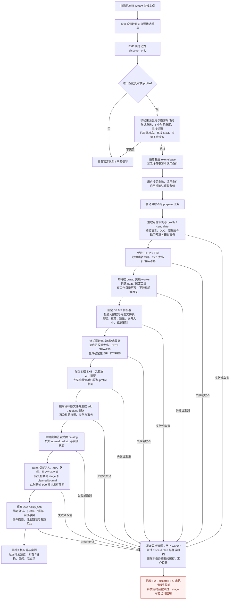
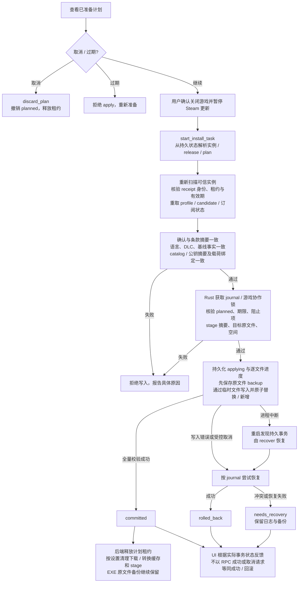
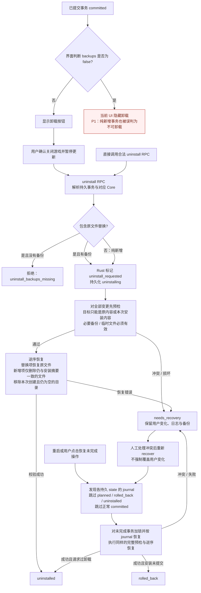

# EXE 补丁完整流程图（当前实现）

2026-10-07 更新：[通用 EXE 自动安装](../generic-exe-installation/design.md) 已增加按完整对象图、受限 AST 与行为条件判断的新内容入口，旧 profile 不再是新安装的唯一入口。下图保留 2026-10-06 审阅时的历史流程，最新实现与验收见[新功能施工记录](../generic-exe-installation/progress.md)。

审阅日期：2026-10-06。基于提交 `d2f551f` 的代码；设计见 [design.md](design.md)，验证记录见 [progress.md](progress.md)，本次缺陷见 [review.md](review.md)。下图区分已实现流程和审阅发现的异常分支，不将设计意图当作已通过验收的行为。

## 1. 来源发现与准备

能力投影阶段不等于实例适用性已经通过：语言、DLC、游戏基线在 prepare 和 apply 中重新核验。`profile.review` 是维护者审核事实的声明；运行时摘要校验不自动证明安装器全部语义安全。当前 registry 有 VBF 中文 v5、夏日中文 DLC v2.02.1、夏日中文本体 v1.03 三条审核条目，其他 EXE 不因格式相同获得安装权。

对应代码：[exe_profiles.py](../../../apps/decky/backend/exe_profiles.py)、[exe_installation.py](../../../apps/decky/backend/exe_installation.py)、[exe_worker.py](../../../apps/decky/backend/exe_worker.py)、[sf95_audit.py](../../../scripts/sf95_audit.py)、[sf95_worker.py](../../../scripts/sf95_worker.py)、[install.rs](../../../crates/core/src/install.rs)。

## 2. 确认安装与事务结束

apply 使用 Rust 在准备阶段保存的 `.stage`，不重新读取 `normalized.zip`；因此删除转换缓存不能使一个计划失效。准备取消必须可靠撤销计划或本地授权租约。安装取消与提交存在竞态，应读取真实终态；崩溃恢复不依赖进程内状态。

对应代码：[main.py](../../../apps/decky/main.py)、[bridge.py](../../../apps/decky/backend/bridge.py)、[tasks.py](../../../apps/decky/backend/tasks.py)、[index.tsx](../../../apps/decky/src/index.tsx)、[install.rs](../../../crates/core/src/install.rs)。

## 3. 卸载与恢复（含当前界面缺陷）

后端与 Rust 已支持纯新增事务卸载，VBF 的三个新增文件不需要原文件备份。当前 UI 仍只检查 `backups`，两个卸载入口都被阻止，详见审阅 P1。卸载 / 恢复使用持久目录与 journal，不要求官方来源仍启用；再次准备 / 安装仍要求现行审核与来源条件成立。恢复不是无条件覆盖：预检通过后，每次写入前仍会检查目标内容。

卸载目前是同步 RPC。施工记录已记载夏日 DLC 的 5,865 个备份恢复约耗时两分钟、客户端超时但后端完成；这是待改善的进度与超时体验，超时不能作为真实事务终态。

对应代码：[index.tsx](../../../apps/decky/src/index.tsx)、[共享 Transaction 类型](../../../packages/ui/src/index.ts)、[main.py](../../../apps/decky/main.py)、[install.rs](../../../crates/core/src/install.rs)。

全过程不执行官方 EXE、Lua、DLL 或 Wine / Proton 安装器。Rust 是游戏文件安装与恢复的写入者；“静态提取成功”“文件事务成功”和“进入游戏后补丁生效 / 存档兼容”是不同验收层次，后一层仍需真实游戏证据。
