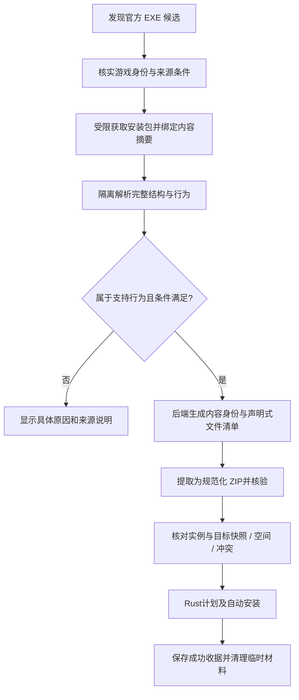

# 按安装器行为支持通用 EXE 自动安装

日期：2026-10-07（Asia/Shanghai，2026-10-14 修订计划）。状态：**实施与验收完成；SF9.5–9.7 通用行为准入、转换和真实 Rust 安装已接通。四款本地矩阵、用户游戏内确认及最终 Decky 验收通过，证据与验证边界见施工记录和验收审计。**

2026-10-15 当前增量状态：**默认值限制移除已实现，自动化与双平台正式隔离 worker 回归通过，候选包已生成；本次修改已部署并完成设备隔离分析转换/RPC/真实页面验收，用户已确认本轮只部署插件并验收运行与界面，实际游戏安装与生效不在本轮范围。** 普通配置按结构读取，按实际组件条件筛选载荷；不新增样本值或游戏白名单。详细方案及限制处理见 [fix-plan.md](fix-plan.md) 与 [policy-inventory.md](policy-inventory.md)，此前验收事实保持历史范围。

关联：[施工记录](progress.md) · [默认值限制移除计划](fix-plan.md) · [调研证据](research.md) · [现有 EXE 功能](../exe-patch-installation/design.md) · [一站式安装](../simplified-install-flow/design.md)。

## 1. 目标与产品决策

用户明确要求自动安装范围由“格式与安装行为是否支持”决定，不以游戏名单或人工逐包审核为准。同一受支持行为的新游戏、新补丁版本应自行检查并生成安装计划，无需修改 `exe_profiles.json`、预填文件摘要或登记游戏 build。

自动安装许可同时满足：来源与游戏身份可靠、安装器结构和行为属于已实现范围、当前实例满足可提取的适用条件、隔离和文件事务可用。来源域名约束仍是下载边界；它不再作为逐游戏名单。HGamer 只提供定位线索，不能授权任意文件直装。

默认流程沿用一站式安装：点击“安装补丁”后自动下载、解析、核验、提取和安装；不增加“申请审核”、解压器选择或多次准备/确认。用户明确要求跳过安装器的条款页、目录选择和向导确认。条款文本只属于内部解析证据，不进入前端数据或用户提示，不模拟点击同意，也不新增确认步骤；完整行为解析仍必须证明这些界面逻辑能与载荷及真实适用条件分离。界面只展示安装进度与确实阻止安装的问题。

“安装条件已核验”与“特定游戏实机验证通过”分开表示。无逐游戏实测也可安装符合通用规则的包；不得将其显示为 `compatibility=verified` 或“已审核版本”。扫描不会把尚未分析的 EXE 显示为已确定可自动安装。

## 2. 范围与行为矩阵

首批目标是共用解析框架的 SF9.5、9.6、9.7，沿用受限 LZMA2/未压缩成员支持。版本号用于选择明确的记录布局，不是游戏许可名单；9.7 的文件记录比 9.5/9.6 多一个序列化字节，不能直接套用最高版本布局。支持高版本安装器制作新包不等于其二进制读写规则自动兼容旧包。未知版本必须明确阻断，不笼统宣称所有 Setup Factory 版本可用。Inno、NSIS、7z SFX 使用统一适配接口，但各自的完整行为适配作为后续里程碑，不能因为能解包就开通安装。

| 行为 | 首批策略 | 判断依据 |
| --- | --- | --- |
| 新增/替换游戏目录内文件 | 自动安装 | 完整文件表、目标变量、实际选择条件可处理；覆盖沿用插件事务 |
| `%AppFolder%` 与其子目录 | 映射至可信扫描实例根 | 根由后端确定，不采纳脚本构造的任意路径 |
| Steam/注册表游戏定位、浏览目录界面 | 可替换为可信实例定位 | 必须识别整个逻辑只用于定位；注册表读取不等于允许写入 |
| 文件存在、CRC/显式摘要检查 | 转为只读前置条件 | 保留表达式及比较值，当前实例必须满足 |
| 条款、语言/安装类型/包选择与向导 | 解析为产品条件和确定选择 | 不影响载荷的界面可省略；影响载荷的分支须明确求值 |
| 默认关机重启助手、错误/取消事件 | 仅在已证明不影响载荷时消除或映射 | 按控制流与受限模板判定，不能见到 API 名称就忽略 |
| 有限条件分支、局部变量、布尔与字面量比较 | 受限 AST 转写 | 输入可追踪，所有路径可判定；超出子集具体阻断 |
| 差分更新、文件删除/移动、外部进程、插件/DLL 调用、网络下载、注册表写 | 首批拒绝自动安装 | 明确指出不支持的行为及来源安装说明 |
| 多卷/密码/未知压缩/未知版本、外部脚本和动态调用 | 首批拒绝 | 不尝试执行安装器、Lua、Wine/Proton 或任意解压命令 |

允许游戏载荷包含 EXE/DLL/JS 等正常文件，不能按扩展名过滤游戏内容；安装运行时和界面资源必须按对象角色与布局分离。格式新特性只需扩展通用适配器，不要求用户手工配置游戏。

## 3. 元数据与语义分析

### 3.1 完整结构是前置条件

将当前按 marker 定位文件表的审计器补为有版本标识的对象解析器。明确对象边界、类引用、计数、表前后对象与跨记录 framing，按布局读取原始字段。停止以样本默认值判定结构有效性；未参与插件文件复制的可定位配置保留为数据，不设逐字段人工审核门槛。实际影响载荷选择或生成的字段按操作处理，真正的结构错位与配置差异分开报告。

覆盖清单包含项目五类事件、界面/控件事件、全局函数与 include、文件条件、安装类型与包、路径变量和覆盖/属性策略。每个区域输出 offset/length、对象类型及处理状态。向导、显示和插件不执行的附带配置按结构读取后可忽略，其值变化不阻断文件复制；确实无法确定记录边界的布局仍需实现解析，不把配置值不同误判为未知布局。没有脚本的判断来自完整资源表，而非搜索不到 Lua 字符串。

### 3.2 受限静态分析与声明式中间表示

脚本仅解析为 AST，绝不解释执行 Lua。识别有限的赋值、常量、已知只读操作、布尔/比较和条件分支；限制节点数、深度、调用数量与分析时间。构建有限调用关系，展开已支持函数，拒绝动态函数名、递归、动态加载及无法追踪的值。不可达危险动作只有在控制流及输入可证明时排除；未知分支不得假设不执行。

通用规则将语义转为 IR：`copy_files`、`require_file_exists`、`require_crc32`、`require_digest`、`select_payload`、`source_terms`、`locate_scanned_instance`。规则的参数可以是任意合法文件名、CRC、来源 AppID 和版本值；禁止在规则中硬编码夏日/VBF/妃神的身份以授予权限。模板 AST 可以推广，整段游戏脚本摘要不能成为主要准入机制。

适配器返回 `supported` / `unsupported` / `invalid`：不支持合法特性与损坏包分开。错误包含对象、偏移、行为类型和简短中文原因，诊断可保留表达式摘要，普通界面不展示原始脚本。

## 4. 身份、条件和版本

继续使用来源记录与已核实 AppID/别名/官方标题关联，文件名和用户点击某游戏不单独证明身份。身份无法核实时显示“无法确认补丁对应的游戏”；这是来源匹配问题，不能提示游戏未审核。对用户指出的游戏，实施前核对当前适配器究竟卡在身份还是格式，分别解决通用来源规则。

条件模型区分三类事实：

1. **来源声明**：语言、Steam/GOG、本体/DLC、官方版本适用说明，保留出处、观察时间、已明确/未知/冲突。
2. **包内必要条件**：文件存在、CRC/显式摘要、组件分支、载荷对应语言；转写后必须成立。
3. **现场快照**：manifest、build、语言、已安装 DLC、前置条件文件及写入目标的当前摘要；绑定一次计划，用于检测准备到写入间变化。

不再要求 build 出现在人工 `verified_buildids` 中。若安装器或官方明确限制版本，按该条件检查；如果没有限制，记录现场 build 并在 apply 前保持一致，不宣称此 build 已实测。现场计算的 SHA 不是“原版认证”，不应伪造 profile baseline；CRC 仅复现安装器门槛，也不提供真实性认证。

“无 DLC 限制”与“DLC 信息未知”分开。候选本体/DLC 身份存在冲突或必要条件缺失时不得默认选择；没有包选择或声明的强制条件且完整语义证明复制集合确定时，不因缺少逐游戏 DLC 表而阻断。已安装 DLC 不证明购买/授权，来源有所有权要求时需另有可靠证据或必要用户声明。

若本体/DLC 条件文件被载荷覆盖，首次安装仍核验原条件；同内容重装只有可信成功收据证明覆盖范围及来源前置条件时才可评估豁免被自身改变的基线。没有收据或内容已变化，不能一般性跳过条件。存档、用户修改及非拥有文件冲突沿用现行事务策略。

## 5. 流程、身份与持久状态

### 5.1 选择身份与内容身份

分析前只有后端候选选择标识；分析后才生成绑定实际包的 release。现已固化为 `exe-selection-<24 位十六进制候选绑定摘要>-<appid>` 与 `exe-content-<24 位十六进制内容绑定摘要>-<appid>`，同步 RPC、持久路径与前端类型。旧 `exe-<profile摘要>-<appid>` 保留既有兼容路径，不能直接复用旧 ID 并换含义。

内容身份至少绑定来源/AppID/语言/变体、EXE SHA、元数据 SHA、完整载荷及选择摘要。分析报告另绑定 adapter/policy 版本、来源条件摘要和实例条件快照。策略升级使旧分析报告失效，但同一内容的成功安装收据仍可读取；算法不把 policy 版本混成内容更新。不同 EXE 字节保守视为新内容，即使 URL 或版本字符串没变。

候选选择 ID 可以启动只读分析/完整安装任务；它不能调用 core apply。前端只能提交实例、后端选择/内容 ID、操作和幂等 request ID，不能传任意 URL/路径/配方/`semantics_approved`。后端在同一任务内解析选择、分析并取得最终 release，任务结果显式返回最终内容 ID，UI 按结果更新，不能假定点击时已有固定 release。

### 5.2 下载、分析与缓存

取消预置 EXE 摘要要求：官方 HTTPS、每跳域名、真实 PE/格式与限额是获取边界；首次下载计算 SHA，用于后续内容一致性而非发行商签名。若官方提供可信摘要/签名，则独立校验并记录。禁止因下载失败把不一致的镜像当成同一内容；不同字节需独立分析，保留最终 URL 与摘要，不拼接镜像。

当前实现仅复用下载缓存：复用前重哈希包，使用条件 HTTP 请求核对来源；每次安装/重装重新生成行为报告并核验转换产物，成功后清理临时包和报告。持久化 schema 1 的 `generic-source.json` 只保存实例、内容身份、选择 ID 和候选绑定摘要，用于重启路由，不保存可复用安装权限。网络可变字段的 TTL 不等于内容授权有效期。来源停用、候选身份/条件变化或安全策略升级使许可失效；成功记录可离线显示，不能离线授予新安装许可。跨任务报告缓存以后若引入，必须绑定 EXE 内容摘要、adapter/policy 版本与报告 schema 并完整校验，不以本轮路由文件替代。

扫描先增量公布“找到补丁来源”；后台可排队分析，按大小设置总流量、并发和时间预算，避免自动下载全库每个 GB 级 EXE。默认建议扫描仅做轻量格式探测、复用有效分析；未分析完整内容不能显示“可自动安装”。详情提供“安装补丁（自动检查）”，点击启动完整流水线；缓存报告满足条件后可显示“有可用补丁”。这修订了旧一站式设计对扫描全面能力判断的假设：不能通过首部 Range 推断完整安装语义。实施前确定扫描预算，产品无需逐游戏人工审核。

2026-10-07 修订：为消除“详情可装、列表却显示仅来源”的误导，列表对安装链路可用且无阻断的通用 EXE 直接显示“有可用补丁”，不再要求先完成分析；详情继续标注“安装时自动检查条件”，安装阶段仍会下载并分析安装器行为，失败按真实原因反馈。原“未分析完整内容不能显示‘可自动安装’”的扫描保守口径据此放宽为“不预设有权限”，安装期许可与条件检查不变。

### 5.3 Worker 与授权

固定 sandbox 分成 `analyze` 和 `convert` 两种固定协议，均离线且不能访问游戏目录。`analyze` 返回严格 schema 的报告；后端结合来源和实例事实决定条件，再发内容与报告摘要绑定的转换请求。`convert` 校验同一包并重做必要结构/行为检查，不能盲信客户端清单或一个批准布尔值。后端核对 ZIP 内容与报告，再交 Rust。

游戏条件在 sandbox 外由后端只读检查，worker 不直接探测 Windows 注册表/文件系统。路径、大小、CRC、ZIP 和 Rust 写入守卫全部保留。计划授权由后端持有，绑定内容、报告、来源条件、实例与文件快照、任务归属和期限；apply 前核验所有必要事实。输入报告/缓存不是新的用户可写许可文件：按当前后端 state 信任边界校验归属、路径、schema 和绑定值；恶意伪造/损坏测试必须拒绝，不能依赖“该文件在缓存目录”。

取消优先持久撤销授权，再尝试 discard；discard 失败也不能继续 apply。禁止 UI 关闭或 RPC 超时被误判为后端已取消。进程重启不恢复旧未完成自动写入许可，按现行任务恢复规则失效并处理临时事务。

### 5.4 收据、重装与迁移

沿用当前一站式安装的“临时失败恢复、成功后清理长期备份”策略；本功能不重新增加卸载、长期备份开关或下载后二次确认。首次准备记录被覆盖目标，失败/取消恢复到本次任务开始前；恢复冲突保留必要材料，成功清理失败不改写安装成功。

旧 profile/安装收据/事务和文件检测保持可读，三条 profile 作为回归证据与旧内容身份映射保留，但新内容不再强制命中它们。不能通过删除旧 state 迁移；不能把旧审核结论无条件继承给新包。迁移含旧 ID 到新内容 ID 的只读关联和冲突检测，同实例/同内容收据只保留一个可信归属，未完成事务优先处理。

重装只允许同实例、同内容身份，修复范围来自可信载荷与成功收据，失败恢复仍使用本次开始前快照。新补丁版本/语言/DLC 切换属于更新，不因 ID 别名自动授权叠加；本期明确提示“补丁内容已变化，暂不支持直接重装为新版本”，后续独立设计内容升级。

## 6. 修改范围与实施拆分

| 阶段 | 修改范围 | 交付和放行条件 |
| --- | --- | --- |
| P0 样本与协议 | 本机只读样本实验；统一 IR/schema、ID 与状态设计 | 三个旧样本＋用户准备的四款本地游戏；完整对象覆盖与跨游戏模板报告；不新增逐游戏许可配置 |
| P1 通用行为适配器 | `sf95_audit.py`，SF9 元数据/受限 AST 模块与测试 | 解析全事件/全局/条件/属性；未知行为具体阻断；禁止按样本 SHA 授权 |
| P2 分析服务与 worker | `exe_worker.py`、`sf95_worker.py`、拟新增分析服务；打包脚本 | 两阶段隔离协议、动态报告/清单、预算、取消与内容缓存；Linux 真实 worker 验证 |
| P3 条件与安装授权 | `exe_profiles.py` 降为旧记录兼容；`exe_facts.py`、`exe_installation.py`、来源绑定与缓存 | 删除新流 build/profile 白名单；条件 IR 与现场快照分离；迁移/重装/撤销测试 |
| P4 RPC 与 UI | `main.py`、后台任务、共享 UI 类型和 Decky 页面 | 选择到内容身份衔接；进度、具体原因、已核验/实测区分；无多次确认；订阅变化与并发一致 |
| P5 验证与部署验收 | 本机完成格式/行为/核心/后端验证，最后进行 Decky 实机交互验收 | 四款本地游戏端到端验证；最后核对 Deck RPC、运行环境和前端交互/手柄 |

每阶段更新本功能施工记录；实施时同步修订原 EXE 与一站式设计的当前规则描述，保留旧审核历史。Rust 核心尽量仍接受规范化 ZIP 与完整配方；如需修改 catalog/bridge 契约，同步 schema、Rust 类型、协议方法白名单及所有客户端，不能塞入未声明字段。

实施顺序先证明语义泛化，再开放许可。P0 无法解释的行为列成格式能力缺口，优先扩展参数化规则；不能用“先为妃神加第四条 profile”充当 P0/P5 完成。当前已开始实施，实际完成范围及验证结果以施工记录为准；只读分析尚不能产生安装授权。

## 7. 验收标准

1. **证明没有游戏白名单**：移除新安装路径对 registry 的依赖后，至少三个 registry 外游戏在无需修改游戏/AppID/build/SHA 配置的情况下，经同一规则完成分析；至少一个含原文件替换。必须包括妃神会秘史；若它的格式确实未支持，记录实际字节证据并将对应格式适配列为未完成，不能宣称该目标已达成。
2. **证明不是逐脚本白名单**：改变合法文件名、CRC 参数、界面文本、事件常量或样本身份不需要新规则；加入未支持动作、条件/包分支、动态调用必须产生对应原因。相同文件表但不同事件的包不能复用许可。
3. **条件正确**：夏日本体/DLC/不同语言分开；错误 CRC、缺文件、语言冲突、DLC 信息未知/冲突和其他实例全部按语义处理；没有显式版本限制的未登记 build 可以安装，不显示实测认证。
4. **报告与内容绑定**：同 URL 内容更新、镜像不一致、篡改报告/ZIP/缓存、policy 升级、来源退订、prepare/apply 间 Steam 更新都不能沿用旧许可。签名不存在时不能将自行计算 SHA 说成发行商认证。
5. **安全与恢复**：路径穿越、链接、大小写/Unicode/文件目录冲突、恶意 PE/对象/压缩、超额 AST/时间/内存均拒绝；sandbox 缺失明确降级。取消与 discard 故障、进程重启、满盘、部分写入恢复按真实终态验证。
6. **收据与体验**：旧三个样本记录仍可读，既有安装显示稳定；同内容重装可修复且不动集合外文件/存档；升级不误当重装；大包任务可取消、页面退出不打断任务、未知 EXE 不再只显示“未审核”模板文案。
7. **本地验证与最终 Deck 验收**：文件摘要验证与游戏内补丁生效分别记录；开发阶段用用户准备的四款本地游戏验证后端及文件事务。Steam Deck 仅用于最终阶段，主要验收 Decky 前端交互、状态/进度、取消、页面退出与重进、来源提示和实体手柄；同时核对实际 Linux worker/RPC 打包集成，不能以 Windows 测试替代 Linux 隔离验证。验证环境与流程见下节。

当前资源基线为 EXE ≤2 GiB、分析单文件 ≤2 GiB（旧 profile 许可仍 ≤1 GiB）、总展开 ≤2 GiB、8,192 条目、16 MiB 元数据/协议、128 MiB LZMA 字典及 3 GiB worker 地址空间。通用行为分析墙钟 240 秒、转换墙钟 480 秒，单进程 CPU 300 秒；旧 profile 转换墙钟仍 180 秒。Lua AST 限 100,000 token、96 层解析深度，条件事实限 8,192 节点；扫描不自动下载每个候选的大型 EXE，点击安装才完整分析。分析与转换各只执行一次，有界获取、核心桥接超时及取消另按既有任务守卫执行，不自动无限重试。本地三样本中的两个单文件超过 1 GiB，因此解析上限调整为 2 GiB；本机 WSL 非特权 bwrap 全量转换和真实写入均通过。Deck 上实际官方大包已以生产 bwrap worker 验证：分析 28.48 秒、转换 55.98 秒且载荷摘要一致；这只证明该包在本轮设备预算内，不保证所有安装器耗时。

### 7.1 本地游戏矩阵与验证环境

用户已在本地电脑准备下列 case，授权开发过程中直接使用；已核实四款的本地 Steam manifest。四款已完成真实安装及文件摘要/存档保护验证，三个官方 EXE 经空 profile 注册表和相同通用规则完成隔离分析、转换、Rust 写入；重装、恢复与游戏内效果分别记录，不混同。

| 本地 case | 必须记录的验证证据 |
| --- | --- |
| 你妈真漂亮 | 官方候选及游戏身份、包格式与完整行为报告、条件判断、安装前后文件差异、同内容重装与失败恢复 |
| 妻子变美的理由 | 同上；与其他 case 比较通用规则覆盖，不能新增游戏专属许可 |
| 妃神会秘史 | 同上；重点核验当前官方包及 Steam/GOG 声明对应的实际行为，解决此前只能显示来源提示的问题 |
| 众人觊觎的女友 | 同上；作为跨游戏泛化 case，记录具体支持/阻断依据 |

四款全部纳入验收，不以任意三款替代完整矩阵。游戏实际 AppID、安装目录、build、语言、DLC、已有补丁/用户修改、安装器类型均在开始实施时只读核实，不能根据名称猜测引擎或声称已经支持。三个历史 profile 继续做兼容回归。

本机承担官方包获取、元数据/AST 分析、来源与实例条件、核心文件事务、取消/故障恢复和重装的主要迭代。优先在独立临时目录/游戏目录副本上做破坏性故障注入；真实安装 case 做改动前快照和可恢复备份，保留原有用户文件与存档。验证留存的快照是开发实验材料，不重新引入产品长期备份设置。实际游戏内效果需要启动对应本地游戏并单独记录，不能用文件复制成功代替。

当前生产 worker 仅支持 Linux bwrap。本地实施先核查已有 WSL2/本地 Linux 容器环境，若可用，在本机完成真实离线 worker 验证；Windows Rust 核心与只读事实检查可在本机独立测试，再由开发测试入口串联与生产相同的 IR/转换产物。Linux 语义测试和 Windows 文件事务测试分别标明平台，不把 Linux 路径事实当作 Windows Steam 实例授权，也不绕过生产 sandbox 以制造端到端通过。没有本地 Linux 环境时明确记录隔离验证缺口、调整本机测试环境方案，不能回到远程 Deck 作为日常开发环境。

本地开发验证不等于交付完整 Windows 客户端 EXE 功能；如需新增 Windows 生产隔离与客户端入口，须另行明确实现范围。最终 Deck 阶段只补平台/打包集成与 Decky 产品交互证据，后端缺陷先回本机复现和修复，避免以远程连接作为主要开发循环。

## 8. 待验证假设

- SF9.5–9.7 完整对象图、受限 AST 与安装属性：历史三个真实完整包已通过顺序完整解析和行为准入；2026-10-15 属性默认值准入由第 9 节移除，实际必要动作仍按已实现能力处理。其他包的覆盖率不能由已有案例推定。
- 常见 Kagura 安装脚本落入受限语法子集：三个 registry 外游戏共用规则完成实际安装，其他脚本的支持范围按行为检查，不承诺所有 Setup Factory EXE 均可提取。
- 妃神当前包格式与动作、官方条件提取、AppID 绑定：已核实 SF9.5、现场文件 CRC/存在条件、官方身份与 AppID/build/语言，实际替换 data.xp3 并完成摘要核验。
- 大型包的元数据分析/重复校验是否超过既有限额及 Deck 内存/时间预算：本机 WSL 三个真实包校验分别耗时约 28、45、46 秒，未超既有 worker 限额；Deck 实际隔离分析 28.48 秒/转换 55.98 秒并通过载荷摘要核验，见施工记录。
- 扫描轻量探测如何与“有可用补丁”过滤同步：安装链路可用且无阻断的通用 EXE 归入“有可用补丁”，安装器是否受支持仍以安装时的行为分析为准，失败按真实原因反馈，不把未分析内容预设为确定支持（2026-10-07 修订）。

以上假设不能靠每个游戏另加审核条目规避；若某类行为暂不支持，产品明确说明类别与原因，并在本功能记录通用能力扩展任务。

### 旧适配与新构建

旧适配的样本/构建覆盖不能阻挡当前候选进入通用行为检查；旧规则无法解析时，重新核验官方来源后走动态选择。旧收据的解析仍保留原内容绑定，不把未经分析的新包当作旧收据的重装载荷。

## 9. 2026-10-15：移除安装器默认值限制（已实现，验收中）

用户要求消除额外的防御性准入，以提高不同安装包配置的兼容性。本次方案覆盖共享 Rust SF9.5–9.7 对象图与行为层：文件尾字节、项目/卸载/界面常量断言、Archive 精确匹配、文件属性/时间戳默认值、空快捷方式/图标/字体、按文件名判断存档、安装类型/包选择以及只读条件子路径。

普通配置按实际布局读取，插件不执行的附带操作不再阻断文件安装。真实载荷选择与生成操作按功能实现；不以“非默认”“未审核”作为独立失败原因。读取字节、长度、CRC 与事务操作继续按实际解包需要处理，不另设游戏或样本取值名单。

完整方案见 [默认值限制移除计划](fix-plan.md)，逐项处置见 [限制处理清单](policy-inventory.md)。

图解析保留原始配置和 before/while/after/project/uninstall 生命周期，普通配置不按默认值准入。组件 Install 状态与文件条件生成全局/逐成员条件；主进程观测条件路径一次，选中成员后计算内容身份，worker 只转换同一成员子集。重装查找同一 EXE/元数据/大小的最近可信事务，以原始条件事实重算选择，再核对成员身份与现场文件。

报告 decoder/policy 及 EXE 授权适配版本升至 v2。未由插件执行的快捷方式、字体注册、向导显示及 Windows 属性配置不阻断普通文件提取；所需内容生成动作仍按已实现能力处理。

当前验证边界：显示进度屏幕的两个 DWORD 尚未映射；While OnPreload 按静态准备步骤处理。隐藏该屏幕且其 OnPreload 有选择副作用的情况，尚未与官方运行时核对。正式隔离 worker 回归与候选包记录见施工记录；设备部署与对应运行验收已通过，见 [本轮部署验收](deployment-20261015.md)；本轮实际游戏安装与生效已由用户明确排除。
