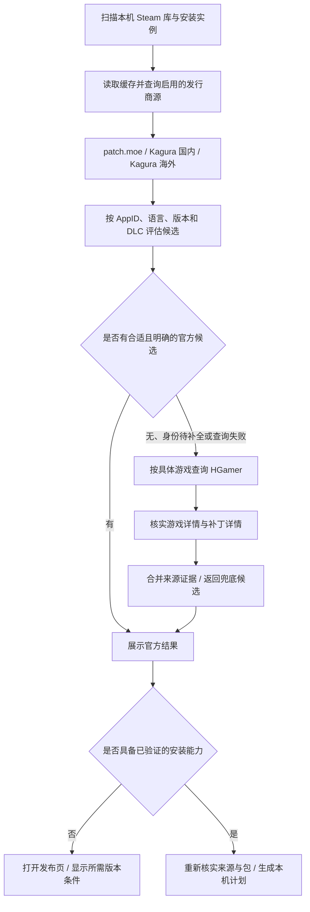

# Feature：KaguraGames 双站内置源与 HGamer 兜底索引

状态：调研完成，待实现。调研日期：2026-10-04（Asia/Shanghai）。目标客户端：Steam Deck / Decky。

施工记录：[progress.md](progress.md)。

本轮交付为方案文档；以下接口、字段、默认值和测试均为拟实施设计，未修改插件运行逻辑，也未执行游戏补丁安装。

## 1. 目标与产品决策

解决《夏日狂想曲》等 Kagura Games 游戏缺少来源，以及内置发行商覆盖不足导致“无匹配”的问题：

1. 默认内置并启用 **Kagura Games 国内源** `kagura-cn`（kagurafan.com）和 **Kagura Games 海外源** `kagura-en`（www.kaguragames.com），使用不同适配器、缓存、状态与下载域名规则。用户本轮明确提供并确认这两个发行商站点。
2. 默认内置并启用 **HGamer 补丁索引** `hgamer`，定位为 `fallback_indexer`。按未充分匹配的具体游戏查询，不要求新增发行商适配器才能显示补丁线索。
3. 游戏身份以 Steam AppID 为主；中文、英文、日文名称及别名用于检索和无 AppID 情况下的精确关联。按游戏版本、补丁语言、本体 / DLC、正式版 / Demo 消歧。
4. “已找到补丁”与“插件可以安装”分开表示。EXE、网盘、登录下载、未知布局及未审核来源仍能被发现并打开发布页，但不得标为 `publisher_zip`。
5. 动态查询网站并保留成功缓存；不内置固定游戏清单、补丁文件或自建镜像。站点失败不等于没有补丁。
6. 国内、海外是来源位置；语言从具体补丁记录读取。国内站并非一定只有中文，海外站也不能一律硬编码英文。

首期完成**双站发现、正确匹配、兜底索引和可用来源引导**。安装格式扩展独立列为后续工作，不能为了让按钮可用而将 EXE 伪装成 ZIP。

## 2. 当前仓库事实与根因

| 位置 | 当前行为 | 本功能需要解决的问题 |
| --- | --- | --- |
| [sources.json](../../../apps/decky/backend/sources.json) | 内置规则只有 patch.moe | Kagura 和 HGamer 均未接入 |
| [sources.py](../../../apps/decky/backend/sources.py) 的 `_normal` / `matches` | NFKC、大小写及标点归一化；显式 AppID 或完整标题 / 别名匹配；同源不同 ZIP 不自动选择 | 不会翻译“夏日狂想曲”与 “Summer Memories”；没有跨语言身份链 |
| 同文件 `_validate_rule` / `_validate_entries` | 规则必须有 `game_root` 与非空下载白名单；记录必须是白名单 HTTPS ZIP | 不能表达只提供网页、EXE、多镜像、未知语言及零搜索结果 |
| [main.py](../../../apps/decky/main.py) 的 `scan` | 清空核心目录返回的 patches，再把源匹配统一构造成 `publisher_zip` | 只读来源引导不会进入 Decky 列表；新源不能直接套用当前转换 |
| [publisher.py](../../../apps/decky/backend/publisher.py) | 准备前再次匹配和校验下载 URL；检查 ZIP、生成本机签名计划 | 发现记录不能直接授权下载 / 安装 |
| 同文件 `RELEASE_PATTERN` 与 sources 的 `source_for_release` | `source-<source-id>-<appid>`，每源每游戏一个 ID | 同源语言和本体 / DLC 可能冲突；需要独立候选 ID |
| sources 的系统 Python 工作进程 | 子进程重新创建 SourceRegistry | 新适配器必须在共同初始化代码注册，不能只注册到父进程 |
| [install.ts](../../../apps/decky/src/install.ts) | 只有 managed_zip / publisher_zip 可准备 | 可复用 discover_only 的引导边界，需调整详情展示与筛选 |

因此首要缺口是**发行商源缺失和发现模型过于偏向 ZIP**，不能仅增加一条游戏名或放宽模糊匹配。现有用户库的具体游戏 build、DLC 状态、当前扫描响应未在本轮读取；不将代码层根因调查当作设备复现。

## 3. 现场调研与证据

### 3.1 KaguraGames 海外站

入口：[海外补丁列表](https://www.kaguragames.com/patch/)，补充入口：[补丁分类目录](https://www.kaguragames.com/product-category/patches/patch/)。分类目录的搜索工具快照显示 226 项、每页 21 项、11 页；这只是观察快照，不能作为实现中的固定数量。

本轮普通 HTTP 客户端使用浏览器式 User-Agent，实际取得 `/patch/` 和 [Summer Memories Patch](https://www.kaguragames.com/product/summer-memories-patch/) 的 **HTTP 200 HTML**。搜索工具直接读取它们曾返回 403；不能据此认定插件后台不可采集，也不能保证 Steam Deck 网络必然成功。HTML 有 WordPress / WooCommerce 产品卡，详情的 Mirror 链接是可直接读取的锚点。需要限定主列表和补丁标签区域，排除侧栏“热门商品”、普通商品与购物车入口。

Summer Memories 本体页面提供 Steam Patch v3；本轮读取到的 Mirror 为：

| Mirror | 页面链接 | 格式判断 |
| --- | --- | --- |
| 1 | [kaguraserver.com 英文 v3](https://kaguraserver.com/KaguraGames/EN/patch/Summer%20Memories/Summer-Memories-EN-Patch-v3.exe) | URL 为 EXE |
| 2 | [kaguragamespatch.com 英文 v3](https://kaguragamespatch.com/KaguraGames/EN/patch/Summer%20Memories/Summer-Memories-EN-Patch-v3.exe) | URL 为 EXE |
| 3 | [Google Drive 页面](https://drive.google.com/file/d/1-QMe6ze8l8nV_zbTkveQ0nm0FDPBpbtr/view?usp=sharing) | 浏览器下载入口 |

没有下载或执行这些文件；格式判断来自页面 URL，尚未检查实际二进制、摘要、安装器类型及包内布局。

[官方 FAQ](https://www.kaguragames.com/contact-us/) 说明可从 Patch 标签无需账户下载，游戏语言和版本应与补丁对应；本体和 Expansion DLC 需要不同补丁。[官方安装说明](https://www.kaguragames.com/patch-instructions/) 描述运行 Windows 安装程序。海外页面的使用地域说明应保存在候选提示中，不以插件转换格式来改变其限制。

### 3.2 KaguraGames 国内站

入口：[KAGURA FAN](https://kagurafan.com/)。本轮 HTTP 读取成功，页面为 WordPress 文章列表，具有 `entry-title`、`entry-content`、类别目录及 `/page/2/` 等分页链接。首页只显示近期文章，旧游戏需从类别目录、文章归档及实际分页发现；不能只采首页。分页数量也不能写死。

用户更正后的本体页：[夏日狂想曲：乡间的难忘回忆](https://kagurafan.com/2020/06/14/%e5%a4%8f%e6%97%a5%e7%8b%82%e6%83%b3%e6%9b%b2%ef%bc%9a%e4%b9%a1%e9%97%b4%e7%9a%84%e9%9a%be%e5%bf%98%e5%9b%9e%e5%bf%86/)。页面提供中文 v1.03，并注明仅供没有购买 DLC 的 Steam 玩家使用；GOG 玩家不适用。其[神乐直链](https://kaguraserver.com/KaguraGames/CN/patch/Summer%20Memories/Summer-Memories-CN-Patch-v1.03.exe) 为 EXE。

[夏日狂想曲+](https://kagurafan.com/2021/01/08/%e5%a4%8f%e6%97%a5%e7%8b%82%e6%83%b3%e6%9b%b2/) 是扩展补丁页面，要求已购买 DLC，标示 v2.02.1（正文另出现 v2.021）；[直链](https://kaguraserver.com/KaguraGames/CN/patch/Summer%20Memories%20DLC/Summer%20Memories%20Plus%20DLC%20CN%20Patch%20v2.02.1.exe) 同样为 EXE。保存这些原始版本字符串，出现矛盾时展示并记录诊断，不擅自改为等价版本。

每篇文章主体内读取多镜像、英文名、日期、版本、语言和使用条件；侧栏类别名只能帮助定位，不能充当补丁正文。迅雷、百度、Drive 等是浏览器入口，不自动改写成直链。WordPress 显示的首次发表 / 修改时间与正文“补丁更新时间”分别保存，不能将修改文章时间认作补丁新版本。

### 3.3 HGamer 目录、搜索和详情

用户入口：[简体补丁目录](https://hgamer.tw/zh-CN/patches)、[夏日狂想曲搜索](https://hgamer.tw/zh-CN/search?q=%E5%A4%8F%E6%97%A5%E7%8B%82%E6%83%B3%E6%9B%B2)。本轮直接 HTTP 取得可解析的 Next.js 服务端 HTML，**无需执行网页 JS**。目录现场显示 668 项、首屏 20 项、34 页；搜索工具较旧繁体快照为 653 项。因此数量只能动态读取，不能作为覆盖承诺。

公开分页是 `/zh-CN/patches/page/2` 形式。搜索请求本轮经 HTTP 308 跳转到同域 `/zh-TW/search`，结果包含 1 个游戏、2 个补丁；简体目录及游戏页仍可直接读取。解析应接受同域语言回退并保存最终 URL / 页面语言；页面语言不等于补丁语言。

搜索页还包含“大家也常搜索”的六个推荐项。只解析真正的“游戏”“补丁”结果区，不把推荐、热门榜、文章结果或整页所有链接当成命中。

[HGamer 游戏详情](https://hgamer.tw/zh-CN/games/summermemories) 提供完整中英文 / 日文别名、Kagura Games 发行商信息、Steam `/app/1227890/` 链接，以及本体和 + 两个补丁。补丁页的 Steam widget 也指向本体 AppID，因此 **AppID 相同不能证明本体和 DLC 补丁可互换**。

[本体补丁详情](https://hgamer.tw/zh-TW/patches/summer-memories) 标示 v1.03、120MB、ZIP；[扩展详情](https://hgamer.tw/zh-TW/patches/summer-memories-dlc) 标示 v2.02.1、267MB、ZIP，但安装说明是安装程序，上游发布页直链实际为 EXE。保留“页面声称格式”和“解析到的格式”，以核实后的上游信息决定能力，产生 `artifact_format_conflict`，不能授予 ZIP 安装能力。

本轮直接 HTML 的本体下载入口指向具体 KAGURA FAN 文章；搜索工具较旧快照中的 + 链接指向站点首页。适配器需支持“具体发布页”和“发行商入口”两种粒度，后者只能继续查询受维护的源或让用户打开网页，不能任选首页第一条下载。

[robots.txt](https://hgamer.tw/robots.txt) 本轮读取到 `/admin/*` 与 `/api/*` 禁止爬取，并公布 sitemap。首期采用公开 HTML 搜索 / 详情 / 分页；不依赖私有 API、Payload 管理接口、Next.js 内部 RSC 协议或页面内脚本执行。robots 不等于获取再分发许可；插件只缓存少量必要元数据，不复制整站正文或补丁资产。

### 3.4 本体与 DLC 的身份基准

| 对象 | Steam 身份 | 关键区别 |
| --- | --- | --- |
| 夏日狂想曲 / Summer Memories / あまえんぼ | [AppID 1227890](https://store.steampowered.com/app/1227890/) | Steam 页可核实 Kagura Games 发行商；本轮页面列有简体中文 |
| 夏日狂想曲+ / Summer Memories+ – Expansion DLC | [DLC AppID 1390150](https://store.steampowered.com/app/1390150/Summer_Memories__Expansion_DLC/) | 应作为本体的扩展条件，不要求 Steam 安装扫描出现独立游戏目录 |

上表是验收样本，不是拟内置游戏目录。国内和海外补丁版号不能跨语言比较大小，更不能把中文 v1.03 与英文 v3 推断成同一包或兼容同一 Steam build。

## 4. 总体架构

增加“来源发现”层，保留现有安装层的校验责任：



关键改动：先获取 core 的本机游戏列表，再进行按需补丁查询；不再在扫描游戏前刷新所有来源并抓取大量无关详情。首次展示可使用缓存，后台有界刷新后更新同一次扫描结果，避免游戏列表等待数百个网页请求。扫描加 generation ID，丢弃旧扫描晚到的结果。

## 5. 来源规则与发现数据模型

### 5.1 配置规则

升级 SourceRegistry 配置为 schema v2，新增 `role`（`publisher` / `fallback_indexer`）、`discovery_only` 能力、优先级、查询方式和语言偏好。v1 规则经内存迁移继续工作；不重写用户 overrides，保留已停用源及自定义源状态。新字段必须有版本化校验，不能向 Rust signed catalog 偷渡额外字段。

| source_id / adapter | role | 公开页面 | 初始能力 |
| --- | --- | --- | --- |
| patchmoe / patchmoe | publisher | 沿用当前规则 | 沿用 publisher_zip |
| kagura-cn / kagura_wordpress | publisher | kagurafan.com 首页、实际类别 / 文章 / 分页 | 发现 + 来源网页；逐条评估格式 |
| kagura-en / kagura_woocommerce | publisher | www.kaguragames.com/patch/、分类分页、产品页 | 发现 + 来源网页；逐条评估格式 |
| hgamer / hgamer_html | fallback_indexer | hgamer.tw 公开搜索、游戏 / 补丁详情及目录分页 | 发现索引；不给下载 / 安装授权 |

`discovery_only` 规则允许没有下载域名和 `root_layout=null`；具备安装能力的分支仍必须验证独立的非空 `download_hosts` 和具体布局。Kagura 页面已观察到 kaguraserver.com、kaguragamespatch.com；其他载点逐个核实后加入维护规则。**HGamer download_hosts 初始为空**，任何聚合页面不得动态扩展发行商白名单。

### 5.2 候选记录

新增 `SourceCandidate`，与现有强制 ZIP 的 entry 分开校验。建议字段：

| 字段 | 语义 |
| --- | --- |
| `candidate_id`, `source_id`, `source_record_id` | 稳定候选身份、源及网站条目身份 |
| `game_appid`, `parent_appid`, `aliases`, `game_title` | 游戏身份及证据支持的别名 |
| `patch_title`, `variant` | 本体 / DLC / Demo / unknown；补丁标题不充当游戏别名 |
| `requires_dlc`, `excludes_dlc`, `platforms`, `patch_kind` | 适用条件；未知明确为 null / unknown |
| `languages`, `version_raw`, `version_evidence`, `published_at`, `patch_updated_at` | 语言、未经推断的版号及不同日期 |
| `source_page`, `upstream_page`, `mirrors` | 聚合详情、发布页面、下载入口分别保存 |
| `format_reported`, `format_observed`, `capability` | 页面标示、解析结果与 discover_only / publisher_zip / managed_zip 能力 |
| `identity_evidence`, `provenance`, `match_basis` | AppID 链接、官方标题关联、聚合索引等证据与来源链 |
| `observed_at`, `cache_status`, `warnings` | 核查时间、陈旧状态、冲突及未知条件 |

`url` 不再混用“来源网页”和“压缩包”。未知日期 / 语言允许 null；ISO 日期在发现层统一解析，投影给旧 ZIP entry 时按旧契约转换。检测、安装能力和身份匹配是独立维度，不能因为 `matched` 就把检测改成“未安装”或兼容性改成“已验证”。

### 5.3 候选 ID 与安装 release_id

首期发现候选使用独立 opaque `candidate_id`，由 source_id + 稳定文章 / 产品 ID 或规范化发布页 + variant + language + **源内版本记录身份**推导。一个产品 / 发布页可包含同语言多个补丁版本，仅产品 ID 不足以唯一标识。优先采用网站提供的每版本条目 ID；缺失时使用明确版号与稳定的文件标识组合，排除临时签名参数、抓取时间戳和页面排序。相同候选 ID 的内容变化另记 fingerprint 并重新核查。

若页面无可靠版本分辨符，则保留页面级“版本待确认”记录和全部入口，不能覆盖其中一个版本或产生可安装候选。新增同页同语言多版本测试，验证列表、详情选择与未来 candidate→release 映射不会相互覆盖。

现有 `patchmoe-<appid>` 与 `source-<source-id>-<appid>` 的 release_id 和 publisher 状态路径保持可解析，避免破坏旧事务。新增发现候选映射到 Decky 展示层；未具备安装能力时后端明确拒绝 prepare。不要只改正则就让发现候选进入安装分发。

将来同源多语言 / 多版本支持安装时，增加 v2 安装身份映射表，以 candidate_id 映射受验证 release_id；同时升级 `source_for_release`、`RELEASE_PATTERN`、`_dispatch_id`、publisher 状态与事务查找，并保留旧格式读取和旧 receipt。此迁移必须先有兼容性测试，首期 EXE 来源引导无需提前迁移事务。

## 6. 两个 Kagura 适配器分别实施

### 6.1 海外 WooCommerce 适配器

1. 用 HTTPS 获取 `/patch/` 主补丁产品列表，解析实际产品卡和分页；必要时使用已核实的分类目录。两入口按产品规范 URL 去重，不把侧栏热门商品算作主列表完整性。
2. 构建轻量产品标题 → 发布页索引；读取与本机游戏名称或身份关联的详情，保留多 Mirror、语言、版号、Steam / GOG 范围和说明。产品页无法取得时保留列表发现条目，显示“详细信息暂不可用”。
3. 优先使用正文明确 Steam 链接关联 AppID；没有链接时按完整英文标题关联本机身份或带 AppID 的 HGamer 游戏记录，保存证据来源。`Patch` 后缀仅从已识别补丁产品名提取；不全局删除 DLC / + / 序号。
4. Mirror 是同一个产品的多个下载入口；可以分组显示，但不同 URL 未经包哈希核实不得宣布字节相同，更不能按域名替换拼出未知链接。
5. EXE 显示“官方安装程序，需按来源说明处理”；ZIP 必须另过格式和布局门槛才投影到 Publisher。403、验证码、登录页面或年龄确认状态保留为可观测状态，不执行挑战脚本。

### 6.2 国内 WordPress 适配器

1. 从首页的补丁类别目录发现所有游戏分类入口；只使用实际锚点，不从中文标题猜日期、slug 或下载文件名。按目标游戏访问类别 / 文章，必要时按观察到的 next 链遍历归档。
2. 正文按 `article` / `entry-content` 限定范围提取：正式游戏名称、明确英文名、补丁版本、语言、正文更新日期、直链和网盘入口。文章侧栏、相邻文章与评论不能提供本记录的下载链接。
3. 《夏日狂想曲》与 + 分别建记录。中文本体附 `excludes_dlc=[1390150]`，扩展附 `requires_dlc=[1390150]`；只有针对本样本的明确页面说明才能形成这些条件，不将“含 DLC”通用推断用于所有 Kagura 游戏。
4. 多个镜像在同一条记录下保留；镜像按规则过滤后的真实 href 保存。正文版号不一致时保留原文差异并禁止静默自动选择。
5. 与海外源通过游戏 AppID 汇合，保持语言和版本记录独立。中文首选来自当前游戏语言 / 用户选择；不能用 Decky 界面语言证明已安装游戏语言。

两个采集器都在 SourceRegistry 共同初始化模块注册，正常 Python 与 SteamOS `/usr/bin/python3 -I` 工作进程一致，复用现有 TLS 验证、系统 CA 和受限重定向机制。

## 7. HGamer fallback 的触发与查询

### 7.1 触发矩阵

判断以**每个游戏的匹配结果**为单位，不能只检查是否存在同名发行商配置。

| 状态 | 自动 HGamer 查询 | 结果处理 |
| --- | --- | --- |
| 内置源无身份 / 补丁记录，包括未收录发行商 | 是 | 显示经详情核实的兜底补丁 |
| 内置官方源只找到标题，缺 AppID / 别名，无法关联本机 | 是，补全身份 | 证据回填匹配器，不扩大下载信任 |
| 内置源失败且无可用缓存 | 是 | 保留失败诊断并展示兜底结果 |
| 官方缓存陈旧或目标语言无候选 | 是，有缓存 / 预算约束 | 官方缓存仍保留；新线索作为补充 |
| 同源多个候选或本体 / DLC 条件未知 | 是，可补充线索 | 不以 HGamer 关联本体 AppID自动消除 DLC 歧义 |
| 已有合适、明确官方发现结果，但它是 EXE | 通常否 | 正常显示来源引导；不因不能自动安装不断搜索 |
| 已有明确官方 ZIP / managed_zip | 否 | 官方候选优先；用户可点“查看更多来源” |
| HGamer 被停用 | 否 | 手动网页入口可见；停用不得被自动补全绕过 |

### 7.2 按需查询流程

1. 从本机 AppID 的当前名称、Steam 本地化名称及带出处的缓存别名构建最多 3 个查询词。AppID 是核实键；不假定 HGamer 支持纯 AppID 检索，更不拼接未经证实的搜索 API。
2. 对 `/zh-CN/search?q=<urlencoded>` GET，接受 hgamer.tw 同域语言重定向；解析实际结果区。对简繁标题差异优先利用页面明确别名，不将汉字转换或翻译结果当作身份确认。
3. 游戏结果进入 `/games/<slug>`，读取该游戏主信息区的 Steam `/app/<id>` 和补丁链接。补丁结果进入详情页后读取其游戏关系、正文 Steam widget / app URL。忽略推荐卡片、广告和图片 CDN URL中的数字。
4. AppID 不同直接排除；没有 AppID时只允许完整名 / 明确别名形成待确认候选，不由相似标题推断官方身份。确切 AppID允许记录为“已匹配的索引结果”，仍标注来源是 HGamer。
5. 获取补丁类型、语言、版号和上游发布页。没有 Steam 关系的 DLsite、Android、GOG 专用或 Demo 项不自动匹配 Steam 正式版。
6. 上游若属于已启用内置源，则交给该适配器重新解析，再合并来源证据；未收录站点只返回详情与外部入口。禁用的官方源不被 HGamer 重新启用或取得后台下载权限。
7. 以 `(appid, variant, language, canonical_upstream_page)` 去重，未知字段不能视为相同；补丁类型不同、语言不同、DLC条件不同则分别显示。官方与 HGamer 指向同一明确发布页时显示一次，附“HGamer 索引提供关联”。

默认不在每次扫描遍历整个 HGamer 目录。分页 / sitemap仅用于已验证 HTML 搜索失效时的受限索引维护或后续手动全量刷新；抓取中断必须记录不完整，不能把未到达页的游戏写入“无补丁”负缓存。

## 8. 匹配、语言与 DLC 选择

匹配顺序：显式 Steam AppID关系 → 同一带 AppID 游戏页的明确别名 → 发行商页与已核实游戏记录的完整名称关联 → 仅标题的待确认线索。缩短标题、前缀、子串、编辑距离和机器翻译只能用于查询词 / 人工建议，不产生自动安装授权。

提取游戏标题时，去掉确认为描述性的“补丁 / Patch / 中文无码补丁包”后缀；保留 `+`、Plus、Expansion、Append、DLC、Demo、数字与版本条件。publisher名 `KAGURA` / `KaguraGames` / `Kagura Games` 可映射到同一发行商 ID，但发行商归一化不是游戏身份依据。

语言先显示当前游戏语言下的候选，其次用户设置的补丁语言，再显示其他语言。未知语言写“语言待确认”；不自动回退英文安装，不比较不同语言版号的大小，也不因为 `.zip` 下载 URL 不同就隐藏所有语言候选。

DLC 状态为三值：满足 / 不满足 / 未知。Steam API 的拥有状态、已安装状态和本机文件证据分别标注，不能仅用扫描到 appmanifest 判定未拥有 DLC。首期若无法可靠核实，则并列显示本体 / 扩展和各自条件，提示用户按已购买、已安装版本确认；用户选择用于来源导航，不能替代未来可执行安装计划的 DLC 预检。

《夏日狂想曲》验收行为：

- AppID 1227890、无 DLC且证据充分：推荐国内本体 v1.03；海外本体单独显示语言与版本。
- 明确 DLC 1390150 存在且版本条件满足：推荐 + 记录，排除国内本体补丁。
- DLC状态未知：仍显示“有补丁”，但候选条件待确认，不任选最新日期或 + 版本。
- 本地名为 Summer Memories、完整中文名、简称或日文名：在已有证据身份链时归为同一游戏，不把 DLC 补丁别名直接并入本体可安装别名。

## 9. 获取与安装能力边界

| 发现对象 | 首期能力 | 后续提升条件 |
| --- | --- | --- |
| 已核实发布页 / EXE / 网盘 | discover_only，可打开来源和说明 | 需独立安装格式方案 |
| HGamer 标 ZIP、官方为 EXE | discover_only + 格式冲突说明 | 核实官方实际载荷，不以聚合标示为准 |
| 官方直接 ZIP，但布局未知或含安装器 | discover_only | 核实实际 ZIP、成员及有效文件布局 |
| 官方纯文件 ZIP，适配器确认 game_root 布局 | 可接入既有 publisher_zip | 按旧链路重验来源、哈希、路径和计划；仍显示尚未逐游戏验证效果 |
| 有审核配方和平台 / build 证据 | managed_zip | 保持原核心审核与签名门槛 |

后端 `prepare_install` 必须基于候选能力重新校验，discover_only返回明确原因，不能只靠前端隐藏按钮。本地手动导入 ZIP也不能把任意 EXE 内容转换成受审核配方。

Kagura EXE支持若后续实施，先识别真实安装器类型、校验文件、在隔离环境只读提取并审查安装脚本 / 目标映射；任何任意代码执行、注册表修改、外部依赖或不明确布局继续保留网页引导。不要默认在 Deck 上通过 Proton执行安装器，也不要宣称仅解压就等效安装。独立完成 Windows / Deck 的安装、启动、生效、卸载及原文件恢复验证后再扩大能力。

## 10. 网络、缓存和并发

以下为初始实现参数，真实 Steam Deck延迟测量后可调整：

| 项目 | 初始值 / 规则 |
| --- | --- |
| 国内 / 海外索引 TTL | 24 小时；详情与目标候选 6 小时 |
| HGamer 正匹配 TTL | 24 小时；无结果负缓存 6 小时 |
| 请求超时 / 重试 | 每请求 15 秒；瞬时网络错误最多重试 1 次；429遵守 Retry-After |
| 并发 / 节流 | 单站并发 1、全局最多 3；同站请求间隔至少 1 秒 |
| 每轮 HGamer 预算 | 最多 10 个游戏、每游戏3个查询词、详情合计最多6个请求；超额等待后续查询 |
| 每游戏发现期限 | 30秒；停止新请求并返回缓存 / 待查询状态 |
| HTML / 分页边界 | 单响应最多2MiB；单索引至多100页、无新记录或 next 循环即停止 |

需要覆盖大库：本机先返回全部游戏，对当前可见 / 选择游戏优先兜底；预算外标“尚未查询”，用户选择时触发查询或下一批后台查询，不能标成“未找到”。同一 AppID多个库实例共享只读发现缓存，安装任务与备份仍按 instance_id隔离。

缓存键包含 source_id、AppID / 查询规范词、locale、schema版本与parser版本；记录最后成功时间和最近失败。成功零结果只有在解析到明确结果区、该查询完整完成后才能负缓存。403 / CAPTCHA / 结构失效 / 超时 / 分页不完整均不产生零结果，不覆盖成功缓存。

各游戏查询原子提交；单游戏失败保留自身历史记录，不能阻止其它游戏成功结果写入。源码维护的下载规则与 HTML缓存分离，缓存加载不能授予新域名权限。更新parser版本时重新验证或重采，保留旧成功缓存作为只读线索。避免大响应超过现有4MiB缓存上限，按源索引 / 查询记录分片而非无限增大一个JSON。

沿用 `source_offline_cached` / `source_refresh_failed` 等状态；新增空结果、排队、部分完成、访问受限、结构失效和格式冲突诊断。HTTP源状态与每游戏发现状态分开：源访问正常不代表该游戏已经查询。

重新扫描不再无条件 `force=True` 越过 TTL；提供明确“刷新来源”动作。QAM重挂载不触发全站重采，前端订阅共享扫描状态。退出 / 新扫描 / 取消可停止剩余发现请求，不影响正在执行的安装事务。

## 11. Decky交互与隐私

订阅页显示“发行商补丁源”与“补丁索引”，包含 Kagura 国内、Kagura 海外和 HGamer的独立开关、查询状态、成功缓存时间。用户可关闭任何源，停用仍保留旧事务与恢复能力。

游戏列表“有补丁”包含已核实 discover_only结果；仅模糊待确认线索不得冒充确定命中，可显示“待确认来源”。详情紧凑展示版本、语言、适用本体 / DLC、来源与能力；官方候选优先，聚合候选标“HGamer找到的补丁”。EXE按钮为“打开官方补丁页”，索引候选为“打开补丁详情”；不要统一写“官方 ZIP”。

无匹配用“已查询的来源未找到补丁”；失败用“来源暂不可用，显示上次结果”；预算未到用“尚未查询，选择游戏后查找”。操作记录与检测保持可达，即使发现源当前失败或停用，也不能丢掉已安装 receipt入口。

HGamer默认启用意味着插件会按需向它发送所查游戏名称，IP和User-Agent由正常HTTP请求提供；不发送Steam账号、库路径、build、安装记录或完整游戏库。Kagura目标查询亦只发送必要检索词 / 页面请求。实现时更新 [privacy.md](../../privacy.md)，设置页说明并可关闭该索引；不记录账号cookie，不做遥测。

## 12. 实施拆分与文件落点

| 阶段 | 工作 | 主要落点 | 完成条件 |
| --- | --- | --- | --- |
| P0：数据与兼容层 | v2规则、SourceCandidate、发现 / 安装分离、旧缓存与override兼容 | backend/sources.py；新增 backend/discovery.py、source_models.py | 旧patch.moe行为与receipt不变；discover_only不会进入Publisher |
| P1：Kagura国内 | WordPress目录 / 分类 / 文章、镜像、语言和DLC条件 | 新增 backend/adapters/kagura_cn.py；sources.json | 本体和 + 分别发现，旧游戏可由实时类别目录发现 |
| P2：Kagura海外 | WooCommerce列表 / 分页 / 产品Patch区域 | 新增 backend/adapters/kagura_en.py；sources.json | 读取实际Mirror，发布页不可用保留列表条目 |
| P3：HGamer索引 | 公开HTML搜索 / 详情、身份补全与逐游戏fallback | 新增 backend/adapters/hgamer.py；discovery.py | 未收录发行商可发现；忽略推荐卡；不取得下载信任 |
| P4：Decky整合 | 扫描顺序、预算、候选返回、详情、开关与状态 | main.py；src/index.tsx、install.ts；packages/ui类型与文案 | 有补丁过滤含来源引导；格式和DLC条件可见；UI不卡全站抓取 |
| P5：验证与文档 | fixtures、测试、实机读取、回归、隐私说明 | backend/test_*.py、decky/tests、docs | 以下验收矩阵通过，网络与包 / 运行验证分别记录 |

以上新文件名为建议，最终按模块边界确定。Python适配器注册和打包需同步核查插件打包脚本，保证新模块、默认规则部署到Deck。Decky的扩展字段在其自身DTO中定义；若需要共享Patch类型扩展，再更新packages/ui和契约说明，不破坏Rust严格signed catalog schema。

依赖顺序：P0先做；P1/P2可独立实施；P3依赖身份 / 候选模型；P4集成完整路径；P5随阶段开展。任务所有权按模块划分，main.py / sources.py由同一集成者修改，避免并行写入冲突。本轮仅文档，不包含实现或Git提交。

## 13. 验证矩阵

### 13.1 自动化与离线fixture

固定**真实HTML结构的最小fixture**用于回归，同时用改标题 / 新记录证明不是静态游戏清单；fixture不包含补丁资产、用户账号或完整站点正文。

| 用例 | 预期 |
| --- | --- |
| 新安装插件 / 老版升级 / 自定义源与停用状态 | 默认新增两Kagura源和HGamer；保留用户状态，不覆盖已有规则 |
| 夏日狂想曲中英日名与AppID1227890 | 证据身份链一致；AppID不同同名不自动匹配 |
| 仅本体、明确DLC、DLC未知 | 适用 / 排除条件正确；未知不选择 + |
| HGamer DLC页widget指向本体AppID | 不把 + 当成本体补丁 |
| 国内侧栏和海外热门商品混入其它下载 | 只采主列表 / 当前正文 / Patch区域 |
| 海外 v3、本体中文 v1.03、扩展 v2.02.1 | 不跨语言比较 / 合包；版本矛盾可见 |
| 同游戏多个语言 / mirror /不同版本与不同补丁类型 | 正确分组与保留候选，歧义不静默变无结果 |
| HTML新增未知游戏或旧游戏位于归档 | 运行时发现，无需维护游戏数组 |
| HGamer搜索真结果+推荐卡 / 无结果+推荐卡 | 只计真结果；推荐不能造成假匹配 |
| 搜索仅命中文章、DLsite / Demo / Android条目 | 不视作Steam正式版补丁 |
| zh-CN → zh-TW重定向、跨站重定向、循环next | 同域语言回退有效；非法跳转 / 循环受限 |
| HGamer ZIP标示而官方为EXE | discover_only + 冲突诊断；不显示准备安装 |
| HGamer链接为官网首页或未知第三方网盘 | 仅线索 / 网页入口，不能选首页首个下载 |
| 非官方host、任意scheme、localhost / 私有地址 | 验证拒绝后台请求；外部导航亦只接受规范HTTPS链接 |
| 403 / CAPTCHA / 429 / 超时 / 页面结构改变 | 保留上次成功缓存；不写“无补丁”负缓存 |
| 完整成功零结果 / 部分分页失败 / 单游戏失败 | 只有完整成功零结果可负缓存；成功记录独立提交 |
| 超过每轮预算、同AppID多库、扫描竞态 | 尚未查询状态正确；发现请求去重；旧generation结果丢弃 |
| HGamer停用、官方源停用 | 不自动查询或后台重新启用；旧事务仍可操作 |
| 伪造discover_only candidate调用prepare | 后端拒绝，不启动下载或生成安装计划 |
| 系统Python工作进程、模块打包、TLS验证 | 两个新发行商适配器与HGamer均可加载，证书验证保持开启 |
| patch.moe ZIP准备 / 安装事务 / 缓存清理回归 | 旧release_id、隔离路径、下载缓存与receipt不受影响 |

### 13.2 真实网络与设备验收

1. 在开发机与Steam Deck分别读取国内首页、国内本体 / +、海外列表 / 本体、HGamer搜索 / 游戏 / 补丁详情；记录最终URL、HTTP状态、解析条数、镜像、耗时与缓存状态。搜索工具结果不能代替Deck后台验证。
2. Deck实际库中的《夏日狂想曲》从“无匹配”变为明确来源候选；核对其真实名称、AppID、语言与DLC状态。若DLC状态不可靠，确认条件待确认行为，而非误选补丁。
3. 选择**运行时检索到的、内置源未覆盖发行商**的已安装Steam游戏：先得到官方源无结果，再由HGamer游戏页核实AppID并显示补丁详情，确认聚合源标签与上游链接。样本不写入生产固定清单。
4. 已有明确官方候选时，确认HGamer不会每次无谓查询；关闭HGamer后，新查询停止。首次冷缓存、热缓存、断网和站点失败分别观察。
5. 大库 / QAM关开 / 重新扫描时验证控制响应、缓存复用、进度与候选更新，不重复全量抓站。
6. 对Kagura EXE样本仅验收发现和来源引导；首期不宣称已安装或补丁生效。后续格式支持必须另行获取包、审查、安装、运行、生效与恢复。

实现完成后的建议命令（本轮未执行）：

```powershell
# 在 apps/decky/backend，以可用的标准 Python 解释器运行
python -m unittest discover -s . -p 'test_*.py'

# 在 apps/decky 运行，Rollup需要该目录的 plugin.json
npm test
npm run typecheck
npm run build

# 在仓库根目录
git diff --check
```

具体解释器用项目可用运行时替换，不为文档调研安装依赖。只有改到共享核心或严格协议时才加入相应Rust检查。

## 14. 发布门槛、待核实项与回退

首期完成门槛：双站分别作为内置发行商源可启停；《夏日狂想曲》身份 / 本体DLC区分通过；HGamer对未知发行商的逐游戏兜底可用；discover_only真实进入Decky列表；格式冲突、缓存失败和预算状态正确；旧patch.moe和事务回归通过。

发布前仍需核实：Steam Deck网络实际可访问性、两站分页完整性与年龄状态处理、可靠游戏语言 / DLC信号、同语言多版本选择，以及额外下载镜像重定向域名。HTTPS下载和HTML发现都必须保留证书检查。网页说明不是当前build兼容性证据，URL为EXE不是实际安装器结构证据。

采用独立适配器与可关闭源逐步上线，发生站点结构回归时只停用该适配器的实时查询，继续显示成功缓存和来源入口；下载能力可单独降级至discover_only。停用新功能不会删除游戏文件、安装备份、签名目录、journal或现有receipt。

不采用的方案：固定Kagura游戏数组会持续漏新作；模糊名称直接安装会混淆本体 / DLC与同名游戏；HGamer全站每次重爬浪费网络且拖慢扫描；将任意聚合下载域名加入白名单会打破现有源隔离；直接运行EXE或按后缀伪造ZIP会绕过现有安装模型。

## 15. 调研记录的可复核边界

本轮只读分析代码，并读取公开HTML及链接，未下载补丁资产、未执行安装器、未接入插件或部署。现场HTTP样本保存在忽略目录 `.artifacts/*-research-*`，仅作为本机调研佐证，不随插件打包；正式实现需整理最小fixture并记录实机结果。

本方案承接现有 [源适配器说明](../../source-adapters.md) 的实时订阅、源隔离与失败缓存原则，并补上发现候选、双站语言 / 版本和fallback编排。实现时同步 source-adapters.md、privacy.md、client-guide.md、Decky README及progress.md，明确新功能已完成的范围与实际验证证据。
