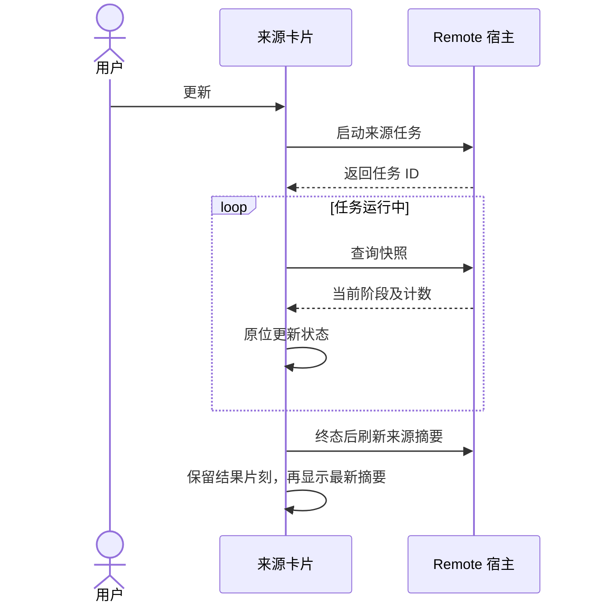
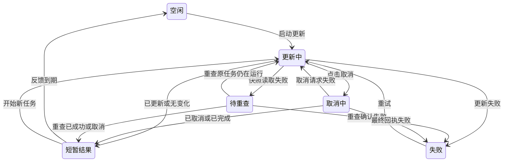
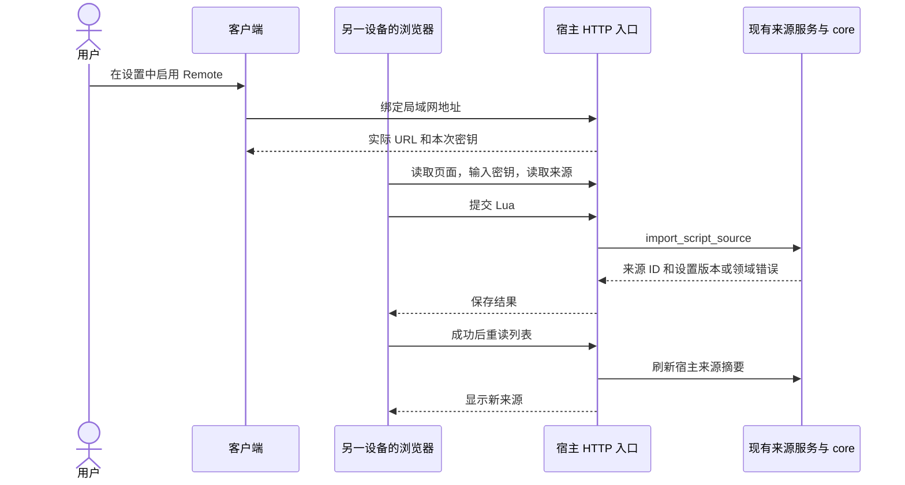
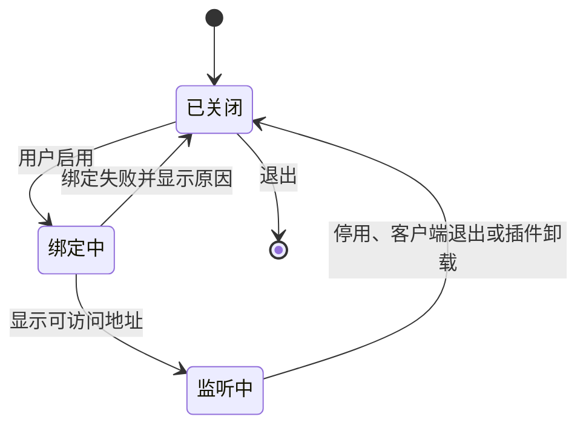

# Remote 局域网全局来源管理

已实现两端宿主及共享网页，局域网双设备实机验收待完成。[施工记录](progress.md)

建议 Windows 和 Decky 各自在客户端生命周期内开启 HTTP 监听，共用一份随包网页。用户在客户端设置中启用 Remote，看到实际监听地址和访问密钥，在同一局域网的电脑或手机打开该地址、输入密钥，即可管理这台设备上的全局来源。关闭浏览器后，已保存的来源继续生效。

## 客户端入口

| 平台 | 用户操作路径 | 接入现有导航 |
| --- | --- | --- |
| Windows | PatchHub 主窗口 → 设置 → Remote | 在 [SettingsPage](../../../apps/windows-flutter/lib/pages/settings_page.dart) 左侧「缓存管理」与「关于」之间新增「Remote」，右侧显示服务开关和连接信息 |
| Steam Deck（Decky） | 游戏模式按「…」打开快捷访问菜单 → Decky → PatchHub → 全局设置 → Remote | 在[全局设置侧栏](../../../apps/decky/src/index.tsx)的「缓存管理」与「关于」之间新增可用手柄选择的「Remote」页，沿用现有[同级路由](../../../apps/decky/src/route.ts)，新增 `/patchhub/sources/remote` |

两端进入 Remote 页时读取宿主实际监听状态。打开「启用 Remote」后，绑定成功才显示完整访问地址（含端口）及本次访问密钥；绑定失败则显示失败原因。离开设置页或收起 Decky 面板后仍可远程访问。回到同一入口可再次查看连接信息或关闭服务，停用后移除地址与密钥。

服务启用后，连接卡片显示实际访问地址与加粗的六位密钥。卡片底部并排放置等宽的「打开网页」和「复制密钥」按钮，分别打开本机浏览器和原样复制当前密钥。

## 网页前端

**PatchHub Remote 采用 Tabler 开源版。** Windows 和 Decky 共用一份网页，使用 Tabler 预编译 CSS、原生 HTML 控件和 TypeScript 调用同源 API。首版直接打开「全局来源」页。将来若加入「游戏部署」，可复用页面布局并增加导航入口，具体传输与部署流程留待该功能立项时设计。

### 选型依据

| 方案 | 现成部分 | 接入成本与判断 |
| --- | --- | --- |
| [Tabler 开源版](https://tabler.io/admin-template) | MIT，基于 Bootstrap 5，提供响应式布局、表单和明暗主题 | 已采用。来源卡片和 Lua 导入表单可直接使用现成样式，后续页面可沿用同一套导航 |
| [react-admin](https://marmelab.com/react-admin/Features.html) | React 资源列表、编辑表单、数据请求和鉴权接入 | 更适合有多类资源的后台。当前只有来源一种资源，Lua 编辑和长任务仍需专门组件，还要维护 data provider |
| [Pico CSS](https://picocss.com/docs) | 语义化表单和卡片，可以直接引用本地 CSS | 也能完成这个单页，但官网已声明停止维护，作为新依赖优先选 Tabler |

桌面与窄屏采用同一来源卡片列表，按索引源、补查源分组。展开卡片后展示名称、启用状态、域名、脚本及适用操作。索引源卡片直接展示各自的更新进度、取消入口及结果，卡片收起时也可查看。顶部的「导入脚本来源」打开右侧面板，支持粘贴源码，或从访问设备选择本地 Lua 文件并读入同一个文本框。查看内置脚本和编辑自定义脚本复用此面板。导入时可一键复制 AI 提示词，剪贴板写入受限时可直接选中并手动复制。CSS、脚本及许可证随 Windows 和 Decky 安装包一起交付，打开网页无需外网。

### 来源卡片与临时反馈改版

索引源采用稳定的两行卡头。第一行是来源名和低对比度的启用状态，第二行左侧是最近检查时间或当前任务，右侧是固定的操作位。所有索引源共享同一对齐线。只在运行中的文字前使用小型活动指示，平时保留白底、细边框。收起时可更新和取消。补查源沿用原有操作。

```text
▸ Shiravune                                      已启用
  最近检查 14:32                                 [ 更新 ]

▸ Kagura Games 国内                              已启用
  ◌ 正在读取索引                                 [ 取消 ]
```

- 整个来源名区域是展开按钮，带方向箭头和 `aria-expanded`。更新／取消是独立按钮，移出展开控件，详情中原有的更新按钮一并移到这里。两者都可用键盘操作；操作位按最长标签留宽，触控区域至少 44 × 44 CSS 像素。长来源名可换行，窄屏优先保留操作位。次行的计数使用等宽数字。
- 空闲时用 `checked_at` 显示最近检查时间，跨日显示日期，从未检查显示「尚未检查」。原始状态码和完整错误放在详情。刷新失败或使用旧缓存时保留对应的简短中文状态。
- 无首个进度事件显示「正在启动」。CLI 的 `update_source_impl` 在索引阶段固定发送 `index, 0, 0`，卡片显示「正在读取索引」。后续 `details` 表示准备匹配，`matched` 的分母是本机订阅该来源且已安装的游戏数；有有效计数时显示「匹配游戏 3/12」，总数为零或缺失时仅显示阶段名。只用任务快照的 `running` 判断整项任务结束，阶段结束事件和分子等于分母都可能早于任务结束。
- 点击取消立即显示「正在取消」，原位按钮锁定重复提交。以宿主最终回执区分取消和抢先完成。取消请求失败时恢复操作，状态查询失败时在同一操作位提供「重查」，继续查询原任务。任务失败、离线缓存或首次更新启动失败在次行保留可理解的提示，详情提供原因及适用操作。
- 成功或取消时次行短暂显示「已更新」「无变化」或「已取消」，约 3 秒后回到最新来源摘要，右侧恢复「更新」。离线缓存等失败结果优先于成功提示。批量更新分别刷新各卡，同步完成也不会堆出一列通知。
- 导入面板的复制按钮成功后在原位显示「✓ 已复制」，保持按钮尺寸和焦点，约 2 秒后恢复「复制 AI 提示词」。只有剪贴板写入或浏览器复制命令成功才确认。两种方式都失败时打开现有预览、选中全文，在预览内提示手动复制；此处展开是用户完成操作所需的下一步。重复复制重新计时，关闭面板清理反馈。

#### 实现边界与调用链

| 位置 | 职责 |
| --- | --- |
| `apps/remote-web/app.ts` | 从现有来源摘要、快照与结果派生展示状态，按来源 ID 更新已有卡片。轮询只修改文本与按钮属性。终态重读摘要时保留其他卡片的展开状态、输入草稿、焦点和滚动位置。 |
| `apps/remote-web/index.html`、`style.css` | 卡头双行布局、独立的展开与任务按钮、复制反馈、键盘焦点与减少动态效果支持。用文字区分状态，读屏只播报阶段切换及结果。 |
| `apps/remote-web/test.cjs`、随包 `app.js` | 回归交互与计时行为，按现有流程生成随包脚本。Windows、Decky 提供的现有 HTTP 契约已包含所需数据。 |

建议用网页内的小函数接入现有 `trackTask` 和 `poll`。快照的 `result` 按现有 `SourceUpdateResult` 读取；取消、网络错误沿用宿主回执。

```ts
type CardFeedback = { label: string; action: "更新" | "取消" | "重查"; disabled: boolean };
function describeUpdate(task: Task, source: SourceSummary): CardFeedback;
function renderCardStatus(sourceId: string, feedback: CardFeedback): void;
```





先校正阶段与结果映射，再固定卡头及复制按钮布局，最后改造列表刷新并做交互验证。新任务、移除来源或关闭面板时释放对应的临时反馈计时器；迟到的回执和旧计时器只能更新原任务。两三秒的计时只控制视觉确认的停留时间。

验收以实际操作为准。桌面和 390px 窄屏分别验证两个来源同时更新、一项取消、另一项完成；记录下一张卡片顶部与当前操作按钮的坐标，状态变化前后应保持一致。轮询期间用 Tab 聚焦取消并用键盘触发。编辑另一张卡片时让任务结束，核对输入、焦点、展开状态和滚动位置。覆盖 0/0、已知游戏数、离线缓存、连续启动两次任务，以及连续复制、关闭重开、复制失败手动选中。在减少动态效果模式下阶段和文字仍清晰。

## 模块与依赖

| 建议位置 | 职责与依赖方向 |
| --- | --- |
| `apps/remote-web/` | 一份静态 HTML、Tabler CSS 和浏览器入口。复用生成的来源类型。现有 `packages/ui` 提供协议类型和显示逻辑，Flutter 和 Decky 页面本身依赖各自宿主 |
| `apps/windows-flutter/lib/host/remote_server.dart` | 用 Dart HttpServer 提供随包资源和固定 API，将请求转给现有 AppModel 变更入口、core client 和任务管理器。监听归应用持有，离开设置页仍可访问 |
| `apps/decky/backend/remote_server.py` | 用 aiohttp.web 在插件事件循环内提供相同契约。复用插件本地操作入口的空闲检查、SourceService、任务与取消逻辑，随插件卸载释放监听。构建时验证实际 Loader 环境可加载服务端模块 |
| 现有 Rust core | 继续独占 Lua 解析、来源 ID 分配、内置只读规则、设置持久化。浏览器只提交源码和明确的管理操作 |

两份轻量 HTTP 适配层可直接使用各宿主的内存状态、任务注册表和浏览器传输。另起 Rust 常驻服务虽然可共用路由实现，却要额外联通两端的更新任务、取消和 UI 刷新。建议用同一组 HTTP 契约用例约束两端。核查入口见 [Windows 全局来源页](../../../apps/windows-flutter/lib/pages/source_pages.dart)、[Decky 插件入口](../../../apps/decky/main.py)、[Decky 来源服务](../../../apps/decky/backend/source_service.py)。

## 接口与操作

建议宿主生命周期签名为 `start(address: IPv4, port: u16) -> {url, accessKey}`、`stop() -> void`（均异步）。本机设置显示监听结果。以下为拟新增的 HTTP 契约，字段内容沿用现有来源模型；路由只接受表内操作。

| 路由（前缀 /api） | 输入与结果 |
| --- | --- |
| GET /sources | 返回 `{sources: SourceSummary[], settings_revision}`，用于打开页面和变更后的刷新 |
| GET /sources/{id}/script、GET /script-prompt | 返回已有脚本文档或提示词 |
| POST /sources、PUT /sources/{id}/script | 请求 `{code: string}`，宿主填现有 api_version；分别新建和按原 ID 保存，返回原导入结果 |
| PUT /sources/{id}/enabled、/name、/interval | 分别传 `{enabled}`、`{name}`、`{interval_hours}`，每次对应一个原有设置操作，返回成功或领域错误 |
| DELETE /sources/{id} | 界面确认后调用现有删除操作，沿用其缓存语义 |
| POST /sources/{id}/updates | 通过宿主启动更新，可传 `{force: boolean}`，返回 `{task_id}`。全部更新按本地页面相同的资格筛选和调度规则提交 |
| POST /updates | 对已启用且当前未在更新的索引源提交更新，返回 `{task_ids: string[], tasks: {source_id: string, task_id: string}[]}`，网页按来源 ID 展示任务 |
| GET /tasks/{id}、POST /tasks/{id}/cancel | 查询 Remote 可操作的来源任务进度或请求取消，完成后重读列表。网页只在任务进行时轮询 |

首版范围建议覆盖来源配置、脚本与来源索引更新。「重新匹配整个游戏库」出现在本地全局来源页，但作用对象是游戏库，建议首版保留在客户端；单游戏订阅、下载与安装也不开放。错误返回 `{code, detail}`，页面分别显示访问密钥错误、宿主忙、Lua 校验及存储错误。导入失败保留源码；保存已经成功但刷新失败时允许只重读，避免重复新建。

实现采用 `Authorization: Bearer <accessKey>`。任务查询和取消回执共用 `task_id`、`running`、`cancel_requested`、`progress`、`result`、`error` 和 `control_error`。新导入的已启用索引源沿用客户端首次更新流程，成功启动时在导入回执附加 `task_id`，启动失败时附加 `task_error`，保留来源保存回执。

## 调用链与生命周期





Remote 默认关闭，每次手动开启生成新的六位数字密钥，允许前导零。绑定用户选定的本机 IPv4 地址。多网卡时优先显示物理网卡，虚拟网卡保留在可选列表中。Windows 和 Decky 优先监听 TCP 端口 `47625`，端口被占用时由系统分配可用端口。连接地址始终使用实际监听端口。关闭时停止接受请求并使旧密钥失效，已交付给宿主的来源任务沿用原生命周期。地址变化后可重新开启。启动失败时显示系统原因。

由于网页能持久修改来源并导入 Lua，所有 API（含读取）要求本次密钥，通过 Authorization 请求头发送，浏览器仅在页面内存保存。静态页不内嵌密钥；写请求检查同源 Origin，服务检查 Host 匹配显示地址，不开放跨域或通用 RPC。普通 HTTP 的请求和密钥在链路上明文传输，此方案面向可信局域网。来源名称、错误和 Lua 一律按文本显示。

## 实施顺序与验收

1. 固定 HTTP 契约及 Tabler 单页。用真实协议样例覆盖索引源、补查源、内置只读、自定义编辑、错误后保留输入，检查手机上的编辑与文件选择。
2. 按「客户端入口」接入两端导航、监听与打包。Windows 从主窗口设置进入，Decky 使用手柄从快捷访问菜单进入；分别验证开启、离页后访问、返回查看同一地址与密钥、关闭后断连。两个宿主共用同一批页面资源。验证设备即使断开互联网，局域网浏览器仍能打开完整界面。
3. 连通来源读写与任务。Decky 的 import_script_source 目前只更新 settings_revision，读取列表需 reload_sources；同时使本地已打开的来源页在重新激活或刷新时取到新摘要。Windows 沿用 AppModel 的刷新路径。查验本机和远端同时变更不同来源是否丢写，若现有写入口未串行，须在同一宿主写入口统一串行。更新及取消使用原任务 ID 和现有忙状态。
4. 分别以 Windows、Steam Deck 为宿主，从另一台真实设备使用展示的 IP 和端口完成新增、改名、启停、间隔修改、更新取消、编辑与删除，核对本机显示和重启后持久化。验证错误密钥、跨源写入、停用断连、再次开启旧密钥失效、插件卸载后端口释放。Windows 检查专用网络防火墙提示，Deck 验证游戏模式下关闭插件面板仍可访问。真机联通性与宿主打包依赖均待实测。
