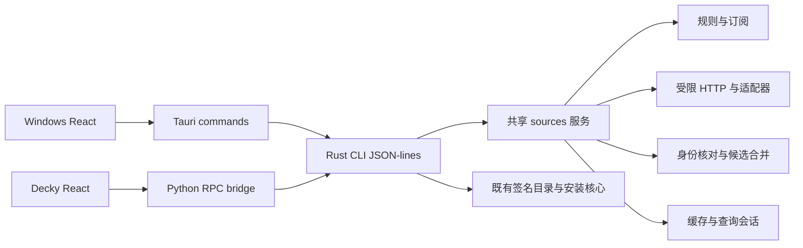

# 来源发现与订阅迁入共享 Rust 后端

施工记录：[progress.md](progress.md)。P0/P1 实现规范：[p0-p1-rust-design.md](p0-p1-rust-design.md)。P0 实机基线：[p0-baseline.md](p0-baseline.md)。P5 集成契约：[p5-decky-design.md](p5-decky-design.md)。状态：**P0–P6 已完成（迁移收口）；Rust 为唯一来源引擎，Windows 与 Decky 实机验证通过；安装器逻辑仍分端（后续独立 feature）**。日期：2026-10-08（Asia/Shanghai）。

## 1. 目标与交付范围

将目前属于 Decky Python 宿主的来源配置、订阅、联网采集、候选发现、缓存和身份核对迁入共享 Rust 核心，由 Windows 与 Decky 使用同一份规则、结果模型和失败处理。以 Windows 中 AppID 2303800“妃神会秘史”能查询真实来源为首个产品验收点；同时让 Decky 切换后保留现有来源、逐游戏选择与安装入口。

名称展示和来源发现是不同功能。[本地化游戏名](../localized-game-names/design.md)已经提供 manifest 名、核心名称覆盖和语言标记；本 feature 消费这些字段，不重新解析 Steam 名称。核心静态签名目录仍按 AppID 匹配；动态发现作为新增层，不向维护目录硬塞特定游戏，也不要求每个新游戏发布新版客户端。

### 1.1 纳入迁移

- 默认来源规则、自定义声明式规则、全局启停、按 AppID 存储的逐游戏订阅。
- patch.moe、通用 HTML 表格、Kagura 国内 WordPress、Kagura 海外 WooCommerce、HGamer 公开 HTML 适配器。
- 受限 HTTP、分页/语言表单/条件请求、官方来源优先和 HGamer 回退、名称查询及身份消歧。
- 成功缓存、完整空结果、失败/partial 状态、检查点、强制刷新、失效规则和跨进程一致性。
- 来源记录与候选 DTO、查源任务的增量结果、取消、上下文过期，以及 Windows/Decky 详情、列表筛选和订阅界面接入。
- Decky 旧状态迁移和对现有 publisher/EXE 安装消费者的来源读取兼容接口。

### 1.2 安装边界

本 feature 迁移来源能力，不重写包下载、ZIP 配方、本机签名、EXE 静态提取/沙箱、事务与恢复。Decky 的 Publisher、ExeProfiles 和 ExeInstallation 继续在准备安装时核对来源选择、身份、语言、DLC、平台与下载域名；它们的数据来源改为 Rust。保留这些消费者的接口兼容和回归验证属于本次范围。

Windows 首期新增候选展示、查询与订阅管理。已有签名目录 ZIP 安装继续工作；动态发现的 ZIP/EXE 可展示来源，但不因为发现成功自动取得 Windows 安装能力。将 Decky 的 publisher_zip / publisher_exe 安装流水线迁入跨平台后端属于后续独立 feature；本计划不将“两个客户端找到同一来源”写成“两个客户端均能自动安装”。

无需新网络服务，不分发 Python 解析运行时到 Windows；规则不允许嵌入代码，适配器只由受维护 Rust 实现注册。不做网站登录、验证码、私有 API、远程脚本执行或游戏清单硬编码。

## 2. 已核实的现状

| 层 | 当前行为 | 迁移影响 |
| --- | --- | --- |
| [Rust CLI](../../../crates/cli/src/runtime.rs) / [catalog](../../../crates/core/src/catalog.rs) | scan 获取签名目录后按 AppID 生成 patches；没有来源管理/发现方法 | 保留静态匹配，新增独立 sources 模块与方法 |
| [Windows Tauri](../../../apps/windows/src-tauri/src/main.rs) / [页面](../../../apps/windows/src/main.tsx) | 宿主提供目录及 state_dir，页面只消费已有 patches；无动态查源链路 | 接入候选和查源任务，不能只修改名称或文案 |
| [Decky main](../../../apps/decky/main.py) | SourceRegistry + ScanSession 发现后投影来源和 patches；传 name_hints | 缩为桥接/平台能力投影，不保留第二套查源策略 |
| [sources.py](../../../apps/decky/backend/sources.py) / [discovery.py](../../../apps/decky/backend/discovery.py) | 网站规则、订阅、采集、名称匹配、发现及缓存；自动查询当前主要用 manifest 名 | 行为迁移到 Rust，并纳入核心名称覆盖 |
| [ScanSession](../../../apps/decky/backend/scan_session.py) | 已安装实例逐项查询，默认并发 3；检查 generation 与 settings_revision，错误保留成功候选 | 会话策略和增量结果归 Rust；宿主只做转发及旧页面快照兼容 |
| [共享 UI DTO](../../../packages/ui/src/index.ts) | 已有 SourceCandidate、GameDiscovery、订阅及 displayPatches；Windows尚未消费候选 | Rust 类型成为权威；沿用已有字段，修正“Decky 专属”注释与契约 |
| [Publisher](../../../apps/decky/backend/publisher.py) / [ExeProfiles](../../../apps/decky/backend/exe_profiles.py) | 读取 sources.matches、cached_candidates、规则与启停，准备时校验 URL；使用本机独立状态 | 改为调用共享来源服务，不复制其查源规则、不迁移事务目录 |

本轮已部署 Windows 的相同参数扫描：签名目录 revision=4，2303800 的 name/localized_name 正确，patches=0、no_catalog_match、无 discovery，目录条目为 0；详见[名称施工记录](../localized-game-names/progress.md)。此前 Decky 施工记录有该游戏的来源发现证据，但不能把历史 source_id 当成本轮设备实时确认；P0 需冻结最新实际结果和匹配依据。

## 3. 目标架构与职责

- 在 `crates/core/src/sources/` 建立 `model`、`registry`、`store`、`http`、`identity`、`adapters`、`session` 模块；核心不依赖 Tauri、Decky、Python或前端 appStore。
- 默认规则迁至 `crates/core/resources/sources.json` 并随核心编译；各客户端不再独立维护副本。自定义配置仅引用受维护 adapter_id。新增 HTML/Unicode 依赖在实施 P0 评估许可、体积、Rust 1.94 和双平台支持后锁定，不在方案中假定已安装。
- 复用现有 reqwest 依赖及 JSON-lines 运输；网络解析与安装校验使用不同接口，不能把通用网页请求器当作补丁下载器。
- state_dir、Steam roots、平台和程序路径由宿主固定注入。前端只传 instance_id、source_id、受限规则/开关、查询偏好和 force；不能传任意本地游戏对象、状态路径、解析脚本或执行参数。
- Python/Tauri 负责进程生命周期、事件转发和平台能力展示；Rust 负责来源业务、会话一致性和数据持久化。Decky 现有 scan_status 可适配 Rust 事件聚合的快照，暂时保留页面 RPC 名称。

## 4. 模型、身份与授权契约

### 4.1 分离三类对象

| 对象 | 用途与约束 |
| --- | --- |
| SourceRule / SourceSubscription | 来源配置、来源角色、page_hosts/download_hosts、全局启用、逐游戏 subscribed、设置版本；规则变更不删除安装记录 |
| SourceRecord / SourceCandidate | 保留 source_record_id/candidate_id、来源链接、game_appid/parent_appid、标题、别名、语言、版本证据、本体/DLC、平台、镜像、声明/观察格式、匹配依据、警告、缓存及来源证据；只读元数据 |
| CatalogRelease / InstallationCapability | 继续由原安装层产生和核实；不能把 candidate_id 当 release_id，不能复制 HGamer 镜像域名到官方下载白名单 |

首次迁移保持现有来源 ID、候选/记录 ID 算法和 publisher release ID 的可识别性；以跨语言 golden fixture 核对 Unicode 转义、排序、URL规范化及哈希输入。确需修改 ID 算法时必须有版本与经过身份验证的映射，不能让旧 receipt 失去路由。静态 catalog 的 match_status 仍维持原契约；新增 discovery/status 和来源匹配字段表达动态层，客户端用共享 DTO/helper 合并展示。

### 4.2 查询名称与身份核对

Rust 从可信本地实例读取 manifest name、非空 localized_name，按确定顺序去重。Decky appStore 名等前端提示沿用最多 3 个、每个 256 字符的上限，只能扩大查询线索，不能改变本地 AppID或直接授权安装。缓存键包含规范化后的实际查询名称集合；preferred_language 与 name_language 单独保存，不把默认名覆盖误当目标语言证据。

AppID 明确一致优先；无 AppID 时沿用完整官方标题或有出处的 verified_alias 规则。标题提示、相似度、文件名、列表位置都不够证明身份。AppID 冲突排除；同 AppID 的本体/DLC、语言、版本分别保留，条件未知不自动消歧。官方候选不足、身份不全或查询失败时按既有规则查询 HGamer；最终合并上游身份/出处，不将索引格式声明提高为安装权限。

### 4.3 页面与状态

保留 `not_queried`、查询中、完整成功、完整空、partial、失败及过期缓存的区别，并为所有旧状态建立映射。失败/403/超时不是“没有补丁”；有成功缓存时显示缓存及最近失败，部分查询不能覆盖成完整零结果。

Windows 详情使用 displayPatches 展示候选、来源页、语言、本体/DLC、版本与能力提示；有已核实身份的候选纳入“有补丁”筛选。安装入口依据本平台的原能力评估，缓存候选本身不产生安装按钮。两端支持全局来源管理、按 AppID 的逐游戏选择、重新查找和查询进度。核心 `scan` 只读本地库/来源缓存，但**两端宿主的默认完整扫描流程**是：先显示scan缓存结果，再自动启动 `scan_sources(force=false)`；该任务先按TTL/条件请求刷新ZIP来源，再逐项发现已安装游戏。无需打开详情才能找到新游戏来源，保持Decky现有自动扫描行为并为Windows提供相同流程。新鲜缓存允许不发网络请求；不把“来源任务已启动”等同“必定刷新所有网站”。

用户显式强制刷新传 `force=true`，单游戏“重新查找”只强制该游戏；普通重新扫描仍用false。新扫描关闭/取消前次来源会话，旧request_id不能更新页面；宿主关闭、取消扫描与IPC断开均向来源任务发送cancel/EOF，订阅变更使旧revision失效并以新选择启动后续查询。进入详情可附加受限名称提示并与当前批量任务去重，离开详情不取消仍属于整体扫描的共享查询。查询中显示scan_progress，取消后保留已有结果并显示取消/未完成，不能永久显示“正在查找”或记作完整空结果。宿主兼容RPC不得悄悄把自动发现改成纯手动。

## 5. CLI 与任务接口（拟新增）

保持 `protocol_version=2` 和原方法语义。新增方法经能力协商启用，未知请求仍严格拒绝；对不支持来源能力的旧核心，只走原扫描并明确“此版本未支持来源查询”，不伪装完整零结果。

| 方法 | 关键参数 / 输出 |
| --- | --- |
| get_capabilities | methods、discovery_schema_version、adapter/query 版本；旧核心 unsupported_method 可识别 |
| list_sources / list_game_sources | 返回规则摘要与全局/逐游戏状态；后者由 instance_id 解析 AppID |
| set_source_enabled / set_game_source / add_source | 受限 ID/布尔值/声明式规则；返回持久 settings_revision |
| refresh_sources | force；刷新 ZIP 来源索引，返回逐源状态，失败保留成功数据 |
| discover_game | instance_id、name_hints、preferred_language、force；返回候选、诊断、查询上下文与版本 |
| scan_sources | 基于本次可信扫描的已安装实例批量发现；返回增量事件及最终结果，支持取消 |
| get_source_policy | 宿主内部读取指定来源的当前有效规则、编译内置规则及Rust计算的rule_origin/fingerprint；为旧_rules/builtins接口提供可信快照，不接受调用方自称builtin |
| resolve_source_record | 供既有安装消费者使用：instance_id 与记录/旧 release 身份；返回当前选择、记录和域名规则，仍须原安装层复核；歧义旧ID不自动选取 |

`scan` 无网络，返回静态 patches 及可用的 sources/discovery 缓存。查源方法走 `serve-task`，stdin cancel/EOF 协作取消；来源事件新增为 `source_progress` / `source_update`，携带 request_id、递增 sequence、实例及 settings_revision，不复用安装字节进度事件。最终响应恰好一次，受限输出行，更新 `main.rs`、operation context 与两端事件消费者；仅新增 METHOD 白名单不足以完成集成。

源设置存储在 Rust 中，revision 必须持久、原子递增。单个会话捕获 revision、规则指纹、实例/名称上下文；写缓存前重核，修改选择或新扫描使旧会话结果不能发布。宿主拒绝旧 request_id/sequence 更新页面。跨进程更新使用短事务/短文件锁及 compare-and-publish，网络期间不持状态锁；不借用 journal.lock，不让来源刷新再次造成 Windows 事务扫描文件占用。

扫描总任务的并发默认 3，按主机共享限速，重复 source/AppID 查询合并。取消不写完整负缓存，不丢成功缓存；旧任务完成后也不能覆盖新选择。新桥接应证明批量任务与详情强制查询的去重、锁顺序及资源上限，而不是在 Rust 中逐字照搬 Python asyncio。

## 6. 缓存、网络与状态迁移

### 6.1 固定缓存层级与策略

| 层级 | 当前布局 / 迁移契约 |
| --- | --- |
| 来源配置 | Python `sources/overrides.json`：enabled、added、games；默认规则 schema 1/2；缺 games 等价全部默认订阅；新增 builtin 与自定义同 ID 时保留用户定义与选择 |
| ZIP 索引 | 旧 `sources/cache/<source>.json`；entries、ETag、Last-Modified、cached_at、checked_at 与来源隔离；条件请求/force 的原行为需对照 fixture 固化 |
| 官方共享索引 | 旧 `sources/discovery-index/<source>.json`；索引新鲜期 24 小时；分页检查点不得与逐游戏成功记录混成一份 |
| 单游戏发现 | 旧 `sources/discovery/<source>/<appid>.json`；success 和最近 attempt 分层；详情及完整零结果 6 小时，HGamer/fallback 有结果记录 24 小时，按实际记录类别确定 TTL |
| 查询上下文 | AppID、实际名称集合/提示、语言、legacy_match、来源选择/规则指纹、parser/query 版本；新名称使未确认负缓存失效，已核实正结果按明确兼容规则复用 |

Rust 使用独立 `sources/rust-v1/` 命名空间：`settings.json`、`cache/`、`discovery/`、`discovery-index/` 与 schema/迁移标记；不原地让 Python 与 Rust 双写旧文件。先迁用户设置，成功缓存逐条校验 Rust 模型、来源域名、AppID和身份，再作为过期 seed 导入；不直接搬旧 fresh/complete 状态。合法候选保留出处和观察时间；损坏、未知版本或无法确认的条目保留原文件，记录诊断后重新查询，不能伪造新鲜成功。

P0 以旧实现及 fixture 固化 key、TTL、分页与 304 语义，P1 实现分层存储。完整成功才能替换 success；partial/failed 更新 attempt 并保留有效 success/已核实候选与分页检查点；完整零结果才写负缓存。失效与失败分别表示：缓存规则/身份已不再适用时不能继续展示为匹配，网络失败却不能删除仍有效的成功结果。停止来源只隐藏普通候选，保留来源摘要的 cached matched 及安装 receipt。

缓存文件和设置文件有大小/条目上限，拒绝链接、reparse point 与非普通文件；采用同目录临时文件、sync及原子替换，兼顾 Windows 文件共享语义，禁止先删旧文件再写新文件。短锁保护设置revision、分页合并和发布检查；source/AppID去重键还包含强制查询及名称上下文，检查点合并要防止晚完成的旧分页覆盖较新的索引。时间戳用于显示/TTL，任务deadline使用单调时钟，系统时钟回退时保守过期。

### 6.2 网络与解析限制

保留单游戏约 30 秒预算和默认并发 3；现有发现调用创建 29 秒/24 请求共享上下文，官方初探还设置子预算。Rust P0 应固定父/子预算及回退顺序；不得让每个新增名称重置预算。请求、重试、重定向、镜像元数据及分页均计入预算，官方/HGamer委托不能循环。按主机统一限速和去重；批量与单游戏任务跨进程也必须协调，等待限速时可取消，不长期占有状态锁。

沿用 4 MiB HTML 响应上限，并对解压后正文、HTML节点/深度、字段长度、记录数、分页、重定向和最终JSON分别限额；具体新增数值作为P0待冻结参数，用样本和超限用例确认，不声称已经实测。请求上限维持64 KiB、结果单行上限沿用8 MiB；源事件应按单行/总任务输出限额截断并诊断，不截断为完整空结果。

HTTPS证书校验、仅声明的page_hosts、受控跨源委托；拒绝URL凭证、非443端口、IP文字、私网/loopback/link-local解析地址，重定向逐跳重核。实施需证明连接使用经过校验的解析地址，避免DNS重绑定；不把page_hosts和download_hosts合并。403/登录/验证码/结构不符返回失败或需浏览器引导，不执行网页JavaScript。公开链接只做元数据读取，不抓完整补丁或上传本地游戏库。

### 6.3 一次性导入、双端状态与回退

1. Decky 从其现有用户state_dir导入；Windows使用自己的既有app_data_dir，不自动连接设备或复制设备游戏库。两端各自拥有订阅与缓存，“能力一致”不等于账号云同步。Windows无旧来源状态时初始化相同默认规则。
2. 迁移前备份配置、来源缓存与manifest；新状态写入暂存目录并完整校验，原子发布后记录版本/完成标记。中断后可幂等恢复；不修改journal、trust、publisher、EXE收据、下载资产或安装实例ID。
3. 同一宿主运行只选择一个来源引擎。开发影子对比只能读同一冻结fixture/缓存，输出到独立忽略目录；不得双写用户状态，不把两个引擎网络结果混合发布。
4. Decky切换失败可回到保留的Python引擎。**每次引擎切换**都记录active_engine、切换序号、双方设置摘要/版本及上次共同设置快照，而不是只依赖首次导入完成标记。Rust→Python回退前，单独导出当前Rust用户设置并验证旧格式映射，保留迁移之后的新选择；不能直接拿旧快照覆盖后来改动。无法向旧格式表达的规则保留并报告；未能保真导出时停止切换，继续运行原引擎，Rust状态不删除，旧发现cache不被新schema覆写。
5. Python→Rust再次切换时暂停旧来源任务，重读Python overrides及其摘要；以最后共同快照对照双方设置。仅活跃Python侧变更按字段导入（含关闭/删除等显式操作），未变更字段保留Rust当前值；若离线编辑导致双方同字段或同source_id有不同变更，保留两份导出并报告冲突，禁止静默采用较旧设置或用墙钟排序覆盖。验证成功后原子发布完整Rust设置、递增revision和切换checkpoint，再启动Rust任务；重入失败继续使用Python。缓存仍按来源/context校验与过期seed规则处理。往返迁移必须幂等，首次完成标记不跳过重入校验。
6. Windows退回旧CLI时只恢复静态目录能力，明确来源查询未支持；不把核心降级错误表现为所有游戏均无补丁。

## 7. 实施阶段与完成门槛

下表均为**待实现**。步骤以依赖和门槛排序，不把当前方案写成已完成迁移。

| 阶段 | 工作与交付 | 进入下一阶段的门槛 |
| --- | --- | --- |
| P0 基线与契约 | 冻结默认规则/旧schema、脱敏缓存和最小HTML fixture；核对2303800实际source_id/identity；制定模型、版本、ID golden对照、限制和行为差异清单 | Windows无源根因可复现；所有已有适配器/状态类别有可重复的离线契约；新名称查询与取消增强明确列作有意变化 |
| P1 规则、订阅与存储 | sources模型/默认单一资源、配置验证、persistent revision、短锁、旧设置导入和分层cache；提供假时钟/HTTP接口 | schema1/2、无games、自定义ID冲突、双向重入/冲突、断电/并发/Windows原子替换及失败保留通过；旧状态完整留存 |
| P2 网络与适配器迁移 | 先patch.moe/table，再Kagura双站，再HGamer/委托；Rust身份核对与去重、查询名称集合、预算/限速 | 同fixture与Python结果语义对齐，差异有明确决策；新增/未知游戏不靠白名单；错误AppID/格式冲突/DLC不会越权 |
| P3 CLI与共享查询会话 | 方法/能力协商、serve-task来源专用事件/取消、scan缓存投影、revision发布检查、source record解析；更新contracts与共享DTO | 双平台CLI协议测试通过；事件隔离/最终响应/旧核心降级正确；并发及取消不污染cache、不触碰安装锁 |
| P4 Windows先接入 | Tauri固定参数/默认自动来源任务桥接，列表与详情候选/过滤、来源管理/逐游戏订阅、进度与重新查找；release便携包 | 真实生产Windows可发现2303800的有效来源，标题与来源证据可核对；离线缓存/失败提示、源选择、重启与旧静态安装路径回归通过 |
| P5 Decky切换与安装消费者兼容 | SourceRegistry替换为薄RPC适配器；main/ScanSession兼容已有RPC；publisher/exe读取接口转向Rust，保留receipt及能力评估 | 旧设置/来源/安装入口与记录保留；订阅关闭后的已安装记录可见；sources.matches/cached_candidates/规则及validate_download不再自行联网/匹配 |
| P6 收口与双端验收 | 核心为唯一正常来源引擎，移除Python采集/发现/cache写入及HTML discovery worker；默认rules仅一份；更新打包、SBOM、source-adapters、contracts/架构摘要 | 双平台离线与CLI矩阵、真实页面/网络和设备验收通过；源码及打包产物无来源策略重复；清楚列出仍未迁移的安装器逻辑 |

P0 → P1 → P2 → P3 → **P4 Windows验收** → P5 → P6。核心适配器通过后可独立完善共享展示契约；状态/ID冻结之前不得同时让多个实施者修改身份算法和旧安装接口。

Python退场只删除已经迁入Rust的来源逻辑及HTML解析工作进程；EXE提取worker、平台降权、任务事件转发和已有安装消费者不会因“Rust迁移”一并移除。只有P6通过才把本feature标为迁移完成，不能仅以Windows找到一个来源结项。

## 8. 验收矩阵

### 8.1 自动化与离线对照（全部待执行）

- 移植行为测试而非逐行翻译：参考 [来源订阅测试](../../../apps/decky/backend/test_sources.py)、[发现注册表](../../../apps/decky/backend/test_discovery_registry.py)、[网页与身份](../../../apps/decky/backend/test_discovery.py)、[扫描会话](../../../apps/decky/backend/test_scan_session.py)、[扫描投影](../../../apps/decky/backend/test_scan_projection.py)。测试同fixture下身份、来源、语言/变体、缓存状态和错误语义，忽略本机路径/时钟；不靠对象键顺序判断相等。
- 默认规则schema1/2、无games、全局关闭/逐游戏选择、按AppID跨库共享、自定义ID与builtin冲突、来源间隔离；旧启停、自定义源、games及本机事务不丢失。
- Rust→Python→修改全局/逐游戏/自定义来源→Rust往返；显式关闭/删除、同ID冲突、双方离线编辑、中途崩溃与重复切换，选择不丢失且完成标记不跳过重入。默认宿主扫描在新鲜、过期及无缓存时均启动来源会话，TTL/force按契约执行；取消不留下永久查询中状态。
- AppID准确/冲突/缺失、同名不同游戏、官方标题/有出处别名/未确认标题、中文/英文/简繁、大小写、标点、`+`与普通版；localized_name为空或只是默认名，任意提示不得改变身份。
- 多镜像/同源多ZIP歧义、语言冲突、本体/DLC、版本未知、索引ZIP而官方EXE、只有发行商首页；HGamer结果不能变安装release或扩大白名单。
- fresh/force/expiry/304、完整空与partial区分、complete→partial→failed保留成功与检查点、parser/query版本/新增名称/来源选择变化失效；强制刷新失败不能令已核实来源凭空消失。
- scan与详情竞争、跨实例同AppID合并、不同query/force不误共享、revision/generation变化后旧结果不发布、取消/EOF/超时/宿主关闭、乱序事件与IPC超限；无journal锁争用或后台残留采集进程。
- URL重定向/DNS/非公开地址/来源隔离、HTML大小/解压/深度/分页和请求预算、缓存坏JSON/未知schema/link/reparse/非普通文件/原子替换；Windows与Linux均实际执行。
- 两端typecheck/build、核心/CLI相关test与clippy、改动范围fmt、桥接事件/订阅UI回归。已有验证只作为基线；新增迁移代码需要执行对应检查，不重复无关功能测试。

### 8.2 真实环境与完成定义（全部待执行）

1. 冻结最新版Decky 2303800发现结果与官方页面证据；仅做脱敏最小fixture，不提交设备全库、凭证、完整网页正文或补丁资产。网页变化须报告与fixture验证分开，不把历史成功当作当前成功。
2. **先Windows**：真实release便携客户端扫描后完成显式/增量发现；2303800至少获得一个身份核实通过的来源候选，页面展示原来源及安装能力边界。“有补丁”能包含该实例。测试查询失败、强制重查、源关闭/逐游戏订阅、离线启动与重启缓存；无原生Python依赖。
3. Decky：按项目 [decky-deploy-verify](../../../.agents/skills/decky-deploy-verify/SKILL.md) 在后续已授权部署范围执行；RPC与真实QAM/全屏展示、来源设置、查询状态、旧记录及能力入口一致。实体手柄单列；本轮编写方案不连接设备。
4. 对相同fixture/规则/查询输入，两平台的来源身份和状态一致；针对不同真实网络、设置、库、语言和平台能力保留合理差异，不能要求两个不同设备的整份扫描JSON完全相同。
5. Decky现有publisher ZIP与EXE路径以模拟来源数据验证准备时重核、停用源拒绝新准备、HGamer/候选越权拒绝、旧receipt可读。实际游戏下载/安装只有在后续验收范围明确包含时执行；未执行项保留“待实机验证”。

功能完成需同时满足：Rust拥有单一来源规则/订阅/查询/cache/身份策略；两个客户端接入该能力；Decky旧状态与安装消费者无回归；自动化与对应真实环境证据记录齐全。完整跨平台动态安装不是本feature的完成条件，但消费者兼容不能跳过。

## 9. 关联、风险与后续

- [来源适配器与订阅指南](../../source-adapters.md)、[总体架构](../../development-plan.md)：实施阶段更新为实际Rust入口；现在只添加迁移计划链接，不提前改写现状。
- [Kagura/HGamer](../kagura-hgamer-fallback/design.md)：迁移其已实现发现行为，保留历史施工事实。
- [本地化游戏名](../localized-game-names/design.md)：名称输入依赖；[扫描状态锁修复](../windows-scan-state-lock/design.md)：独立状态锁回归基线。
- [通用EXE安装](../generic-exe-installation/design.md)、[精简安装流程](../simplified-install-flow/design.md)：安装能力消费者，保留candidate/release、出处和旧记录契约。
- 风险集中在HTML解析/Unicode和ID差异、partial缓存与分页、跨进程发布/限速、旧订阅导入及安装消费者；通过冻结fixture、独立状态命名空间、逐阶段门槛和可回退单引擎切换控制。
- 后续独立任务：将publisher ZIP/EXE下载、能力评估及静态提取迁到跨平台核心，补齐Windows动态安装；本次只为其提供稳定来源契约。
- 规划和功能代码分别提交；与本地化名、状态锁修复及其他既有修改按功能/改动块分别处理。Git提交按用户后续授权单独执行，不改变待实现状态。
