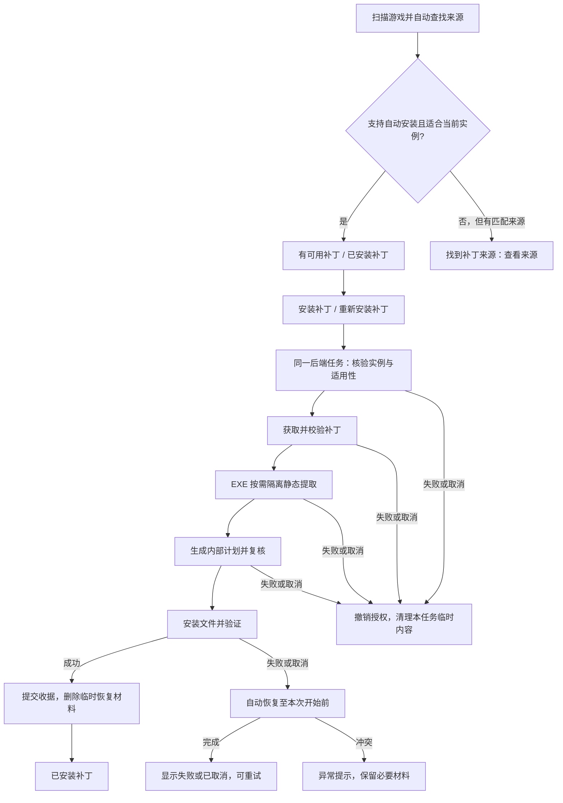

# 补丁一站式安装与流程精简

2026-10-07 补充：[通用 EXE 自动安装](../generic-exe-installation/design.md) 沿用本流程，点击后自动完成完整行为/条件检查和安装，不复现安装器向导，不展示条款或增加确认步骤；新内容按支持行为准入。最新验证范围见其[施工记录](../generic-exe-installation/progress.md)。

状态：**后端与 Decky 已实现并部署；自动化、VBF 重装与下载取消、真实界面验证通过。完整实机矩阵待验收，Windows 适配 TODO。** 日期：2026-10-06（Asia/Shanghai），详细范围以施工记录为准。

施工记录：[progress.md](progress.md)。现状与代码证据：[research.md](research.md)。关联：[EXE 安装](../exe-patch-installation/design.md)、[下载缓存清理](../cache-cleanup/design.md)、[Decky UX](../decky-ux/design.md)。

## 1. 目标与范围

用户选定补丁后，只需点击一次“安装补丁”或“重新安装补丁”。工具连续完成获取、校验、必要的 EXE 静态提取、文件安装、状态刷新及临时空间清理。

- 删除“接受条款”“核对适用条件”“启用并保留备份”的人工环节。
- 删除准备完成后的安装计划确认、关闭游戏确认弹窗及“继续确认安装”。
- 删除补丁卸载产品能力，以及为安装成功后卸载而保留的备份、开关、按钮、RPC 和专用状态逻辑。
- 扫描阶段自动查找并判断安装能力；正常界面表达“有可用补丁”“找到补丁来源”“已安装补丁”，主操作为“安装补丁”“重新安装补丁”。
- 进行中的下载、校验、安装、取消和失败仍提供必要反馈，不要求用户理解计划、事务、配方或备份。

本 feature 落地后端、共享 Rust/CLI 契约和 Decky 一站式任务。按用户最新决定，不保留旧接口兼容性；Windows 客户端本轮不修改，可能无法工作，后续适配作为明确 TODO，不阻塞本轮验收。

后端和 Decky 已实现并部署到 Steam Deck，验证范围见施工记录；Windows 适配延后。跨版本升级、切换语言或本体/DLC 补丁、未知 EXE 安装、新来源适配器不属于本 feature。

## 2. 产品决策

### 2.1 一次操作完成安装

“安装补丁”即启动选定实例、选定补丁的整条流水线。下载完成后自动进入校验/提取和安装；没有第二个按钮，也不要求先生成或查看计划。

安装按钮附近可保留一句“安装时请关闭游戏并暂停更新”的普通提示，不设置勾选项或再次确认。官方来源链接和语言/版本摘要可在详情中查阅，不成为必读步骤。原始条款/来源证据可保留在审核资料中；新流程不生成虚假的 `terms_accepted=true` 或 `conditions_accepted=true`。

删除人工适用条件确认，不删除工具对 AppID、平台、build、实际语言、已安装 DLC、目标文件与来源身份的检查。优先在任务开始时尽早发现不适用情况，写入前重新检查。无法自动判定的条件按审核规则报告具体原因，不能用默认勾选或推断 DLC 购买权补齐；这一边界不增加人工确认步骤。

### 2.2 展示状态与动作

| 真实情况 | 正常展示 | 主操作 |
| --- | --- | --- |
| 扫描已找到支持自动获取和安装、适合当前实例的补丁，未检出完整补丁 | 有可用补丁 | 安装补丁 |
| 扫描只找到匹配来源，工具不支持自动获取并安装（例如仅 HGamer fallback 匹配） | 找到补丁来源 | 查看来源 |
| 当前实例的审核目标文件完整匹配 | 已安装补丁 | 重新安装补丁 |
| 已有本工具安装收据，部分补丁文件丢失/损坏 | 补丁文件不完整，需重新安装（异常提示） | 重新安装补丁 |
| 获取/校验/提取/安装进行中 | 当前阶段和真实进度 | 原生关闭键取消安装，无内容区按钮；禁用重复启动 |
| 来源已匹配，但当前实例不满足自动安装条件 | 找到补丁来源，并说明不适用原因 | 查看来源；不显示可执行安装 |
| 扫描完成且没有匹配条目或来源 | 暂未找到补丁 | 重新查找 |
| 安装失败且自动恢复完成 | 安装失败，可重试 | 安装补丁或重新安装补丁 |
| 未完成操作无法自动恢复 | 具体失败原因（异常区） | 尝试恢复；成功前阻止后续写入 |

**扫描就完成来源查找与自动安装能力判定，不要求用户先进入游戏详情或点击“准备安装”才能得知是否有可用补丁。** 找到自动获取并安装链路受支持且适合当前实例的条目，显示“有可用补丁”；只有匹配来源、未形成可自动安装条目时，显示“找到补丁来源”。HGamer 当前作为 fallback 来源，即使匹配成功也仅属于后者，不因发现 EXE/ZIP 下载链接就升级成可自动安装。

同一游戏存在多个来源时，汇总状态优先级为“已安装补丁”→“有可用补丁”→“找到补丁来源”→“暂未找到补丁”；各来源详情保留其各自能力。例如官方源可自动安装且 HGamer 也匹配时，游戏仍显示“有可用补丁”。扫描尚未结束显示“正在查找补丁”，查询失败显示具体原因并保留可用的上次结果，不能提前显示“暂未找到补丁”。

通用 EXE 补丁按安装器行为在安装时判定条件；没有逐游戏审核配方时，扫描把候选标为 `check_required`，同样显示“找到补丁来源”，不升级为“有可用补丁”。这类条目在详情仍提供“安装补丁”，点击后自动检查条件并完成获取、校验与安装，不要求用户按来源手动处理；能力边界与实施见 [通用 EXE 自动安装设计](../generic-exe-installation/design.md)。

“已安装补丁”以当前实例文件验证为准，不由备份存在、旧 `committed` 记录或 RPC 返回成功单独决定。现有内核细分检测状态保留为内部事实，由展示层统一投影。扫描判定不下载完整补丁包或生成安装计划；实际下载后的包校验和写入前复核仍由安装任务完成。

来源停用、暂时离线或补丁条目消失时，仍利用本地安装收据显示可验证的已安装状态；新的安装/重装继续检查现行来源与审核能力。游戏库离线显示不可访问，不能误判成“未安装”；游戏实例卸载或迁移后不沿用旧安装状态。

### 2.3 真正支持重新安装

重新安装无需先卸载，复用同一条流水线。首期限定同一实例、同一审核补丁的内容身份（release/profile、载荷摘要、路径集合、build、语言、DLC 变体），不把它变成升级或变体切换。

- 正常已安装时可重新获取或复用经过校验的缓存，重新写入并验证目标文件；重复点击仍只启动一个任务。
- 对具有可信安装记录的同一补丁，允许补齐缺失文件、替换已拥有且损坏的目标文件。点击“重新安装补丁”授权的覆盖范围只能是已审核的目标文件集合；不删除集合外文件，不处理存档。
- 新任务记录安装开始前的实际内容，作为**本次失败恢复**的快照。该快照可能已是补丁内容，不能称作原版，也不能用于成功后的卸载。
- 无安装记录但文件完整匹配审核载荷时，可显示已安装；重装先按可信配方核实全部范围。外部安装损坏、未知文件归属和不同版本叠加不能自动按已拥有文件处理。
- 同一实例存在未完成写入/恢复时，继续互斥；新的重装不能通过删除旧 journal 绕过它。新任务失败不丢失上一份成功安装收据，新任务成功后原子更新收据。

本次调查中的三条 EXE profile 校验 VBFI.exe 或 Game.exe/Script.vdf，载荷写 extra.xp3 或 www 文件，允许评估同 profile 重装时继续核验这些独立基线；后续 profile 若覆盖基线文件，需要独立审核的重装条件，不能普遍放宽原版摘要检查。

### 2.4 删除长期备份，保留最小安装恢复

不再提供“卸载补丁”、成功后的恢复原版、备份保留开关或手动清理事务备份入口。EXE 与 ZIP 都在成功提交后自动删除本任务的 `.backup` 和 `.stage`。

保留安装期间的临时原内容和最小持久进度记录，原因是多文件安装不是全目录原子操作：满盘、取消或中断可能发生在写入了一部分文件之后。这些材料仅用于撤销**未成功安装的操作**；纯新增文件无需复制原文件。失败恢复结束后同样清理。恢复冲突时暂留必要材料，并给出一次异常处理入口。

取消在写入前撤销任务及计划授权；写入后恢复至任务开始前状态；提交成功优先于迟到的取消请求。成功后清理失败只形成待清理记录，不把安装成功改成失败；启动时可重试有明确归属的清理。

移除长期备份减少稳态占用，**不保证降低安装期间峰值空间**。空间估算仍包含载荷暂存、转换包、必要临时原内容和目标临时文件，不能因移除设置就少算这些字节。

游戏整体卸载由 Steam 管理。本工具不为此新增守护扫描或主动删除游戏目录的机制，也不把“Steam 必然删除所有额外补丁文件”当作清理 state 的依据。

## 3. 技术方案

### 3.1 后端持有一个完整任务

统一入口为 `start_patch_install_task(instance_id, release_id, operation, request_id, archive_path="")`，其中 operation 为 install/reinstall。前端只能提交实例、选择标识和受限操作意图，不能提交目标目录、下载 URL、配方或 profile。本地 ZIP 导入仍经过现有路径白名单和哈希校验；来源必须浏览器下载时只说明该限制，不声称所有条目都支持自动下载。

内部 prepare/apply 可以复用，但不能通过 React `useEffect` 或准备完成回调串接两个独立用户任务。request_id 必须绑定实例、补丁和 operation，重复请求返回原任务，不能因 RPC 超时重新创建安装。后端任务贯穿全流程，下载进度不是安装成功。

2026-10-07 按用户修订：安装必须保持前台，通过原生右下角关闭按键提示请求取消，不提供“取消安装”或“关闭进度窗口”内容区按钮。实际退出、切换游戏、关闭插件界面或失联取消当前任务，必要恢复结束后展示结果；只有系统覆盖菜单打开但未离开界面不算退出。`task_status` 续约前台租约，失联 15 秒后受控停止，重连不自动续装。终态切换只展示实际结果与原生关闭提示的新面板。保留 worker 超时和资源上限，后端关闭仍受控停止，重启处理未完成写入。详见 [Decky UX 修订](../decky-ux/design.md)。

后端在阶段边界及 apply 入口核对任务取消标志和持久授权；撤销授权不依赖 discard RPC 成功。15 分钟计划期限仍是内部限制，准备后立即 apply；过期则任务失败并清理，不让用户手动重新确认。跨实例的互斥策略先沿用现有串行安装，不扩展并发下载。

### 3.2 取消与旧确认协议

删除 EXE `_accept`、`ExeConfirmations`、consent gate、`condition_declaration`、强制 `keep_backups` 的调用契约；新版本 receipt 绑定审核事实、任务、计划和有效授权，不再记录人工同意。schema 迁移同步修改 `plan_evidence`、`validate_apply`、缓存租约读取，不能只改写入方。

删除新产品路径中的 `confirmed_game_closed` 人工确认语义；不能简单把原 API 固定传 true 冒充已验证关闭游戏。内核仍检查 Steam 更新/下载状态、目标实例、锁、路径和写前摘要。当前锁不能阻止游戏/Steam 同账户并发写入；P0 核对可用的运行状态自动检测接口，能识别游戏运行时提前拒绝，无法可靠检测的部分明确为能力限制，并保留普通提示，不重新引入确认弹窗。

旧“prepare + 手动 apply”入口不再由前端开放。旧可执行计划在升级时失效，旧 RPC 不得成为取消后重新 apply 的后门；协议版本/固定方法白名单与客户端打包一致更新。维护诊断可以保留只读计划查询，不提供通过旧确认位绕过新版任务授权的安装入口。

### 3.3 状态与数据

保留用于识别的最小安装收据：实例身份、AppID/build、语言/variant、稳定内容身份、审核载荷及目标摘要、成功时间。事务只保留排错和未完成恢复需要的事实，不用 `.backup` 是否存在判断安装或重装能力。

替换 `_forget_without_backups`/`forget_transactions` 的正常重装用途，由 Core 显式区分已提交安装记录与未完成写入；新任务的失败恢复不能误恢复旧 committed 事务。来源按 release 分散的 state 必须经过统一实例互斥，不能仅在单个 state 中检查冲突。

profile 当前由完整 JSON 摘要派生 release_id，修改 terms 文案或 schema 也会改变 ID。迁移不得靠名称猜关联；建立旧 ID 到稳定内容身份的别名，至少核对 AppID、语言、variant、原 EXE 摘要、载荷摘要和目标集合。仅授权同一审核内容的重装，不把审核修订变化当作升级授权。

### 3.4 升级迁移与清理

升级先停止接收新安装任务，等待当前写入完成或受控停止；取得 state/实例互斥后才迁移，不能与运行中的安装或清理同时改 journal。

1. 原子迁移 settings：忽略旧 keep_backups，不再向 UI 返回或提供 setter；保留下载缓存 auto_cleanup 偏好。
2. 检查旧持久任务：先撤销 planned 的可执行授权；未完成安装/卸载沿用旧读取和恢复语义，完成处理之前不删除材料。
3. 提取并校验 committed 安装收据，保存成功后再清除本工具拥有的旧成功备份/stage；新版本不继续维护成功安装的卸载能力。
4. `uninstalling`、`uninstall_requested` 等旧数据读取仅在迁移兼容层保留；不再产生新的卸载状态。历史记录可只读展示，兼容层删除必须有升级样本验收依据。
5. EXE 长期保护改为按真实未完成状态保护；损坏 journal、损坏授权或归属不清时先诊断，不因目录叫 exe 就永久保留所有备份，也不盲删。
6. 清理由可信 UUID、工具 state 边界、无链接校验和真实终态约束；不删整个 state/journal，不碰个人 Downloads、存档、离线游戏库或用户未知文件。
7. 数据迁移和清理可重复、可中断重启，不触发旧计划安装，也不撤销成功安装。下载缓存设置独立于临时恢复材料的提交后清理。

### 3.5 扫描阶段的来源查找与能力判定

首次扫描和用户主动重新扫描包含“扫描 Steam 实例→查找已启用/订阅来源→核对自动安装能力→更新列表”整条只读流程。内部安装前的可信实例重扫不重复启动全库联网查找。自动查找覆盖扫描得到的已安装实例，不依赖详情页挂载；保持现行来源启用/订阅规则，不自动开启已停用的来源。

复用现有 per-game discovery 服务和缓存，以后端扫描会话编排有界并发、请求预算及超时，而非把所有联网查询塞入一个长时间阻塞的 scan RPC。先呈现本地游戏与有效缓存，随后按实例增量更新来源和能力；展示扫描进度，用户无需逐个游戏触发。列表筛选、搜索和 QAM 重挂载只消费扫描快照，不重新联网查询。官方来源按现有策略优先，HGamer 保持 fallback 定位。

能力判定统一覆盖可信 ZIP 与已审核 EXE：存在本客户端可执行的获取/安装链路、可信 release/profile 绑定、来源有效性，以及当前实例的 build/语言/DLC/基线等可自动核验条件。需要浏览器手动下载、未知格式、仅候选、未审核或实例不适用的匹配只能输出“找到补丁来源”及原因；不能以 `hasMatchedPatch` 或候选数量直接等同自动安装能力。

只读能力探测不执行 prepare，不提取完整包、不写游戏、不生成有效计划/租约。来源查找与能力探测的结果绑定 scan generation、settings revision、实例和补丁身份；重新扫描、订阅变更、实例变化后的旧响应丢弃。列表汇总与详情按钮使用同一份能力结果，避免列表显示“有可用补丁”但详情仍要求人工查找或确认。

## 4. 实施拆分与依赖

| 阶段 | 工作 | 完成门槛 |
| --- | --- | --- |
| P0 契约与样本 | 固化扫描阶段查找/能力结果与状态优先级、稳定身份/别名、任务存活、重装路径授权、旧 journal/receipt/settings 样本；核对运行状态与不能推断的适用条件 | 自动流程规则不靠人工布尔位；取消授权问题纳入前置修复 |
| P1 内核与迁移 | 显式同内容重装、最小安装收据、失败临时恢复、提交后清理、旧未完成卸载读取/恢复；移除新卸载生产接口 | 有旧数据仍可识别/重装，未完成事务无法绕过，迁移幂等 |
| P2 后端任务 | 编排扫描阶段全库来源查找及只读能力探测；统一获取→prepare→apply；改 tasks lease/取消、EXE receipt、备份保护和 settings；可靠撤销授权 | 无需逐游戏查找即可分类；一次安装请求完成全链路，界面退出取消，取消后任何 apply 拒绝 |
| P3 Decky 界面 | 扫描进度与三种主要状态；移除计划确认、consent、卸载、备份设置/清理和正常事务操作页；诊断收起，异常恢复单独展示 | 列表和详情能力一致；安装/重装均一次操作，选择来源不新增强制步骤，QAM/全屏一致 |
| P4 调用方与资料 | 同步 CLI/桥接/契约；Windows 一站式入口与终态判断延后为 TODO；更新现行资料 | 后端和 Decky 没有生产卸载入口或旧确认位；明确 Windows 待适配 |
| P5 验收 | 自动化异常矩阵；Deck 上 ZIP/三个审核 EXE profile 安装与连续重装、界面退出、取消、空间和旧数据迁移；Windows 回归后续执行 | 以下验收项完成，未实测范围仍明确记录 |

P0 → P1 → P2 → P3/P4 → P5。文档与代码分开提交；各阶段按实际依赖形成可审阅提交，不把其他 feature 的修改混入。实现后修订关联设计的现行规则，保留既有 progress/flow/review 的历史事实。

## 5. 验收标准

- **扫描分类**：不打开详情即可查找到补丁并判定能力；支持自动获取并安装的匹配显示“有可用补丁”，仅 HGamer fallback 匹配、未审核 EXE 或需手动下载的匹配显示“找到补丁来源”；官方可自动安装与 HGamer 同时匹配时优先显示“有可用补丁”；未检出/查找中/查询失败分别反馈，不混成未找到。
- **扫描一致性**：ZIP 与审核 EXE 都在扫描阶段核对当前实例；列表与详情安装动作一致；来源增量更新、有效缓存、重新扫描、订阅变化和过期响应隔离通过；筛选和 QAM 重挂载不重复联网；扫描不下载完整包或写游戏文件。
- **交互**：点击安装或重装一次就进入完整任务；下载完成自动安装；无条款、条件、保留备份勾选及安装/关闭游戏确认弹窗；无卸载按钮、卸载 RPC、备份保留开关或事务备份清理入口。
- **成功事实**：只有 committed 且目标文件验证通过才显示已安装；清理成功后重启/重扫仍能识别，来源离线或停用不抹掉已安装事实。
- **重装**：ZIP、VBF 纯新增、夏日本体和 DLC 替换型各可连续安装→重装；无旧备份仍可重装；拥有文件缺失/损坏可修复；失败回到本次开始前，旧成功收据不丢失；变体切换不误授权。
- **任务**：快速双击、重复 request_id、启动 RPC 响应丢失、轮询失败不会产生两次写入；实际退出全屏管理页、关闭进度或选择其他游戏后取消安装；失联后超时取消，重连仅展示真实取消 / 恢复结果，不恢复安装。系统覆盖菜单未退出时不误取消。
- **取消**：获取、提取、内部计划生成、prepare/apply 交界、安装写入、提交附近都按真实终态反馈；discard RPC 尚未执行就失败时授权仍失效；已取消的旧 plan ID 无法经任何入口应用。
- **恢复/清理**：满盘、文件被占用、后端中断、临时清理失败均有可复现结果；成功不留长期 backup/stage；异常恢复材料不被误清；迁移旧 committed/planned/applying/uninstalling/needs_recovery 和损坏数据后行为正确。
- **边界**：保留包摘要、路径/链接、ZIP 展开预算、EXE worker 隔离、profile/来源/实例/语言/build/DLC 检查；未知候选仅提供来源；用户存档与目标集合外文件无变化。
- **实机体验**：触屏、鼠标和实体手柄各验证一次；检查下载/安装速度与阶段、取消反馈、重连和真实游戏内补丁生效。旧 feature 的文件安装/恢复证据不替代本流程的新验收。

建议实现后的检查：Decky npm test/typecheck/build（在 apps/decky 构建）、相关 Python task/EXE/cache/settings 测试、Rust install/runtime/协议测试、后续 Windows 适配完成后执行其 typecheck/build；打包与 schema 一致性。实施与已完成设备验证结果见施工记录，未覆盖矩阵仍待验收。

### 实机落实的启动与刷新约束

公共 RPC 等待启动迁移完成，仅对短暂 installer_busy 有限重试，不删除锁或绕过损坏日志。已核验官方候选刷新优先使用允许域名内的来源页面与已验证别名，但仍重新核验身份、profile 和当前条件。新扫描开始即撤销旧 generation 轮询，包括新快照尚未返回期间。设备验证结果见施工记录，未覆盖矩阵仍待验收。
